<div align="center">


# 얼쑤

**정간보 기반 AI 연주 평가로, 입문자도 혼자 국악기를 연습할 수 있는 앱**

팀 이도(E102)가 🎼 **보기 → 🎧 듣기 → 🎶 연주 → 📊 평가**의 학습 흐름을 하나의 앱으로 제공합니다.

`단소` · `소금` · `정악대금` · `산조대금` &nbsp;|&nbsp; `Android` · `iOS` · `Web(Kotlin/Wasm)`

</div>

---

제품 범위와 우선순위는 [프로젝트 기획서](https://app.notion.com/p/3ffa0252aa4580a5a16cc55beadea3ba)를 기준으로 합니다. 기능별 확정 동작은 [문서 목록](docs/README.md)의 스펙을, 영역별 구현·실행 방법은 각 폴더의 README를 따릅니다.

## 📑 목차

- [📦 제출 산출물](#-제출-산출물)
- [✨ 기능 둘러보기](#-기능-둘러보기)
- [🔄 연주 평가 흐름](#-연주-평가-흐름)
- [🛠 기술 스택](#-기술-스택)
- [🖥 운영 구성 요약](#-운영-구성-요약)
- [🗂 저장소 구조](#-저장소-구조)
- [🌿 브랜치](#-브랜치)
- [✅ 실행과 검증](#-실행과-검증)
- [🤝 협업 규칙](#-협업-규칙)
- [🤖 AI 작업 도구](#-ai-작업-도구)
- [🔐 환경 변수와 비밀 정보](#-환경-변수와-비밀-정보)
- [🔗 관련 문서](#-관련-문서)

## 📦 제출 산출물

최종 제출 문서는 `main` 브랜치의 [`exec/`](https://github.com/team-edo/eolssu/tree/main/exec)에만 있고, `develop`에는 없습니다. 소스를 받은 뒤 빌드·배포하려면 포팅 매뉴얼부터 읽습니다.

| 산출물 | 파일(`main` 브랜치) |
| --- | --- |
| 📘 포팅 매뉴얼(빌드·배포 절차, 제품 버전, 환경 변수, 배포 특이사항) | [exec/1-porting-manual.md](https://github.com/team-edo/eolssu/blob/main/exec/1-porting-manual.md) |
| 🔌 외부 서비스 정보(소셜 로그인, R2, SMTP, 스토어 등) | [exec/2-external-services.md](https://github.com/team-edo/eolssu/blob/main/exec/2-external-services.md) |
| 🗄 DB 덤프 최신본(구조 전체와 기준 데이터, 개인정보 행 제외) | [exec/3-eolssu-db-dump.sql](https://github.com/team-edo/eolssu/blob/main/exec/3-eolssu-db-dump.sql) |
| 🎬 시연 시나리오 | [exec/4-demo-scenario.md](https://github.com/team-edo/eolssu/blob/main/exec/4-demo-scenario.md) |

## ✨ 기능 둘러보기

> 📷 아래 화면은 2026-11-25 `develop`(`9191c23c6`) 디버그 빌드를 Android 에뮬레이터(Pixel 7, API 35)에 설치해 운영 서버에 로그인한 상태로 캡처했습니다.

### 🏠 홈

첫 화면에서 바로 **AI 연주 평가**를 시작하고, 아래로 내리면 배우기·연습·기록 기능 카드가 나타납니다.

<table>
  <tr>
    <td align="center"></td>
    <td align="center"></td>
  </tr>
  <tr>
    <td align="center">첫 화면</td>
    <td align="center">기능 카드</td>
  </tr>
</table>

### 🐾 기초 배우기

악기를 처음 잡는 사람을 위한 **7단계 과정**입니다. 악기 알기·감상 → 자세·호흡 → 첫 소리 → 기본음 → 음 잇기 → 음역 넓히기 → 혀치기 순서로, 단계마다 할 일을 하나씩 확인하며 넘어갑니다.

<table>
  <tr>
    <td align="center"></td>
    <td align="center">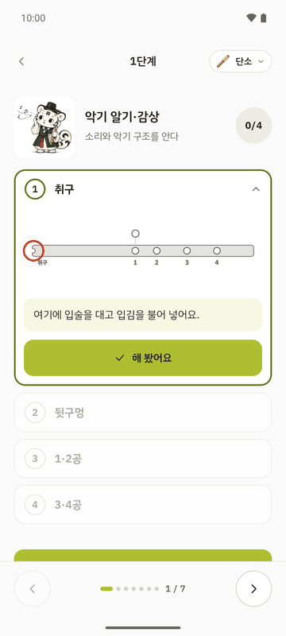</td>
  </tr>
  <tr>
    <td align="center">7단계 징검다리</td>
    <td align="center">단계별 할 일</td>
  </tr>
</table>

### 🎼 연습하기 — 쉬운 정간보와 모범 연주

제공 곡과 내 악보 중에서 곡을 골라 정간보를 보며 연습합니다. 곡은 입문·초급·중급 난이도와 장단으로 구분됩니다.

- 🔤 **한글 표기**: 한자 율명 옆에 한글 이름을 붙여 읽기 쉽게 합니다.
- 🪈 **운지법**: 정간보 옆에 악기 운지 그림을 함께 보여 주고, 지금 페이지 다음에 부를 두 음을 미리 알려 줍니다.
- ▶️ **모범 연주**: 악보에 맞춰 재생하며 지금 연주 중인 음을 붉게 따라갑니다.
- 🎯 **한 음씩**: 현재 정간의 예시음을 듣고 한 음씩 불어 보며 기기에서 바로 판정합니다. 판정할 수 없는 기기에서는 직접 넘깁니다([판정 기준](docs/specs/note-practice-criteria.md)).

<table>
  <tr>
    <td align="center">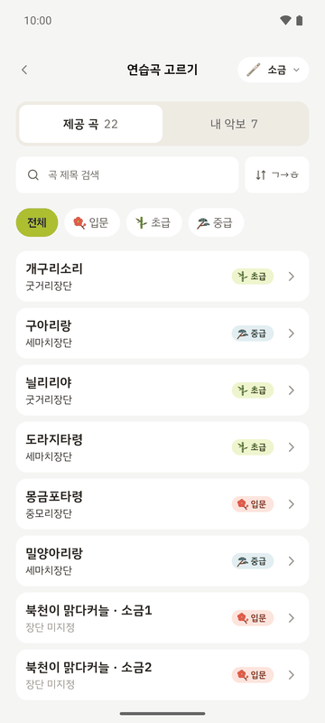</td>
    <td align="center">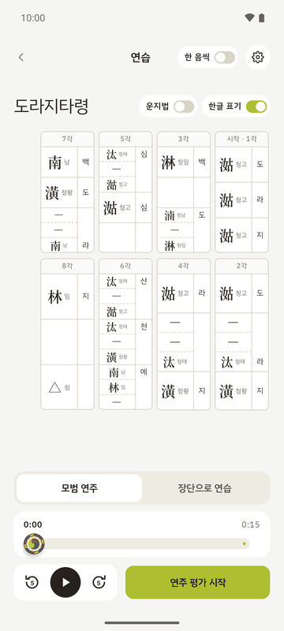</td>
    <td align="center">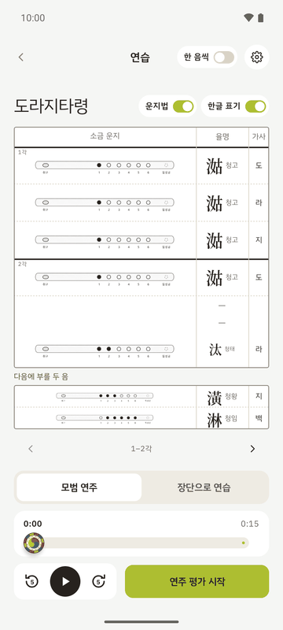</td>
  </tr>
  <tr>
    <td align="center">연습곡 고르기</td>
    <td align="center">한글 표기</td>
    <td align="center">운지법</td>
  </tr>
  <tr>
    <td align="center">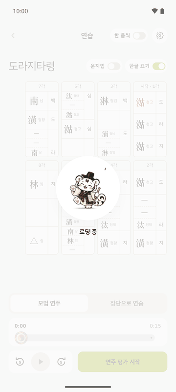</td>
    <td align="center">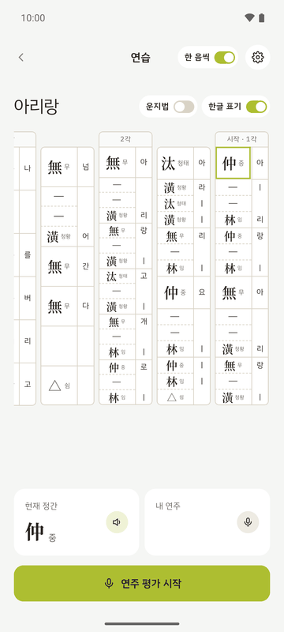</td>
    <td></td>
  </tr>
  <tr>
    <td align="center">모범 연주 따라가기</td>
    <td align="center">한 음씩 연습</td>
    <td></td>
  </tr>
</table>

### 🥁 장단 메트로놈

곡의 장단을 칸 단위 구음으로 보여 주고, 장단 소리를 미리 들어 볼 수 있습니다. 연습 중 장단 소리와 장구 그림 박 표시를 켜고 끄며, 속도도 바꿀 수 있습니다.

<table>
  <tr>
    <td align="center">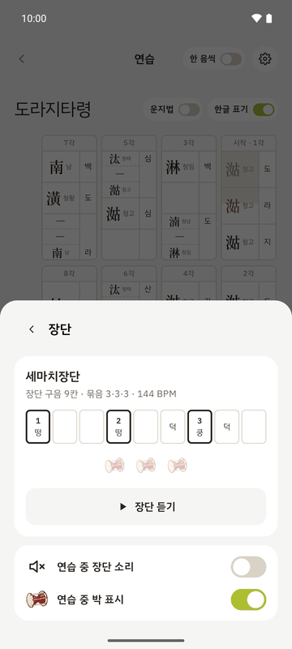</td>
    <td align="center">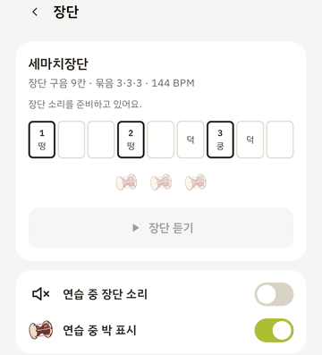</td>
  </tr>
  <tr>
    <td align="center">장단 설정</td>
    <td align="center">장단 미리듣기</td>
  </tr>
</table>

### 🎙 AI 연주 평가

곡을 고르고 연주를 녹음하면 서버가 정답 악보와 비교해 점수를 매깁니다([평가 흐름](#-연주-평가-흐름)).

- 📊 **총점과 항목별 점수**: 음정·박자·음 길이를 따로 보여 줍니다.
- ❌ **틀린 부분**: 음정·박자·길이·미검출로 나눠 정간보 위에 표시합니다. 저장한 기록에서는 정간을 눌러 그 위치부터 내 녹음을 다시 들을 수 있습니다.
- 🔁 **구간 연습**: 추천 취약 구간이나 직접 고른 구간을 반복하고, 그 구간만 다시 평가해 틀린 음 수의 변화를 봅니다.
- 📈 **지난 연주와 비교**: 이전 기록을 골라 점수 변화와 항목별 차이, 두 연주에서 틀린 곳을 함께 봅니다.

<table>
  <tr>
    <td align="center">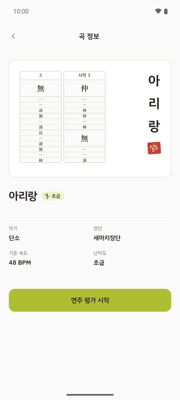</td>
    <td align="center">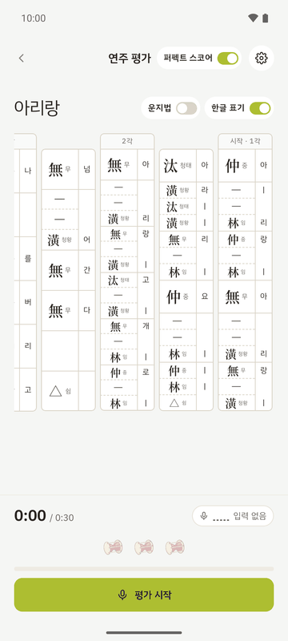</td>
    <td align="center">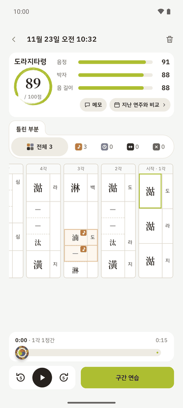</td>
    <td align="center">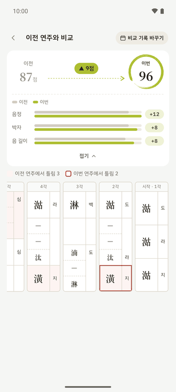</td>
  </tr>
  <tr>
    <td align="center">곡 정보</td>
    <td align="center">평가 준비</td>
    <td align="center">평가 결과</td>
    <td align="center">지난 연주와 비교</td>
  </tr>
</table>

### 📈 연습 기록

곡별로 연주 기록을 모아 보고, **연습 기록지**에서 주별·월별 연습 시간과 횟수, 날짜별 연습 달력을 확인합니다([연습 기록](docs/specs/practice-records.md))).

<table>
  <tr>
    <td align="center">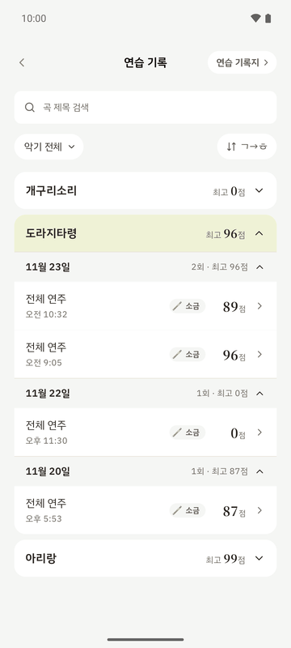</td>
    <td align="center">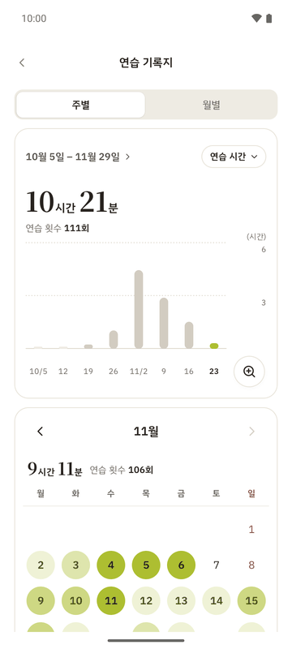</td>
  </tr>
  <tr>
    <td align="center">곡별 기록</td>
    <td align="center">연습 기록지</td>
  </tr>
</table>

### 🪈 운지법 보기

악기별로 저취(낮은 단)·평취(중간 단)·역취(높은 단)의 율명마다 막는 구멍·여는 구멍·반 막음을 그림으로 보여 주고, 기본음과 요성 소리를 들려줍니다.

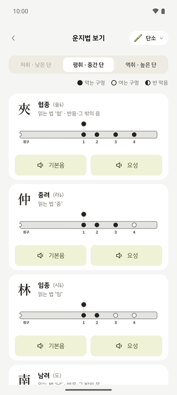

### 📖 정간보 읽기

정간보를 처음 보는 사람을 위해 정간보란 무엇인지, 읽는 순서, 음의 길이, 음의 높낮이, 시김새를 그림과 소리로 한 쪽씩 설명합니다.

<table>
  <tr>
    <td align="center">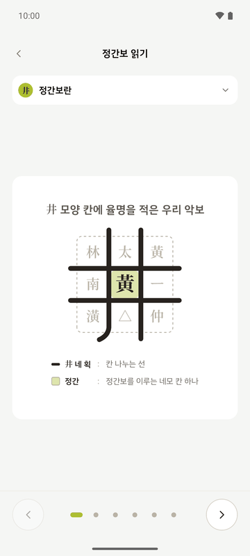</td>
    <td align="center">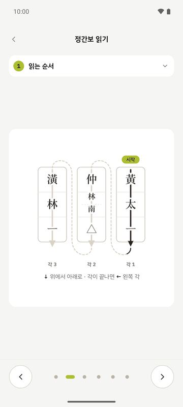</td>
    <td align="center">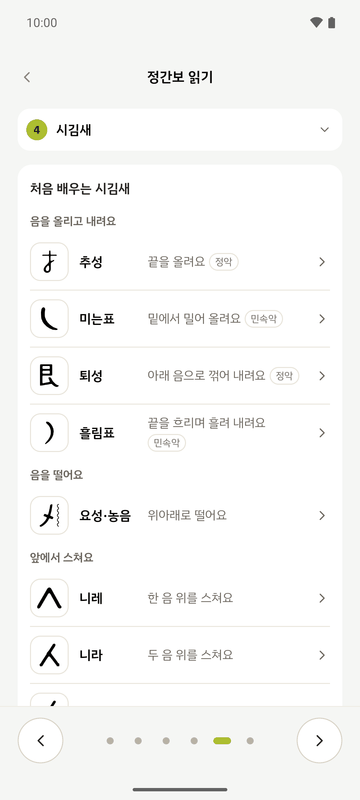</td>
  </tr>
  <tr>
    <td align="center">정간보란</td>
    <td align="center">읽는 순서</td>
    <td align="center">시김새</td>
  </tr>
</table>

### 📝 악보 추가·편집

가지고 있는 정간보·오선보를 올리면 편집 가능한 정간보 초안으로 바꿔 주고, 제공 곡을 내 악보로 복사해 고칠 수도 있습니다. 저장한 악보로는 서버가 모범 연주 음원을 만들어 연습과 평가에 씁니다.

- 📥 **악보 가져오기**: 정간보 PDF(글자 층)·스캔 사진과 오선보 PDF·이미지를 인식합니다. 악보 종류와 연주할 악기(정간보는 장단도)를 고르고 파일을 올립니다([악보 인식](docs/specs/score-recognition.md), [정간보 스캔](docs/specs/jeongganbo-scan-recognition.md)).
- ✏️ **편집**: 악기 음역에 맞춘 높이 맞추기(이조), 율명·기호, 시김새, 정간 나누기·합치기와 장단, 빠르기를 고칩니다([내 악보](docs/specs/user-sheets.md), [구간 빠르기](docs/specs/jeonggan-tempo-edit.md)).
- 🔊 **내 악보 음원**: 저장한 악보로 모범 연주 음원을 만들어 미리 듣고 연습합니다([음원 흐름](docs/specs/sheet-audio-app-flow.md)).

<table>
  <tr>
    <td align="center">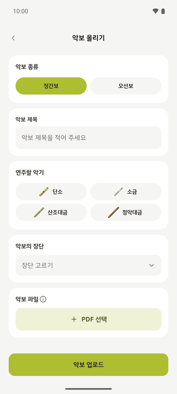</td>
    <td align="center">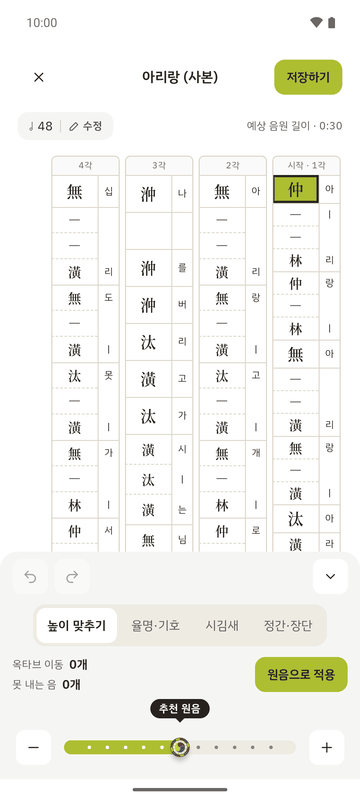</td>
    <td align="center">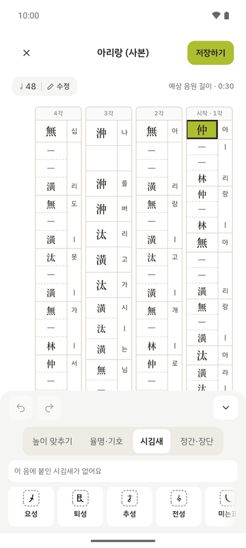</td>
  </tr>
  <tr>
    <td align="center">악보 올리기</td>
    <td align="center">높이 맞추기</td>
    <td align="center">시김새 편집</td>
  </tr>
</table>

> 💡 그 밖의 기능별 동작과 변경 이력은 [문서 목록](docs/README.md)의 기능 스펙에서 확인합니다. 악기 확장 순서와 2차 범위는 기획서를 따릅니다.

## 🔄 연주 평가 흐름

```text
정답:     공통 악보 데이터(정간보) → 음표 시퀀스
연주 후:  앱 녹음 업로드 → backend 검사·저장(R2) → ai 분석 API(pYIN 음높이 추정 → DTW 정렬 → 음표별 채점)
          → backend가 결과 저장 → 앱이 상태 조회 후 점수·음표별 판정 표시
```

요청·실패 코드·제한은 [분석 실패 처리 스펙](docs/specs/practice-analysis-failure.md)과 [ai README](ai/README.md)를 따릅니다.

## 🛠 기술 스택

| 영역 | 사용 기술 | 자세히 |
| --- | --- | --- |
| 📱 Frontend | Kotlin Multiplatform, Compose Multiplatform, Ktor, Koin (Android·iOS·Web Wasm) | [frontend](frontend/README.md) |
| ⚙️ Backend | Kotlin, Spring Boot, Spring Security(OAuth2 Resource Server), MyBatis, Flyway, springdoc | [backend](backend/README.md) |
| 🧠 AI | Python 3.12, FastAPI, librosa(pYIN), DTW 채점 / 악보 인식(OMR): 오선보 Audiveris, 정간보 글자 층 jeongganbo-generator, 정간보 스캔 MALerLab jeongganbo-omr 모델(PyTorch CPU·OpenCV) | [ai](ai/README.md) |
| 📊 Data | 공통 악보·참고 음원·카탈로그 구축, 연습 집계 마트 | [data](data/README.md) |
| 🗄 DB·저장소 | MySQL 8.4, Cloudflare R2(녹음·음원·악보 원본) | [DB 스키마](docs/contracts/db-schema.md) |
| 🐳 Infra | Docker Compose, Nginx(TLS), Jenkins, Prometheus·Grafana, Mattermost 점검·알림 | [infra](infra/README.md) |
| 🤝 협업 | GitLab, Jira, Notion, Mattermost | [AGENTS.md](AGENTS.md) |
| ✍️ 기술 블로그 | Hugo, GitHub Pages, Jenkins 자동 배포 (develop과 분리된 `blog` 브랜치) | https://team-edo.github.io |

## 🖥 운영 구성 요약

| 서버 | 역할 | 자세히 |
| --- | --- | --- |
| edo1 | 운영 서비스: Nginx(웹·API·TLS) → backend(블루그린) · ai · omr · playback · MySQL. Jenkins, Prometheus·Grafana | [운영 서버 문서](infra/runtime/README.md) |
| edo2 | DB·설정 암호화 백업과 격리 복원, MySQL 읽기 전용 복제본·대기 환경, Mattermost 점검 중계와 상태 변화 알림 | [인프라 문서 안내](infra/README.md) |

- 🚀 배포: backend는 develop 병합 시 Jenkins가 블루그린으로 자동 배포하고, 웹은 수동 잡으로 배포합니다. ai·omr·playback은 해당 이미지 입력이 바뀌면 Jenkins가 이미지를 빌드·검사해 자동 배포합니다.
- 🏁 최종 발표용 main 반영·태그·시연 동결은 [릴리스 절차](infra/release/README.md)를, edo1 장애 시 edo2 전환은 [장애 전환 런북](infra/standby/failover-runbook.md)을 따릅니다.
- 📐 구성 요소 간 연결과 실측 수치는 [시스템 아키텍처](docs/knowledge/infra/system-architecture.md)와 [운영·품질 실측 근거](docs/knowledge/infra/ops-quality-evidence.md)에 정리돼 있습니다.

## 🗂 저장소 구조

```text
S15P31E102/
├── AGENTS.md     # AI 공통 작업 지침
├── CLAUDE.md     # Claude Code에서 공통 지침 불러오기
├── frontend/     # KMP 앱(Android·iOS·Web)
├── backend/      # 곡·악보·연습·평가·계정 API
├── ai/           # 연주 분석 API, 악보 인식(OMR) 서비스
├── data/         # 악보·음원 데이터 구축, 음원 생성기(playback), 집계 마트
├── infra/        # 운영 Compose·Nginx·Jenkins·백업·점검·릴리스
├── docs/         # 스펙·계약·지식·결정·작업 기록, README 화면(assets/readme)
├── docker-compose.dev.yml · docker-compose.prod.yml   # 초기 backend·Nginx 예시(운영은 infra/runtime/compose.yml)
├── .env.dev.example · .env.prod.example               # 위 예시용 환경 변수 이름·용도
└── .gitlab/      # MR 템플릿
```

## 🌿 브랜치

| 브랜치 | 역할 |
| --- | --- |
| `develop` | 기본·개발 통합 브랜치. 작업 브랜치는 여기서 만들고 여기로 MR하며, 운영 자동 배포의 기준입니다. |
| `main` | 발표 시점의 `develop`을 반영한 제출 기준 브랜치. `develop`에 없는 `exec/` 제출 산출물을 함께 담습니다. |
| `blog` | 기술 블로그 글·설정. 서비스 코드가 아니어서 develop과 기록을 공유하지 않으며, 글 쓰는 방법은 `blog` 브랜치의 README를 따릅니다. |

각 작업 폴더에는 파트별 `AGENTS.md`와 이를 불러오는 `CLAUDE.md`가 있습니다. `data/raw/`, `data/processed/`, `ai/data/`, `ai/models/`는 Git 제외 대상이며, 소스와 작은 검증용 샘플은 추적 가능한 별도 경로에 둡니다.

## ✅ 실행과 검증

실행·검증 명령과 필수 환경은 각 영역의 README에 기록합니다.

- 개발 중에는 변경 영역의 관련 테스트를 실행하고, 완료 시 영향받는 영역의 필수 검사와 회귀 검증을 수행합니다.
- 모델 추론·실제 기기·대용량 음원 검증은 빠른 기본 검사와 실행 조건을 구분합니다. 해당 변경에 필요한 검증은 병합 전에 수행합니다.
- 운영 Jenkins 잡이 실행하는 파이프라인 원본은 `infra/jenkins/`에 있습니다([운영 서버 문서](infra/runtime/README.md#jenkins)).
- 문서의 상대 링크는 `python3 -B infra/scripts/check-markdown-links.py`로 검사합니다.

## 🤝 협업 규칙

Jira 업무·브랜치·MR 규칙은 [루트 AGENTS.md](AGENTS.md)의 `Jira·Git·MR` 절을 따릅니다. `Task 단위`와 `커밋 규칙` 절의 작업 구분 기준·브랜치와 커밋의 공통 타입은 팀 합의 전 초안으로 관리합니다.

## 🤖 AI 작업 도구

- Jira 작업은 연결된 MCP로 처리합니다. 팀원별 연결과 요청 예시는 [Jira MCP 사용 안내](docs/knowledge/tooling/jira-mcp.md)를 참고합니다.
- COCO는 [루트 AGENTS.md](AGENTS.md)의 `COCO` 절에 적힌 배포본을 기준으로 사용합니다.
- 팀 기본은 필요한 스킬을 사용자가 선택해 명령어로 실행하는 방식입니다. 고정된 단계 순서를 강제하지 않습니다.
- 자연어에 따른 자동 선택은 개인이 명시적으로 허용한 경우에 적용합니다.
- Codex는 `$coco-build`, Claude Code는 `/coco-build`처럼 각 도구의 명령으로 선택합니다.
- COCO 갱신 알림·QA 앱 다운로드·서버 연결은 [Eolssu Updates 앱](infra/tool-updates/README.md)을 사용합니다.
- 공통 규칙은 [루트 AGENTS.md](AGENTS.md), 파트별 규칙은 각 폴더의 `AGENTS.md`를 따릅니다. `CLAUDE.md`는 같은 지침을 불러옵니다.
- 코드 변경이 없는 조사·학습도 팀이 재사용할 결과가 생기면 [기록 기준](docs/README.md)에 따라 지식·실험·결정을 남깁니다.

## 🔐 환경 변수와 비밀 정보

인증 정보, 개인 키, 실제 환경변수 값은 커밋하지 않습니다. 예시 파일에는 이름과 용도만 남기고, 운영 값은 서버 환경 파일과 Jenkins Credentials에서 주입합니다([운영 서버 문서](infra/runtime/README.md)).

## 🔗 관련 문서

- [저장소 문서 목록](docs/README.md)
- [인프라 실행과 운영 문서 안내](infra/README.md)
- [프로젝트 기획서](https://app.notion.com/p/3ffa0252aa4580a5a16cc55beadea3ba)
- [팀 Jira·Git 규칙](https://app.notion.com/p/Jira-Git-af8a0252aa45823e9cbf8131a9ac7734)
