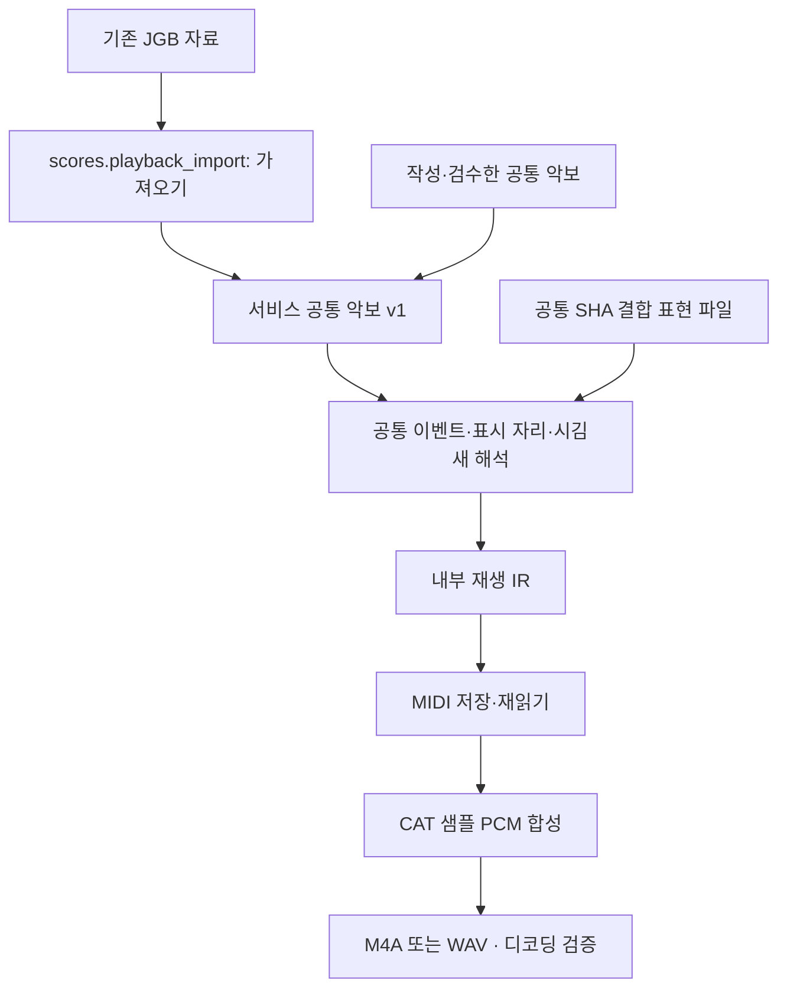

# 서비스 공통 악보의 MIDI·CAT·M4A 생성

`schemaVersion: 1`인 서비스 공통 악보를 받아 MIDI와 CAT 샘플 기반 음원을 만드는 로컬 CLI입니다. 기본 출력은 AAC-LC 192kbps 목표의 M4A이며, 검증용 WAV는 `--audio-format wav`로 선택합니다. 생성기는 공통 악보의 이벤트·표시 자리·시김새를 직접 해석합니다. JGB는 별도 가져오기 단계에서만 읽습니다.

DATA의 사전 음원 제작 범위이며 FE 구현·서버 게시·DB 등록·연주 녹음 채점은 포함하지 않습니다. 생성 성공은 원보 판독이나 정석 연주 품질의 검수 완료를 뜻하지 않습니다. 기준은 [338 스펙](../../../docs/specs/common-score-playback.md)과 [작업 기록](../../../docs/plans/S15P31E102-338.md)입니다.



## 서비스 공통 악보 v1 입력 (338)

저장소 루트에서 공통 악보와 `music.bpmUnit` 기준 BPM, 원본과 같은 악기를 명시합니다. 아래 아리랑은 점4분음표96 BPM입니다.

```powershell
.\data\.venv\Scripts\python -m data.src.playback --score data/tests/fixtures/scores/ngc-standard-2022-p173.score.json --common-bpm 96 --instrument danso --assets assets.json --out data/processed/playback/arirang
```

- 입력 계약은 [score_data.schema.json](../scores/score_data.schema.json)입니다. 스키마·표시 자리·이벤트 시간·음높이·검수 상태를 검사합니다.
- `--common-bpm`과 `--instrument`는 필수입니다. 악기는 `danso`, `sogeum`, `jeongak-daegeum`, `sanjo-daegeum` 중 원본 `score.instrument`와 같은 하나를 선택합니다. `--instrument all`은 지원하지 않습니다.
- BPM·조율을 장단명이나 악기 기본값으로 추측하지 않습니다. QUARTER는1, DOTTED_QUARTER는3/2 quarter로 길이와 BPM을 함께 환산합니다. JEONGGAN/JANGDAN_BEAT는 전송상1박=1quarter이며 서양 표기 음가를 확정하는 의미가 아닙니다.
- `music.hwangHz`의 조율과 원본 eventId/cellId를 보존합니다. `--transpose`를 명시한 경우에만 반음 이동하고 대응표에 기록합니다. 자동 옥타브 보정·편곡은 하지 않습니다.
- release를 NOTE 길이 안에 넣어 쉼을 보존합니다. 숨표는120ms 목표와 최대 반길이 정책을 적용합니다. 합쳐진 지속 이벤트를 다시 나누거나 같은 음의 별도 이벤트를 합치지 않습니다.
- 기본 모드는 비어 있지 않은 `sigimsae`를 거부합니다. 등록 기호를 재생하려면 아래 교육용 정책을 명시합니다. rejected 원본, 불일치 표시, 지원하지 않는 MIDI 분할·음역도 실패합니다.
- 악보 길이와 파일 길이는 다릅니다. 이 아리랑의 악보는30초이며 MIDI reset/EOT 여백 약550ms가 파일에 추가됩니다. 입력 reviewed 상태는 합성 연주의 전문가 검수 완료를 뜻하지 않습니다.

### 모든 등록 시김새의 교육용 미리듣기

```powershell
.\data\.venv\Scripts\python -m data.src.playback --score data/tests/fixtures/scores/common-preview-study.score.json --common-bpm 60 --notation-policy educational-preview/v1 --instrument danso --assets assets.json --audio-format wav --out data/processed/playback/preview-study
```

악기별 규칙을 사용하며 미확정 음열·효과에는 버전이 있는 교육용 선택값을 기록합니다. 정석 연주나 전용 격음 샘플 확보를 뜻하지 않습니다. 구체적인 수치와 문맥별 지원 범위는 [공통 시김새 정책](../../../docs/knowledge/data/common-score-expression-preview.md)을 따릅니다.

- `--common-expressions expressions.json`은 `common-score-expressions/v1` 파일을 받습니다. `sourceSha256`은 입력 공통 JSON의 실제 바이트 해시입니다.
- `placements`는 원본 기호 전체를 `(eventId, cellId, row, col, symbols)`에 연결합니다. 파일이 없으면 이벤트 첫 표시 자리에 적용하고 `event-origin-inferred`로 기록합니다. 기호 오타·원본/배치 불일치·상충 표현은 오류입니다.
- `jo`, `relativeScale`, `expressionPolicy`, `expressionProfile`, `performancePlan`으로 선택한 해석을 함께 전달할 수 있습니다. 생성기에는 별도의 JGB 계획/프로필 CLI 옵션이 없습니다.
- 빠르기 기호는 해당 정간 시작부터 적용하며 원래 기호 위치와 적용 위치를 구분해 기록합니다. 반복·길이표·늘임은 수행 시간만 바꾸고 원본 저장·채점 이벤트와 tick은 유지합니다.
- `performance.common.json`은 표시 자리별 수행 시간표입니다. 실제 음원 SHA와 공통 입력 SHA에 결합하며 반복한 표시 자리에도 occurrenceId를 부여합니다.
- 각 경계 지속의 명시 근거가 있을 때만 `gakContinuations`에1-based 새 각 번호와 `basis`를 지정합니다. 첫 자리는 이음·빈칸이어야 하며 앞 음의 숨표·쉼과 충돌하면 실패합니다. 원본 v1의 REST/채점 시간은 바꾸지 않습니다.

### 명시적 연주 계획과 표현 프로필

표현 파일에 담는 연주 계획은 예를 들어 `danso-performance/v1` schema와 **공통 입력 바이트**의 `input_sha256`을 사용합니다. BPM은 정간/분, `times`는 최초 연주를 포함한 횟수입니다. 프로필은 `danso-expression-profile/v1`처럼 악기를 명시하고 수치의 `basis`를 남깁니다. 이 선택값은 전통 주법의 공인 표준이나 채점 허용치가 아닙니다.

<a id="jgb-파일에서-생성"></a>

### 기존 재생용 JGB를 공통 악보로 가져오기

JGB는 생성기에 직접 넣지 않습니다. 별도 가져오기 명령으로 공통 JSON·표현 파일·원문 대응표를 먼저 만든 뒤 생성기에 넘깁니다. 생성 시 원본 JGB를 다시 읽지 않습니다. 다성부 입력은1-based `--part`로 가져올 성부를 선택합니다.

```powershell
$imported = python -m data.src.scores.playback_import input.jgb.json --instrument danso --part 1 --out data/processed/common-import/song | ConvertFrom-Json
python -m data.src.playback --score data/processed/common-import/song/common.json --common-bpm $imported.bpm --common-expressions data/processed/common-import/song/expressions.json --notation-policy educational-preview/v1 --instrument danso --assets assets.json --out data/processed/common-import/song-audio
```

가져오기 결과의 `playback_args`에도 같은 생성 인자가 들어 있습니다. 입력의 악기·황종·명시 빠르기·staffUnit 비율·원본 ID를 보존합니다. 원본 사본 `source.jgb.json`과 원문 대응표는 **가져오기 묶음**에만 존재합니다. 결과는 `inferred`이며 채점 정답·전문가 검수·서비스 게시를 대신하지 않습니다.

가져오기 명령은 `--performance-plan plan.json`, `--expression-profile profile.json`, `--notation-policy educational-preview/v1`을 지원합니다. 계획의 원본 JGB SHA를 먼저 검증한 뒤 생성된 공통 SHA로 재결합하고 원래 계획·프로필·기호 위치를 기록합니다. 반복을 표시 자리에 미리 복제하거나 생성 때 중복 적용하지 않습니다.

명시 교육 정책에서 원문 반복표/도돌이표의 기본은 해당 각 총2회입니다. 짝 없는 길이표는 꾸밈 생성 후 해당 자리의 수행 길이 배율을 적용하고, 원문에서 유효한 짝 길이표는 꾸밈 생성 전에 적용합니다. 명시 계획은 자동 빠르기/반복 계획을 대체합니다. 빠르기·반복 주석만 있는 행은 음가를 차지하지 않으며 원문 Unicode 문자 범위는 `normalization`에 남깁니다. 기준음 없는 음열·충돌하는 효과는 오류입니다.

이전 생성 명령의 `--part`, `--bpm`, `--speed`, `--hwang-midi`, `--jo`, `--performance-plan`, `--expression-profile`, `--assume-danso`는 제거했습니다. 성부·계획/프로필은 가져오기 단계에서 처리합니다. 생성의 기본 빠르기는 `--common-bpm`, 조율은 공통 악보, 표현 선택은 공통 표현 파일을 사용합니다. 구형 `gugak-reviewed-score/v1` IR도 생성 CLI 입력으로 받지 않습니다.

## 설치와 빠른 검사

Python3.10 이상과 별도 가상환경을 사용합니다. 저장소 루트의 PowerShell 명령입니다.

```powershell
python -m venv data/.venv
.\data\.venv\Scripts\python -m pip install -r data/src/playback/requirements.txt
.\data\.venv\Scripts\python -m unittest discover -s data/src/playback/tests -p "test_*.py" -v
```

작은 고정 악보와 합성 신호를 사용하므로 CAT 파일·모델·서버·네트워크가 필요하지 않습니다. `test_pipeline.py`는 공통 입력→MIDI/PCM/실제 AAC, 출처 보존, 게시 실패 복구를 검사합니다. 공통 해석은 `test_common_score.py`·`test_common_preview.py`에서 검사하고 JGB 단위 검사는 가져오기 경계 회귀용으로 유지합니다. `examples/`의 구형 IR은 하위 엔진 검사 자료이지 생성 CLI 입력 예제가 아닙니다.

M4A 생성과 실제 코덱 검사에는 FFmpeg와 ffprobe가 필요합니다. [공식 다운로드 안내](https://ffmpeg.org/download.html)에 따라 실행 파일을 준비합니다. 프로그램은 자동 설치하거나 PATH를 변경하지 않습니다. PATH 또는 단일 명령의 `--ffmpeg`·`--ffprobe`로 지정하거나 다음 프로세스 환경변수를 사용합니다.

```powershell
$env:FFMPEG_BINARY = 'C:/tools/ffmpeg/bin/ffmpeg.exe'
$env:FFPROBE_BINARY = 'C:/tools/ffmpeg/bin/ffprobe.exe'
.\data\.venv\Scripts\python -m unittest discover -s data/src/playback/tests -p "test_*.py" -v
```

인코더가 없으면 실제 AAC 검사가 건너뛰어질 수 있습니다. M4A 변경의 통합 검증에서는 두 프로그램을 준비해 해당 검사까지 실행합니다. WAV 출력에는 FFmpeg가 필요하지 않습니다.

## CAT 준비와 출력 묶음

[CAT 국악 라이브러리](https://www.catseoul.com/gugak-library/)의 해당 악기 Live Sampler v1.3 ZIP을 로컬에 준비합니다. Git 밖의 `assets.json`에 `{"danso": "C:/local-gugak/danso-v1.3.zip"}`처럼 실제 경로를 기록합니다. 다른 악기는 `sogeum`, `jeongak-daegeum`, `sanjo-daegeum` 키를 사용합니다. 상대 경로는 assets JSON의 폴더 기준입니다. ZIP·원본 악보·생성 음원은 저장소에 넣지 않습니다.

| 단소 출력 예 | 내용 |
| --- | --- |
| `source.common.json` | 입력 공통 악보의 원본 바이트 |
| `source-map.json` | 공통 ID·표시 자리·조율·빠르기·기보/수행 시간 대응 |
| `score.json` | 생성된 내부 재생 IR; 서비스 입력 스키마와 구분 |
| `danso.mid` | MIDI 제어 메시지와 음표 |
| `danso.m4a` / `danso.wav` | 선택한 형식의 실제 음원 |
| `danso.json` | MIDI 이벤트·샘플 추적·음원 길이/해시·검사 결과 |
| `manifest.json` | 입력·설정·구현·프로필 해시와 생성 조건 |
| `expressions.common.json` | 표현 파일을 지정한 경우 그 원본 바이트 |
| `performance.common.json` | 교육용 정책을 선택한 경우 실제 수행 시간표 |

M4A는44.1kHz·mono·AAC-LC, 목표192kbps입니다. 중간 WAV를 저장하지 않고 메모리 PCM을 인코더에 전달합니다. WAV는44.1kHz·mono·PCM16입니다. `audio.frames/seconds`는 PCM, `container_seconds`는 M4A 표시 길이, `decoded_frames/end_padding_frames`는 디코딩 길이와 끝 패딩입니다. 재생 시작0·길이 오차2샘플 이내·끝 패딩1024샘플 미만·유한값·피크를 검사하며 인코더 버전을 기록합니다.

임시 폴더에서 합성·인코딩·디코딩 검사까지 성공한 뒤 결과 폴더를 교체합니다. 교체 실패 시 이전 묶음을 복구합니다. 입력/설정 파일과 출력이 겹치거나, 출력에 다른 개인 파일·반대 형식의 음원·이전 JGB 생성 묶음이 있으면 거부합니다. JGB 가져오기 폴더와 음원 출력 폴더도 분리합니다. 프로세스 강제 종료·전원 손실까지 보장하는 트랜잭션은 아닙니다.

## 내부 재생 IR과 표현 정책

`score.py`의 `gugak-reviewed-score/v1`은 컴파일 이후 MIDI/샘플러에 전달하는 내부 형식입니다. `notes`, quarter BPM, MIDI 음높이·길이·표현 파라미터를 담으며 서비스 공통 악보와 구분합니다. MIDI 자체에는 원본 ID가 없으므로 악기별 JSON의 `parent_ids`와 공통 대응표를 함께 보관합니다.

꾸밈의 `1/16 quarter`는 quarter BPM60에서62.5ms이며 일반적인16분음표(`1/4 quarter`)와 다릅니다. 단소 추가 떨림은±25cent이고 소금·정악대금·산조대금에 자동 추가하지 않습니다. 정악·산조대금의 서로 다른 연결음은 앞 release와 다음 attack을 `min(20ms, 다음 발음 길이/5)`로 맞추며 기보 음높이·시작·길이는 바꾸지 않습니다.

음역 밖을 자동 이조하거나 다른 악기의 표를 자동 상속하지 않습니다. 긴 음은 검증된 안정 샘플 구간을 연장하며 적합한 구간이 없으면 실패합니다. 메모리 보호 기본 길이 제한은600초이고 `--max-duration-seconds 1200`처럼 명시적으로 바꿀 수 있습니다. CAT 원본 조율·실연 음색과 교재의 모든 주법을 재현한다고 주장하지 않습니다.

악기별 지원·근거·한계는 [단소](../../../docs/knowledge/data/danso-expanded-auditions.md), [소금](../../../docs/knowledge/data/sogeum-playback.md), [정악대금](../../../docs/knowledge/data/jeongak-playback.md), [산조대금](../../../docs/knowledge/data/sanjo-playback.md)을 참고합니다. CAT 샘플은 로컬에 유지하며 실제 배포·서비스 사용 조건은 별도로 확인합니다.

## 실제 음원 검증

같은 입력·표현 파일·CAT ZIP·속도·코드·인코더 버전으로 재생성하고 원본 ID·샘플 해시·M4A 코덱·길이·피크를 확인합니다. 파형을 독립 비교하려면 다음 명령을 사용합니다.

```powershell
.\data\.venv\Scripts\python -m data.src.playback.verify_common --score data/tests/fixtures/scores/ngc-standard-2022-p173.score.json --bpm 96 --audio data/processed/playback/arirang/danso.m4a --out data/processed/playback/arirang/verification.json
.\data\.venv\Scripts\python -m data.src.playback.verify_preview --expect data/tests/fixtures/playback/common-preview.expect.json --case danso --audio data/processed/playback/preview-study/danso.wav --out data/processed/playback/preview-study-check.json
```

독립 관측창·기대값·허용치는 [공통 파형 검증 기록](../../../docs/knowledge/data/common-score-audio-verification.md)과 [시김새 점검](../../../docs/knowledge/data/common-score-expression-preview.md)을 따릅니다. 합성 검사나 실제 샘플 생성 통과는 전문가의 원보·연주 품질 검수와 구분합니다.
