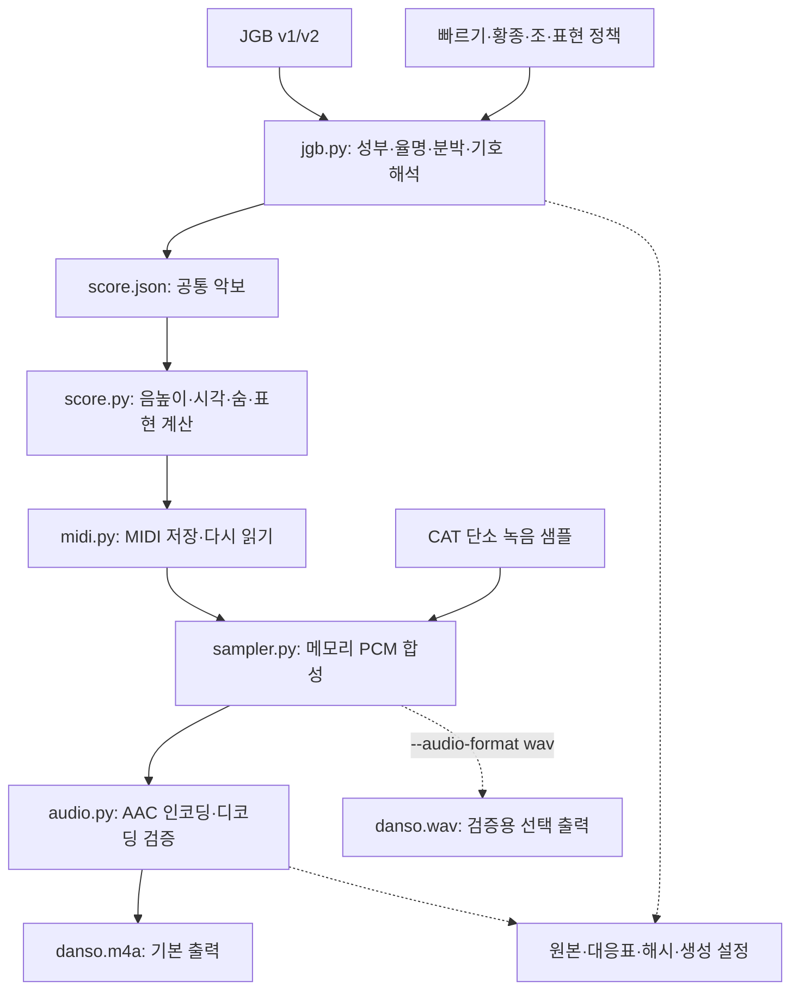

# JGB·공통 악보 JSON의 국악기 MIDI·CAT 음원 생성

JGB v1·v2 또는 공통 악보 JSON(`gugak-reviewed-score/v1`)을 해석해 MIDI를 저장하고, CAT 단소 샘플로 합성한 PCM을 **AAC-LC 192kbps 목표의 M4A**로 저장하는 로컬 CLI입니다. 중간 WAV 파일을 만들지 않으며, WAV가 필요할 때는 `--audio-format wav`를 선택합니다. [105](https://ssafy.atlassian.net/browse/S15P31E102-105)의 재생 기반에 [166](https://ssafy.atlassian.net/browse/S15P31E102-166)의 JGB 입력·M4A 출력을 더했습니다.

담당 범위: 박찬형은 **JGB를 바탕으로 정석 음원을 제작**하고, 사지한은 **채점·AI 평가**를 담당합니다(2026-10-27 사용자 확인). 이 도구는 정석 음원 제작을 위한 재생 기반입니다.



`__main__.py`가 입력 악보 하나의 변환 전체를 연결합니다. 기본 출력과 검증용 출력은 각각 다른 폴더에 생성합니다.

`.jgb.json`을 `--score`에 직접 넣을 수 있습니다. 한 번에 악기 하나와 한 성부를 선택합니다. 등록된 `profiles/*.json`이 지원 악기를 정하며 `--help`에서 확인합니다. 사진 인식·웹 API·합주·연주 녹음 채점은 포함하지 않습니다.

## 설치와 빠른 검사

저장소 루트에서 Python 3.10 이상으로 별도 가상환경을 만듭니다. 아래 명령은 PowerShell 기준입니다.

```powershell
python -m venv data/.venv
.\data\.venv\Scripts\python -m pip install -r data/src/playback/requirements.txt
.\data\.venv\Scripts\python -m unittest discover -s data/src/playback/tests -p "test_*.py" -v
```

작은 합성 신호를 사용하는 검사이며 CAT 파일·모델·서버·네트워크가 필요하지 않습니다. 음표/쉼표/붙임줄/이음줄·원본 ID·음역·실제 무음·CC11·Pitch Bend·추가 떨림과 실패 시 기존 산출물 보존을 확인합니다.

M4A 생성과 실제 코덱 검사에는 **FFmpeg와 ffprobe**가 필요합니다. [공식 다운로드 안내](https://ffmpeg.org/download.html)의 OS별 배포본을 준비합니다. 프로그램이 자동 설치하거나 PATH를 바꾸지는 않습니다. PATH에 있으면 바로 사용하고, 경로를 직접 지정하려면 단일 명령에 `--ffmpeg C:/tools/ffmpeg/bin/ffmpeg.exe --ffprobe C:/tools/ffmpeg/bin/ffprobe.exe`를 붙입니다. 검사와 실행에 공통으로 사용할 환경변수도 지원합니다.

```powershell
$env:FFMPEG_BINARY = 'C:/tools/ffmpeg/bin/ffmpeg.exe'
$env:FFPROBE_BINARY = 'C:/tools/ffmpeg/bin/ffprobe.exe'
.\data\.venv\Scripts\python -m unittest discover -s data/src/playback/tests -p "test_*.py" -v
```

실제 설치 위치로 바꿉니다. 두 실행 파일이 없으면 M4A 통합 검사 2개는 건너뛰고 나머지 검사는 실행합니다. M4A 변경을 병합하기 전에는 이 검사도 실행해야 합니다. WAV 선택 출력은 FFmpeg가 필요하지 않습니다.

## 실제 단소 음원 생성

[CAT 국악 라이브러리](https://www.catseoul.com/gugak-library/)의 단소 Live Sampler v1.3 ZIP을 로컬에 준비합니다. 아래 내용을 Git 밖의 `assets.json`으로 저장하고 `danso` 값을 실제 ZIP 경로로 바꿉니다. 상대 경로는 assets JSON의 폴더 기준입니다. ZIP·원본 악보·생성 음원은 저장소에 넣지 않습니다.

```json
{"danso": "C:/local-gugak/GUgAK-DEMO DanSo Live Installer v.1.3.zip"}
```

```powershell
.\data\.venv\Scripts\python -m data.src.playback --score data/src/playback/examples/seryeongsan-first-jangdan.json --assets C:/local-gugak/assets.json --instrument danso --out data/processed/playback/seryeongsan-fixed25
```

단소의 추가 떨림은 **±25cent로 고정**하며 다른 악기에는 자동 추가하지 않습니다. 이전 `--vibrato` 인자는 명령에서 제거합니다. 원본 CAT 샘플에 녹음된 흔들림은 그대로 남습니다. `--transpose`는 명시적인 반음 이동이고 기본0입니다. 자동 옥타브 보정·편곡은 하지 않습니다. `--instrument all`은 공통 IR의 등록 프로필 전체 청취용이며 JGB에는 악기 하나를 지정해야 합니다.

출력 폴더에는 `danso.mid`, **`danso.m4a`**, 해석·샘플 추적 `danso.json`, 입력 사본 `score.json`, 재현 정보 `manifest.json`이 생성됩니다. M4A는44.1kHz·mono·AAC-LC이며 목표 비트레이트는192kbps입니다. 실제 비트레이트는 인코더와 음원에 따라 달라지며 결과에 따로 기록합니다. PCM을 메모리에서 인코더 stdin으로 전달하므로 중간 WAV를 저장하지 않습니다.

WAV가 필요한 경우 같은 명령에 `--audio-format wav`를 추가하고 새 `--out`을 지정합니다. WAV는 기존44.1kHz·mono·PCM16입니다. 출력 폴더에 반대 형식의 음원이 있으면 이전 파일을 삭제하지 않고 작업을 거부합니다. 인코딩·디코딩 검사까지 임시 폴더에서 성공한 뒤 결과를 공개하므로 인코더 실패 시 이전 산출물을 보존합니다.

`danso.json`의 `audio.file/format/codec/sha256/bytes`는 실제 생성 파일을 가리킵니다. `frames/seconds`는 합성 PCM 기준이고 `container_seconds`는 M4A 재생 길이, `decoded_frames/end_padding_frames`는 다시 디코딩한 길이와 AAC 끝 패딩입니다. 재생 시작0·표시 길이 오차2샘플 이내·디코딩 끝 패딩1024샘플 미만·유한값·피크를 검사합니다. `manifest.audio_output`에는 FFmpeg·ffprobe 버전을 남깁니다. 이 검사는 청감상 원본과 동일하다는 판정이 아닙니다.

## JGB 파일에서 생성

같은 설치·CAT 준비를 마친 뒤 저장소 루트에서 실행합니다. 원본과 다른 출력 폴더를 사용합니다.

```powershell
.\data\.venv\Scripts\python -m data.src.playback --score C:/local-gugak/song.jgb.json --assets C:/local-gugak/assets.json --instrument danso --out data/processed/playback/song
```

- v1의 `melody`, v2의 `parts[].melody`를 읽습니다. 여러 성부면 `--part 1`처럼 1부터 번호를 지정해야 합니다. `activePart`는 편집 위치라 자동 선택에 쓰지 않습니다.
- `tempoBpm`은 **정간/분**입니다. `--bpm 60`으로 덮어쓰거나 `--speed 0.75`로 속도를 바꿉니다. 정간을 4분음표로 환산할 때 길이와 BPM에 같은 비율을 적용합니다. `dotted=3/2`, `plain=1`, `eighth=1/2`; `auto`·누락은 기본각이12정간이면 `eighth`, 나머지는 `dotted`입니다.
- 황종은 `hwangPitch`를 사용하며 `--hwang-midi 63`으로 지정할 수 있습니다. BPM·황종이 없으면 자동으로 추측하지 않습니다. `tempoBpmGak`은 표시용이므로 재생 속도로 쓰지 않습니다.
- 한글 율명·청/중청/배/하배, 같은 각 안의 빈칸·`-`·`{빈지속}` 연장, 쉼·쉼표, 숨표`<`를 지원합니다. 같은 율명을 다시 적으면 새로 발음합니다. 각 첫 연장은 쉼이며 각 정간 수·분박 분할이 잘못되면 실패합니다.
- 앞꾸밈: 니레·니라·니로·노네·너녜·노니로·노리노·네로네. 앞뒤 꾸밈: 느니르. 본음 음열: 나니나·나느나. 독립 상대음: 노·니·로·리·니나·느나·노라·느니·니로나·같은음표. `{한글 이름}`과 대응 registry ID를 받습니다. 상대음에는 명시한 `joPreset` 또는 `--jo jung-pyeong` 등이 필요합니다.
- 꾸밈은 각각 `1/16 quarter`·velocity80, 음열은 본음 자리를 균등 분할하고 연결합니다. `<`의 목표 공백은120ms이며 release를 합친 단축량을 마지막 음 길이의 절반으로 제한합니다. 다음 음의 시작·전체 장단 길이는 유지합니다.
- 농음표·떠는표는 음량 요성4Hz·depth0.08, 흘림표는 음 말미30%(최대200ms)에50cent 하강을 적용합니다. 수치는 청취용 근사값입니다. 지속 위 농음은 재발음 없이 그 위치에서 시작합니다. 덧길이·반길이는 짝을 이루어 정간 시간을 보존하는 경우에 지원합니다. 원문점은 의미 미확정 주석으로 보존하며 소리 효과를 주지 않습니다.
- **추성·실제 풀어내림표·일반 반복 기호, 한자 율명, 장구 반주·합주는 미지원**입니다. 나머지 알 수 없는 기호는 위치를 알려 실패합니다. 기존 고정25cent 떨림과 명시된 농음·흘림을 구분합니다.

JGB 입력에서는 원본 바이트 사본 `source.jgb.json`과 `source-map.json`이 추가됩니다. `score.json`은 변환된 공통 악보이며 원본과 구분합니다. `danso.json`의 `events[].parent_ids`를 대응표의 `notes` 키로 찾으면 성부 원본 ID·각·정간·분박·문자 범위와 연장된 칸을 확인할 수 있습니다. 대응표의 시간은 원본 자리의 시간이고 실제 발음 시간은 `events`에 있습니다. 문자 범위는 **0부터 세는 Unicode 문자 위치·끝 제외**이며 JavaScript UTF-16 위치와 구분합니다. manifest에 원본·변환본·대응표·소스 해시와 선택한 템포·배율을 기록합니다. JGB 결과 폴더를 공통 악보 JSON 입력에 재사용하면 이전 대응표가 남지 않도록 거부합니다.

## 공통 악보 JSON 입력

입력은 단선율 음표·쉼표를 순서대로 나열합니다. 예제는 세령산 첫 장단37개 입력을 꾸밈 확장 후44개 MIDI 음으로 만듭니다. 이 숫자는 인식 정확도가 아닙니다.

| 필드 | 현재 코어의 의미 |
| --- | --- |
| `schema` | `gugak-reviewed-score/v1`. 이름과 별개로 원보 검수 상태를 명시 |
| `source` | 판본 `edition`, `manually-transcribed-unverified`·`machine-transcribed-unverified`·`source-review-unverified` 상태. JGB 입력의 원보 검수 상태는 추정하지 않음 |
| `context` | `sounding` 실음 MIDI, `written` 명시 옥타브 이동, 또는 `yul`의 황종 MIDI+율명/register. 스타일·조율 설명 필수 |
| `quarter_bpm` | 4분음표 기준 BPM. JGB의 주박·정간 단위와 구분 |
| `notes[].id` | 중복 없는 문자열. 장식/붙임줄 처리 후 JSON의 `parent_ids`로 보존 |
| `duration` | 4분음표를1로 하는 양수 유리수. 예: `1`, `1/18`, `3/2`; PPQN14400에서 표현 가능해야 함 |
| `rest` / `tie` / `slur` | 쉼 / 같은 음을 합치는 붙임줄 / 연결 발음. 같은 의미로 처리하지 않음 |
| `ornament` | `grace-before` 또는 `upper-return`. 이웃음 높이 명시. 기본 시가 `1/16 quarter` |
| `breath_seconds` | 음 끝에서 요청 공백+release만큼 차감. 악보 시간은 유지. 직접 작성한 IR 값은 자동 변경하지 않음 |
| `release_seconds` | 기본50ms, 0~50ms를 CC72의0~127로 양자화. 프로젝트 전용 환산이며 일반 MIDI 플레이어의 절대시간 규약이 아님 |
| `pitch_curve` | `end_cents`, `tail_fraction`, `maximum_seconds`로 명시한 말미 음높이 변화 |
| `expression` | 시작·45%지점·끝의 CC11 값0~127. 기본 `[127,127,127]` |
| `yoseong` | 명시된 음의 amplitude/pitch/mixed 요성. 단소 정악의 기본은 amplitude |

**MIDI 파일 자체에는 원본 음표 ID를 저장하지 않습니다.** 악기별 JSON의 `parent_ids`와 JGB 입력의 `source-map.json`을 함께 보관합니다. 여러 성부 합주·JGB 반복 전개·임의 시김새를 자동 처리하는 기능은 없습니다.

실음 MIDI를 쓰거나 `황종 MIDI + 율명 반음 간격 + register×12`로 음높이를 정합니다. 단소 프로필의 교재 기준 음역은 MIDI66~92입니다. 黃=63이라는 환산 기준과 실제 연주할 옥타브를 구분하며, 범위 밖 음을 자동으로 올리지 않습니다. `tuning_a_hz`는 비교 기준 이동이고 CAT 샘플의 잔여 조율 편차를 자동 교정하지 않습니다.

## 표현 초기값과 한계

- 꾸밈 `1/16 quarter`는 4분음표의1/16입니다. quarter BPM60에서62.5ms이며 일반적인16분음표(`1/4 quarter`)와 다릅니다.
- 명시 요성: 4Hz, ±25cent(pitch/mixed), amplitude depth0.08, 지연250ms, 시작/끝 fade150ms. depth0.08은 충분히 적용된 구간의 CC11 배율92~100%를 뜻합니다.
- 단소만 추가 떨림: ±25cent, 650ms 이상 음에4.5Hz·지연220ms·fade-in/out180/160ms. pitch/mixed 요성과는 중복되지 않으며 amplitude 요성에는 겹칠 수 있습니다.
- 직접 작성한 IR의 숨은 미지정0초, 예제는120ms입니다. JGB 숨표는 무음+release를 음 길이의 절반 이내로 조정합니다. 긴 음에서는 기존120ms+50ms를 유지합니다.
- 연결 attack/release20ms, 일반 release50ms, 단소 연결 시 새 샘플의100ms 지점부터 재생합니다. 동일음 연결은 샘플 위치를 이어갑니다.
- 속도 변경 시 꾸밈은 박 비율을 따르고 JGB 숨은 길이에 맞춰 줄어듭니다. 떨림 주기·지연·fade는 초 단위입니다. 곡별 빠르기와 음가 단위를 먼저 확인해야 합니다.

이 값은 교재의 표준이나 채점 허용치가 아닌 실험값입니다. 기호별 적용·근거·남은 검수는 [기존 표현 조사](../../../docs/knowledge/data/score-instrument-playback-pipeline.md)와 [단소 표현·출력 근거](../../../docs/knowledge/data/danso-expanded-auditions.md)에 있습니다. 물리적 호흡·음색 변화, 긴 음의 자동 샘플 반복은 구현하지 않았습니다. 알 수 없는 기호·조율 문맥 누락·불완전 붙임줄·장식 시간 초과·음역 이탈·샘플 소진은 실패합니다.

## 실제 CAT 검증

이 CLI의 출력은 음원·MIDI·변환/추적 JSON입니다. 목록 일괄 처리·원보 교정·빠르기 조사·HTML 페이지 생성은 포함하지 않습니다. 필요한 빠르기·조·악기와 원보 교정은 입력을 준비할 때 확인합니다.

CAT ZIP을 보유한 개발자가 위 CLI를 실행해 입력37→MIDI44, 원본 ID, manifest/악기별 JSON의 소스·입력·프리셋·샘플 해시, M4A 코덱·길이·피크를 확인합니다. 무음·파형의 정확한 비교가 필요할 때는 WAV 선택 출력을 사용합니다. 재현할 때는 같은 입력·ZIP·속도·코드·인코더 버전을 사용합니다. 작은 합성 검사 통과와 실제 샘플 생성 성공은 전문가의 원보·연주 품질 검수와 구분합니다. 최신 M4A 검증은 [단소 변환 기록](../../../docs/knowledge/data/danso-expanded-auditions.md), 이전 WAV 검증은 [음원과 재현 기록](../../../docs/knowledge/data/score-instrument-playback-pipeline.md#음원과-재현)에 있습니다.

## 단소 이외 악기의 JGB 입력

각 프로필이 포함된 브랜치에서 `--instrument jeongak-daegeum`, `sanjo-daegeum`, `sogeum`을 선택합니다. assets JSON도 해당 키로 실제 CAT ZIP을 연결합니다. 출력 파일명은 `<악기키>.mid/.m4a/.json`입니다.

성부의 `instrument`가 선택 악기와 같아야 합니다. 원본의 값이 `all`·누락·일반 `daegeum`이면 판본에서 악기/대금 기종을 확인한 뒤 `playback.instrument`와 `playback.instrument_basis`에 기록합니다. CLI 악기 선택만으로 원본의 기종을 확정하지 않습니다. 이미 다른 악기로 지정된 성부는 거부합니다. 소금에 자동 +12반음, 대금에 자동 청/관종 조율을 적용하지 않습니다.

단소 이외 JGB의 농음·흘림 기호는 `playback.expression_policy`가 있어야 합니다. `name`, 선택 근거 `basis`, `status: "audition-policy-not-performance-standard"`를 넣고, 필요한 효과를 다음처럼 명시합니다. 이 수치는 예제 청취용이며 악기의 표준값이 아닙니다.

```json
{
  "playback": {
    "instrument": "jeongak-daegeum",
    "instrument_basis": "직접 확인한 판본·페이지·악기 표기를 기록",
    "expression_policy": {
      "name": "authored-audition-example",
      "basis": "정책 입력 검사용으로 작성한 수치. 실제 곡에 사용하려면 곡별 검토 필요",
      "status": "audition-policy-not-performance-standard",
      "vibrato": {"mode":"pitch", "hz":3, "cents":40, "depth":0, "delay_seconds":0.1},
      "fall": {"end_cents":-75, "tail_fraction":0.4, "maximum_seconds":0.15}
    }
  }
}
```

상대음 장식에 기존 `joPreset`을 쓸 수 없으면 `playback.relative_scale`에 황종 기준 반음 음급의 오름차순 배열 `pitch_classes`와 선택 근거 `basis`를 기록합니다. `joPreset`/`--jo`와 중복 지정할 수 없습니다. 다른 악기에서는 출현 음급만 보고 단소의 상대음 음계를 자동 보충하지 않습니다.

비단소 JGB의 편집기 기본 템포(`tempoBpmUserSet` 미확정)는 재생 속도로 채택하지 않습니다. 판본 근거를 확인한 준비 JSON 또는 명시적인 `--bpm`이 필요합니다. 직접 작성한 공통 IR의 숨표·감쇠는 입력값을 보존하며, 여러 성부가 있으면 단일 CLI에서 `--part`로 선택합니다.
