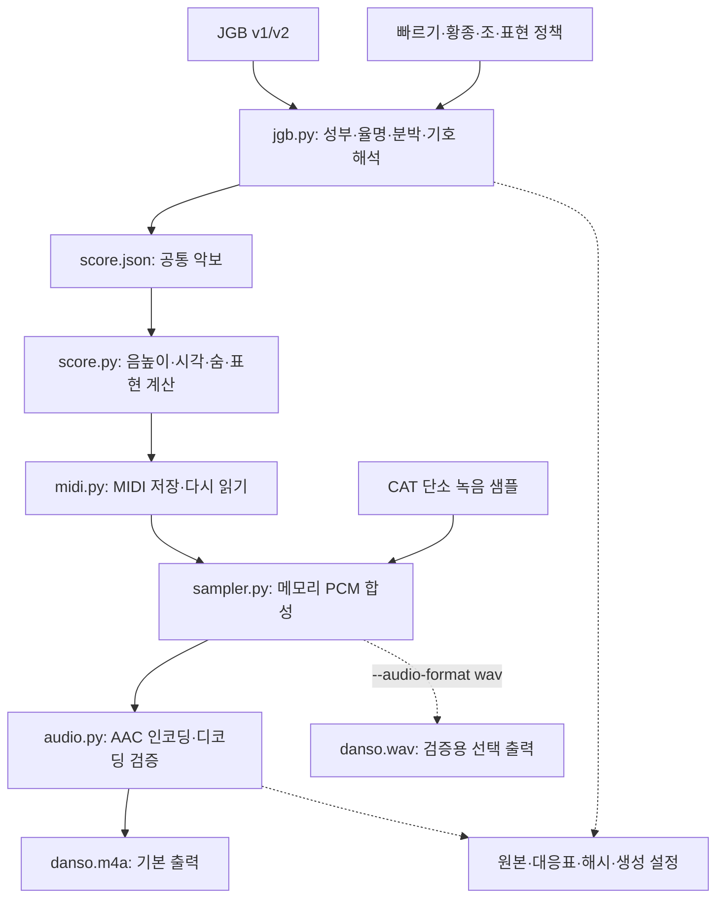

# JGB·공통 악보 JSON의 MIDI·CAT·M4A 생성

JGB v1·v2 또는 공통 악보 JSON(`gugak-reviewed-score/v1`)을 해석해 MIDI를 저장하고, 선택한 CAT 악기 샘플로 합성한 PCM을 **AAC-LC 192kbps 목표의 M4A**로 저장하는 로컬 CLI입니다. 중간 WAV 파일을 만들지 않으며, WAV가 필요할 때는 `--audio-format wav`를 선택합니다. [105](https://ssafy.atlassian.net/browse/S15P31E102-105)의 재생 기반에 [166](https://ssafy.atlassian.net/browse/S15P31E102-166)의 단소 JGB·M4A와 [108](https://ssafy.atlassian.net/browse/S15P31E102-108)의 소금 해석을 더했습니다. [106](https://ssafy.atlassian.net/browse/S15P31E102-106)의 정악대금과 [107](https://ssafy.atlassian.net/browse/S15P31E102-107)의 산조대금도 같은 공통 엔진을 사용합니다. 아래 그림은 단소 출력의 예이며 악기별 프로필과 표현표를 선택합니다.

담당 범위: 박찬형은 **JGB를 바탕으로 정석 음원을 제작**하고, 사지한은 **채점·AI 평가**를 담당합니다(2026-10-27 사용자 확인). 이 도구는 그 제작을 위한 재생 기반이며, 생성 성공이나 자동 테스트 통과만으로 원보 판독·정석 연주 품질의 검수가 끝난 것은 아닙니다.



`__main__.py`가 입력 악보 하나의 변환 전체를 연결합니다. 기본 출력과 검증용 출력은 각각 다른 폴더에 생성합니다.

`expressions.py`와 `tempo_repeat.py`는 **JGB → score 내부의 보조 모듈**입니다. 최종 `score.json`에는 표현·빠르기·반복이 이미 반영되며 이후 MIDI → CAT PCM → M4A 흐름은 같습니다.

| 모듈 | 책임 |
| --- | --- |
| `jgb.py` | JGB 문자열·성부·각/정간/분박 해석, 원문 위치·음표 ID·지속 대상 연결 |
| `expressions.py` | 음형·별칭·미지원 사유, 농음/흘림/풀어내림 등의 효과, 꾸밈·숨·늘임 정책, 표현 프로필 검증과 적용, 자동 떨림 설정값 |
| `tempo_repeat.py` | 명시한 빠르기 계획 적분·반복 전개·시간/반복 ID 계산. 짧아진 숨의 예산은 표현 모듈 호출 |
| `score.py` / `midi.py` | 범용 score 검증·이벤트 계산 / MIDI 제어 메시지 생성과 재읽기 |

호출은 `convert_jgb()` → 표현 정책 적용 → 계획이 있을 때 `apply_tempo_repeat()` → 최종 score 반환 순서입니다. 코드·테스트 파일은 `tempo_repeat`로 통일합니다. 기존 입력을 계속 읽도록 CLI 옵션 `--performance-plan`, JSON schema `danso-performance/v1`, 출력 파일 `performance-plan.json`과 대응표의 `performance` 키는 유지합니다.


`.jgb.json`을 `--score`에 직접 넣을 수 있습니다. 한 번에 악기 하나와 성부 하나를 선택하며 사진 인식·웹 API·합주·연주 녹음 채점은 포함하지 않습니다.

## 서비스 공통 악보 v1 입력 (338)

`schemaVersion: 1`의 B2 JSON은 `gugak-reviewed-score/v1` 재생 내부 JSON과 구분합니다. 원본 JSON을 그대로 넣고 `music.bpmUnit` 기준 BPM을 명시합니다. 아리랑은 세마치 기준 데이터의 점4분음표96 BPM을 사용합니다.

```powershell
.\data\.venv\Scripts\python -m data.src.playback --score data/tests/fixtures/scores/ngc-standard-2022-p173.score.json --common-bpm 96 --instrument danso --assets assets.json --out data/processed/playback/arirang
```

- `common_score.py`가 스키마·표시 자리·이벤트 시간/음높이 일치를 검증한 뒤 기존 재생기로 전달합니다. `jsonschema`도 requirements에 포함됩니다.
- BPM·조율을 장단명이나 악기 기본값으로 추측하지 않습니다. QUARTER는1, DOTTED_QUARTER는3/2 quarter로 길이와 BPM을 함께 환산합니다. JEONGGAN/JANGDAN_BEAT는 전송상 1박=1quarter이며 서양 표기 음가를 확정하는 의미가 아닙니다.
- `--instrument`는 원본 instrument와 같아야 합니다. 명시한 기존 `--transpose`만 이조하며 대응표에 기록합니다.
- `source.common.json`은 원본 바이트, `source-map.json`은 버전·출처·조율·BPM·원본 tick/초·NOTE 번호·모든 표시 자리 대응을 보관합니다. `score.json`은 재생 IR입니다. MIDI만 분리하면 ID 대응을 잃습니다.
- release를 NOTE 길이 안에 넣어 쉼을 보존합니다. 숨표는 기존120ms 목표/최대 반길이 정책을 적용합니다. 합쳐진 지속 이벤트를 다시 나누거나 같은 음의 별도 이벤트를 합치지 않습니다.
- 기본 모드에서 비어 있지 않은 `sigimsae`는 명시적으로 중단합니다. 아래 교육용 미리듣기 모드를 선택하면 등록 기호에 기본 근사값을 적용합니다. v1 배열만으로는 장식의 원래 위치·조를 복원할 수 없습니다. rejected 원본, 불일치 표시, 미지원 MIDI 시간 분할·음역도 실패합니다.
- 악보길이와 파일길이는 다릅니다. 이 아리랑의 악보는30초이며 기존 MIDI의 reset/EOT 여백 약550ms가 파일에 추가됩니다. 입력 reviewed는 합성 연주의 전문가 검수 완료가 아닙니다.

상세 범위와 검증 기준은 [338 스펙](../../../docs/specs/common-score-playback.md), 실행 증거는 [작업 기록](../../../docs/plans/S15P31E102-338.md)을 따릅니다.

생성한 실제 PCM을 원본과 독립 비교하려면 다음 명령을 사용합니다. M4A의 FFmpeg/ffprobe 옵션, 관측 기준·범위 및 실제61음 측정값은 [파형 검증 기록](../../../docs/knowledge/data/common-score-audio-verification.md)을 따릅니다.

```powershell
.\data\.venv\Scripts\python -m data.src.playback.verify_common --score data/tests/fixtures/scores/ngc-standard-2022-p173.score.json --bpm 96 --audio data/processed/playback-338/arirang-wav/danso.wav --out data/processed/playback-338/verify-wav.json
```

### 모든 등록 시김새의 교육용 미리듣기

```powershell
.\data\.venv\Scripts\python -m data.src.playback --score data/tests/fixtures/scores/common-preview-study.score.json --common-bpm 60 --notation-policy educational-preview/v1 --instrument danso --assets assets.json --audio-format wav --out data/processed/playback/preview-study
```

단소·소금·정악대금·산조대금의 기존 악기별 규칙을 우선 사용하고, 미확정 음열·효과에는 버전이 있는 교육용 선택값을 채웁니다. `--instrument`는 입력 악기와 같아야 합니다. 이 모드는 정석 연주나 전용 격음 샘플 확보를 뜻하지 않습니다. [정책·기호별 수치·호환성 설명](../../../docs/knowledge/data/common-score-expression-preview.md)을 먼저 확인하세요.

- 별도 위치 파일은 `--common-expressions expressions.json`으로 지정합니다. 형식은 `common-score-expressions/v1`, 원본 `sourceSha256`, 원본 기호 전체의 `placements`입니다. 기존 v1 원본을 고치지 않습니다.
- 위치 파일이 없으면 이벤트 첫 표시 자리에 적용하고 `event-origin-inferred`로 기록합니다. 조 미지정 시 교육용 황종계면 기본값을 명시합니다. 기호 오타·원본/배치 불일치·상충 표현은 오류입니다.
- `performance.common.json`은 실제 음원 SHA와 원본 SHA에 묶인 표시 자리별 수행 시간표입니다. 늘임·길이표·반복을 적용한 시간으로 화면을 진행시킬 때 사용합니다. 원본 `events`는 저장·채점에 계속 사용합니다.
- `source-map.json`에는 기존 본음 기준 대응표와 펼친 표현/근거/추정 위치를 함께 남깁니다. 단독 MIDI만으로는 이 정보를 복원할 수 없습니다.
- 직접 JGB 입력은 파일에 `playback.notation_policy: "educational-preview/v1"`을 지정합니다. 직접 JGB의 반복은 기존 `--performance-plan`으로 범위를 명시하고 길이표 짝 규칙을 유지합니다. 공통 입력의 기본 반복/길이표 정책과 구분합니다.

## 설치와 빠른 검사

저장소 루트에서 Python 3.10 이상으로 별도 가상환경을 만듭니다. 아래 명령은 PowerShell 기준입니다.

```powershell
python -m venv data/.venv
.\data\.venv\Scripts\python -m pip install -r data/src/playback/requirements.txt
.\data\.venv\Scripts\python -m unittest discover -s data/src/playback/tests -p "test_*.py" -v
```

작은 고정 악보와 합성 신호를 사용하는 검사이며 CAT 파일·모델·서버·네트워크가 필요하지 않습니다. 아래 169개는 테스트 메서드 수이며, 검수한 곡 수나 원보 인식 정확도가 아닙니다. 각 테스트의 입력과 확인 내용은 [테스트별 설명](tests/README.md)에 정리합니다.

| 파일 | 대응 구현 | 개수 | 확인 범위 |
| --- | --- | ---: | --- |
| `test_jgb.py` | `jgb.py` | 52 | 구문·기호·분박·지속·악기별 음열·빠르기 선택·원문 대응 |
| `test_score.py` | `score.py` | 17 | 공통 악보 검증·소금 음역·옥타브·요성 시작 시점·이벤트 생성 |
| `test_midi.py` | `midi.py` | 12 | MIDI 제어 메시지·단소 자동 떨림·소금 명시 표현 |
| `test_sampler.py` | `sampler.py` | 18 | 합성 PCM의 주파수·위상·무음·악기별 지속·샘플 확장 |
| `test_audio.py` | `audio.py` | 4 | PCM 출력·프로세스 오류·실제 AAC 시간 정렬 1개 |
| `test_pipeline.py` | `__main__.py` 및 모듈 연결 | 24 | score→MIDI·JGB→PCM·CLI의 출처/실패 보존·실제 M4A 전체 변환 1개 |
| `test_expressions.py` | `expressions.py` | 12 | 악기별 표현 정책·음형·꾸밈/숨 시간·프로필 검증 |
| `test_tempo_repeat.py` | `tempo_repeat.py` | 14 | 악기별 계획·빠르기 적분·반복·원문 위치·숨표 예산 |
| `test_common_score.py` | `common_score.py` / CLI | 7 | 서비스 v1·표시/이벤트 참조·조율·BPM·쉼·숨·미지원 오류 위치 |
| `test_verify_common.py` | `verify_common.py` | 9 | 독립 파형 관측기와 반음·쉼·내부 단절·종료 잔음 반례 |

파일은 주된 검증 대상 모듈을 기준으로 나눕니다. 여러 단계의 연결은 `test_pipeline.py`에서 검사하며, 고정 입력·합성 샘플 헬퍼는 `_helpers.py`에서 공유합니다. 테스트 파일끼리는 import하지 않습니다.

PDF에서 농음표와 풀어내림표를 구별하거나, 수정한 JGB를 원보·동일 판본의 실연과 대조하는 검사는 없습니다. 예를 들어 풀어내림 테스트는 **구현한 농음+하행 곡선**을 확인하고, 빠르기 테스트는 **값을 명시적으로 선택했는지** 확인합니다. 선택한 곡선·BPM 자체의 음악적 정답 여부를 인증하지 않습니다. 실제 CAT 뱅크를 사용한 수동 생성 결과와 원보 재대조의 한계는 [근거 문서](../../../docs/knowledge/data/danso-expanded-auditions.md)에 따로 기록합니다.

M4A 생성과 실제 코덱 검사에는 **FFmpeg와 ffprobe**가 필요합니다. [공식 다운로드 안내](https://ffmpeg.org/download.html)의 OS별 배포본을 준비합니다. 프로그램이 자동 설치하거나 PATH를 바꾸지는 않습니다. PATH에 있으면 바로 사용하고, 경로를 직접 지정하려면 단일 명령에 `--ffmpeg C:/tools/ffmpeg/bin/ffmpeg.exe --ffprobe C:/tools/ffmpeg/bin/ffprobe.exe`를 붙입니다. 검사와 실행에 공통으로 사용할 환경변수도 지원합니다.

```powershell
$env:FFMPEG_BINARY = 'C:/tools/ffmpeg/bin/ffmpeg.exe'
$env:FFPROBE_BINARY = 'C:/tools/ffmpeg/bin/ffprobe.exe'
.\data\.venv\Scripts\python -m unittest discover -s data/src/playback/tests -p "test_*.py" -v
```

실제 설치 위치로 바꿉니다. 두 실행 파일이 없으면 M4A 통합 검사 2개는 건너뛰고 나머지 검사는 실행합니다. M4A 변경을 병합하기 전에는 이 검사도 실행해야 합니다. WAV 선택 출력은 FFmpeg가 필요하지 않습니다.

## 실제 단소 음원 생성

[CAT 국악 라이브러리](https://www.catseoul.com/gugak-library/)의 단소 Live Sampler v1.3 ZIP을 로컬에 준비합니다. 아래 내용을 Git 밖의 `assets.json`으로 저장하고 `danso` 값을 실제 ZIP 경로로 바꿉니다. 상대 경로는 assets JSON의 폴더 기준입니다. ZIP·원본 악보·생성 음원은 저장소에 넣지 않습니다.

```json
{"danso": "C:/local-gugak/GUgAK-DEMO DanSo Live Installer v.1.3.zip"}
```

```powershell
.\data\.venv\Scripts\python -m data.src.playback --score data/src/playback/examples/seryeongsan-first-jangdan.json --assets C:/local-gugak/assets.json --instrument danso --out data/processed/playback/seryeongsan-fixed25
```

단소의 추가 떨림은 **±25cent로 고정**하며 별도 선택 옵션이 없습니다. 소금·정악대금·산조대금에는 이 자동 떨림을 추가하지 않습니다. 이전 `--vibrato` 인자는 명령에서 제거합니다. 원본 CAT 샘플에 녹음된 흔들림은 그대로 남습니다. `--transpose`는 명시적인 반음 이동이고 기본0입니다. 자동 옥타브 보정·편곡은 하지 않습니다. 등록 프로필은 단소·소금·정악대금·산조대금이며 `--instrument all`은 공통 score 입력에서 등록된 프로필 전체를 뜻합니다. JGB에서는 `--instrument danso`, `sogeum`, `jeongak-daegeum`, `sanjo-daegeum` 중 하나를 선택합니다.

출력 폴더에는 `danso.mid`, **`danso.m4a`**, 해석·샘플 추적 `danso.json`, 입력 사본 `score.json`, 재현 정보 `manifest.json`이 생성됩니다. M4A는44.1kHz·mono·AAC-LC이며 목표 비트레이트는192kbps입니다. 실제 비트레이트는 인코더와 음원에 따라 달라지며 결과에 따로 기록합니다. PCM을 메모리에서 인코더 stdin으로 전달하므로 중간 WAV를 저장하지 않습니다.

WAV가 필요한 경우 같은 명령에 `--audio-format wav`를 추가하고 새 `--out`을 지정합니다. WAV는 기존44.1kHz·mono·PCM16입니다. 출력 폴더에 반대 형식의 음원이 있으면 이전 파일을 삭제하지 않고 작업을 거부합니다. 인코딩·디코딩 검사까지 임시 폴더에서 성공한 뒤 결과를 공개하므로 인코더 실패 시 이전 산출물을 보존합니다.

`danso.json`의 `audio.file/format/codec/sha256/bytes`는 실제 생성 파일을 가리킵니다. `frames/seconds`는 합성 PCM 기준이고 `container_seconds`는 M4A 재생 길이, `decoded_frames/end_padding_frames`는 다시 디코딩한 길이와 AAC 끝 패딩입니다. 재생 시작0·표시 길이 오차2샘플 이내·디코딩 끝 패딩1024샘플 미만·유한값·피크를 검사합니다. `manifest.audio_output`에는 FFmpeg·ffprobe 버전을 남깁니다. 이 검사는 청감상 원본과 동일하다는 판정이 아닙니다.

## 단소 JGB 파일에서 생성

같은 설치·CAT 준비를 마친 뒤 저장소 루트에서 실행합니다. 원본과 다른 출력 폴더를 사용합니다.

```powershell
.\data\.venv\Scripts\python -m data.src.playback --score C:/local-gugak/song.jgb.json --assets C:/local-gugak/assets.json --instrument danso --out data/processed/playback/song
```

- v1의 `melody`, v2의 `parts[].melody`를 읽습니다. 여러 성부면 `--part 1`처럼 1부터 번호를 지정해야 합니다. `activePart`는 편집 위치라 자동 선택에 쓰지 않습니다.
- `controls.tempoBpm`은 **정간/분**입니다. 숫자만 있으면 기본값일 수 있으므로 **최상위 `tempoBpmUserSet: true` 또는 명시적인 `--bpm 60`**이 있어야 변환합니다. 플래그는 사용자가 재생 빠르기를 직접 선택했다는 편집 상태이며, 음악적 근거의 검증 완료를 뜻하지 않습니다. false·누락은 중단하며 문자열 `"true"`도 거부합니다. 장단명·`--speed`·표시용 `tempoBpmGak`으로 대신 확정하지 않습니다.
- `--speed 0.75`는 선택된 빠르기에 적용할 배율입니다. 정간을 4분음표로 환산할 때 길이와 BPM에 같은 비율을 적용합니다. `dotted=3/2`, `plain=1`, `eighth=1/2`; `auto`·누락은 기본각이12정간이면 `eighth`, 나머지는 `dotted`입니다. 이 구형 입력 호환 선택도 대응표에 기록합니다.
- 황종은 `hwangPitch`를 사용하며 `--hwang-midi 63`으로 지정할 수 있습니다. BPM·황종이 없으면 자동으로 추측하지 않습니다. `tempoBpmGak`은 표시용이므로 재생 속도로 쓰지 않습니다.
- 한글 율명·청/중청/배/하배, 같은 각 안의 빈칸·`-`·`{빈지속}` 연장, 쉼·쉼표, 숨표`<`를 지원합니다. 같은 율명을 다시 적으면 새로 발음합니다. 각 첫 연장은 쉼이며 각 정간 수·분박 분할이 잘못되면 실패합니다.
- 공식 단소 교육자료의 장식부호12종·율명 대용부호12종을 지원합니다. 나니로/나니르·로니로·느로니르·니레나·니느라니·느나니나·느나르나니 등을 포함하며 [전체 음열·별칭·근거](../../../docs/knowledge/data/danso-expanded-auditions.md#단소-기호-대조)를 따릅니다. 상대음에는 명시한 `joPreset` 또는 `--jo jung-pyeong` 등이 필요합니다. 새로 지원한 니느라니·느나르나니는 우물사이의 음열과 달라 공식 교육자료 기준을 `symbol_policy`에 기록합니다.
- 기존 니로·노리노·느나·같은음표 외에 니루니·느네느·네로나도 기호 사전의 음열을 받습니다. 떠이어표는 공식 임→무→임 예시에 한해 지원하며 다른 율명에는 실패합니다. `{한글 이름}`과 대응 registry ID를 받되 공식 자료에서 추가한 로니로·느니르나니 등의 이름은 문서의 별칭표를 따릅니다.
- 꾸밈은 각각 최대 `1/16 quarter`·velocity80입니다. 짧은 분박에서는 같은 tick 길이로 줄여 본음에 자리 절반 이상을 남깁니다. 음열은 본음 자리를 균등 분할하고 연결합니다. `<`의 목표 공백은120ms이며 release를 합친 단축량을 마지막 음 길이의 절반으로 제한합니다. 다음 음의 시작·전체 장단 길이는 유지합니다.
- 농음표·떠는표는 음량 요성4Hz·depth0.08, 흘림표·미는표는 음 말미30%(최대200ms)에 각각50cent 하강·상승합니다. **풀어내림표(`vib-long`)**는4Hz·±25cent 음높이 농음과 말미60%(최대600ms)의50cent 하행을 결합합니다. 수치는 청취용 근사값이며 실제 도착음·운지·음색의 재현을 보증하지 않습니다. pitch 농음에는 기존 자동25cent 떨림을 중복 적용하지 않습니다.
- 끊는표는 release를 포함해 음 길이의 절반만 발음합니다. 숨표와 종료 예산을 공유하며 앞 음의 잔향도 예정 무음을 침범하지 않게 줄입니다. 늘임표는 표시된 자리의 연주시간을2배로 늘려 이후 음의 시작도 미룹니다. 공식2~3배 범위 중 선택한 값이며, 대응표에 원문 시간과 연주 시간을 분리합니다.
- 같은 각의 지속은 마지막 본음을 연장하고 뒤꾸밈을 끝으로 미룹니다. 지속 위 농음·풀어내림은 표기 위치 전에는 시작하지 않습니다. 중복 음높이 곡선, 끊기와 지속/장식음열의 모호한 결합은 새 음으로 분리하도록 오류를 냅니다. 덧길이·반길이(`len-double`/`len-half`)는 짝을 이루어 정간 시간을 보존해야 합니다. 원문점은 의미 미확정 주석으로 보존합니다.
- 특강표는 강세 근사로 재생합니다. 요성표/겹요성표·겹흘림·추성/퇴성은 아래 표현 프로필에 수치와 근거를 명시합니다. 겹미는표는 상류 ID가 확인되지 않은 로컬 입력 확장이며 별도로 기록합니다. 격음·내림/하성·꺾는음은 운지·기호 대응·조 문맥 또는 전용 샘플이 더 필요합니다. 이를 강세·퇴성으로 바꾸지 않습니다. 소리 미상/추정인 느니라·나니르노니르·노라느니, 한자 율명·장구 반주·합주는 지원하지 않습니다.

긴 지속·늘임은 원 샘플 안에서 상관도·음높이·음량이 안정적인 구간을 찾고 crossfade로 연장합니다. 기존 네 후보가 모두 실패할 때만10~94% 지점을2% 간격으로 추가 탐색하며 품질 기준은 같습니다. 검사에 실패한 샘플은 중단합니다. `danso.json`의 `render_trace[].sustain_loop`에 실제 구간과 검사값을 남깁니다. 이미 샘플 길이 안에 들어가는 음은 기존 경로를 유지합니다.600초는 메모리 보호 기본값이며 `--max-duration-seconds 1200`처럼 늘릴 수 있습니다. 환산 quarter BPM은 MIDI Set Tempo의 실제 표현 범위로 검사합니다.

## 소금 JGB 파일에서 생성

`assets.json`에 `"sogeum": "로컬 CAT 소금 v1.3 ZIP 경로"`를 추가합니다.

```powershell
python -m data.src.playback --score data/src/playback/examples/sogeum-jgb.json --instrument sogeum --assets assets.json --out data/processed/playback/sogeum-example
```

소금도 같은 `jgb → score → MIDI → CAT PCM → M4A` 흐름을 사용합니다. 원본의 `instrument/ornInstrument=sogeum` 또는 판본 근거를 적은 `playback.instrument="sogeum"`·`instrument_basis`가 필요합니다. 후자는 악기 누락/`all`에만 사용하며 명시된 다른 악기를 덮어쓰지 않습니다. `tempoBpmUserSet:true` 또는 `--bpm`도 필요합니다. 음높이는 실음이며 자동 +12를 하지 않습니다. 기술 음역70–96, 정악 관행70–92를 구분합니다.

`expressions.py`에서 소금 교재의 네로나·니르나니 음열과 나니르노니르의 앞꾸밈5음을 적용합니다. 기호 이름만 같다고 단소 음열을 공유하지 않습니다. 느네느·느니르 등 대응이 불명확한 경우는 오류로 중단합니다. 정확한 기호표·한글 입력 확장·남은 제약은 [소금 근거](../../../docs/knowledge/data/sogeum-playback.md)를 따릅니다.

소금 JGB의 농음·흘림·미는·풀어내림에는 `playback.expression_policy`의 `name`, `basis`, `status="audition-policy-not-performance-standard"`와 해당 수치가 필요합니다. `vibrato`는 `mode`, `hz`, `delay_seconds`와 방식에 맞는 `cents`/`depth`, `fall`/`push`는 score의 `pitch_curve`, `unwind`는 `yoseong`과 `pitch_curve`를 갖습니다. 수치·기호 해석은 입력 작성자의 명시적 선택이며 소금 공인 표준으로 간주하지 않습니다. 예시는 근거 문서에 있습니다.

선택한 빠르기·반복 계획은 `sogeum-performance/v1`, 별도 표현 프로필은 `sogeum-expression-profile/v1`을 사용합니다. 필드·원본 해시 검사는 아래 단소 예와 같습니다. 끊기·늘임·꾸밈·숨표의 공통 재생 선택값과 기본 특강표 수치도 대응표에 남깁니다. 소금의 긴 음은 실제 샘플에서 검증된 안정 구간을 사용하며 실패하면 중단합니다. 단소용 연결 시작점100ms는 적용하지 않습니다.

## 산조대금 JGB 파일에서 생성

`assets.json`에 `"sanjo-daegeum": "로컬 CAT 산조대금 v1.3 ZIP 경로"`를 추가합니다.

```powershell
python -X utf8 -m data.src.playback --score data/src/playback/examples/sanjo-authored.jgb.json --instrument sanjo-daegeum --assets assets.json --out data/processed/playback/sanjo-example
```

명시된 산조 성부 또는 판본 근거가 있는 `playback.instrument="sanjo-daegeum"`·`instrument_basis`를 사용합니다. 근거 있는 준비 입력만 악기 누락·`all`·일반 `daegeum`을 산조로 구체화할 수 있습니다. 다른 악기나 정악대금을 산조로 덮어쓰지는 않습니다. 빠르기 선택 검증·원본 보존은 공통 규칙을 따릅니다. 관종별 실연 음역은 미확정이고 CAT simple 원 프리셋은 MIDI60–91, 검증된58/59 확장을 포함한 유효 샘플 범위는58–91입니다. 지원 밖은 실패하며 자동 이조하지 않습니다.

일반 대금 교재에서 확인한 니레·니라·노니로 등의 제한된 음열만 산조표에 등록합니다. 네로나·니느라니·느나르나니·떠이어표 등 정악·소금의 복합음형을 자동 상속하지 않습니다. 농음·흘림·미는·풀어내림은 명시적 `expression_policy`가 필요하며 산조 원보의 특정 글리프 판독이나 유파별 표준 수치로 간주하지 않습니다. 세부 지원표와 근거는 [산조대금 문서](../../../docs/knowledge/data/sanjo-playback.md)를 따릅니다.

빠르기·반복은 `sanjo-daegeum-performance/v1`, 별도 표현은 `sanjo-daegeum-expression-profile/v1`을 사용합니다. 긴 음은 검증된 샘플 구간을 연장하고, 안정 구간이 없으면 실패합니다. MIDI86도 앞부분의 검증된 안정 구간을 찾아15초 지속을 생성합니다. 원 산조 프리셋60~91과 구분하여, 같은 ZIP의 검증된 WAV와 정악 프리셋 설정을 명시한58/59 확장을 지원합니다. 원본 음높이·황종·옥타브는 바꾸지 않고, 사용한 확장·원래/유효 키존·출처와 샘플 해시를 manifest/trace에 남깁니다. 단소 전용 연결 시작점100ms는 적용하지 않습니다. 정악·산조 CAT가 공통67개 WAV를 사용한다는 경고를 출력에 보존합니다.

## 명시적 연주 계획과 표현 프로필

원본 `instrument=all`은 단소 판정이 아닙니다. 단소 자료임을 확인했을 때만 `--assume-danso`를 붙이며 선택 이력을 남깁니다. 다른 악기 이름은 이 옵션으로 덮어쓰지 않습니다.

곡 중간의 빠르기·반복은 `--performance-plan plan.json`으로 지정합니다. 아래 파일의 `input_sha256`에는 **실제 원본 파일 바이트**의 SHA256을 넣습니다. 기본 빠르기 선택 검사는 그대로 필요합니다. `bpm`은 정간/분이고 `times`는 최초 연주를 포함한 횟수입니다.

```json
{
  "schema": "danso-performance/v1",
  "input_sha256": "원본 파일의 SHA256",
  "tempos": [
    {"gak": 2, "cell": 1, "bpm": 80},
    {"gak": 3, "cell": 1, "bpm": 60, "end_gak": 4, "end_cell": 1}
  ],
  "repeats": [{"start_gak": 1, "end_gak": 4, "times": 2}]
}
```

첫 빠르기는 해당 정간부터 즉시 적용하고, 두 번째는 시작점의 빠르기에서 목표60까지 원문 정간 위치에 따라 선형 변화합니다. 다음 정간의 시간은 변화 구간을 적분해 계산합니다. 이는 선택 가능한 재생 방식이며 실연의 유일한 해석이 아닙니다. 반복 구간은 각 단위이며 중첩·겹침과 음/꾸밈을 자르는 경계는 거부합니다. 반복된 음에는 새 ID와 원본 위치를 함께 남깁니다.

JGB의 `{조금느리게}`·`{조금속하게}`·`{점점느리게}`·`{점점속하게}`는 숫자가 없으므로 해당 위치의 계획을 요구합니다. 점점 기호는 끝 위치도 필요합니다. `{본래속도로}`는 원래 선택 BPM으로 복귀합니다. 기호 뒤 `@100,0,0`은 배치값이므로100 BPM으로 읽지 않습니다. `{repeat}`는 같은음 대용부호이고 `||`는 각 경계이며 구간 반복으로 바꾸지 않습니다.

표현 수치는 `--expression-profile profile.json`으로 명시합니다. 아래는 **기능 설명용 선택값**이며 단소 표준값이 아닙니다. `basis`에는 판본·실연·연습용 선택 등 실제 근거를 적습니다.

```json
{
  "schema": "danso-expression-profile/v1",
  "policies": {
    "shake": {"basis": "연습용으로 선택한 음높이 요성", "yoseong": {"mode": "pitch", "hz": 4, "cents": 80, "delay_seconds": 0}},
    "bend-down": {"basis": "연습용으로 선택한 하행 곡선", "pitch_curve": {"points": [[0, 0], [0.7, 0], [1, -150]]}}
  }
}
```

`points`의 첫 값은 효과 구간 내 위치0~1, 둘째는 기준음 대비cent입니다. 음량/음높이 요성의 방식·깊이·주파수와 여러 번 움직이는 곡선을 명시할 수 있습니다. 이 수치 기능이 깊은/얕은 요성 글리프나 산조 꺾는음의 자동 판독을 뜻하지는 않습니다. 기본 특강표도 세기110·CC11 강약을 사용한 합성 선택값이며 격음의 지공 조작을 대신하지 않습니다.

계획·프로필은 로컬 CLI 설정이며 FE·AI·BE 공유 계약을 바꾸지 않습니다. 제공된 파일의 원본 바이트와 해시는 출력의 `performance-plan.json`, `expression-profile.json`, `manifest.configuration_sha256`에 보존합니다. 결과는 임시 폴더에서 검사한 뒤 폴더 단위로 교체하고 교체 실패 시 이전 묶음을 복구합니다. 다른 개인 파일이 든 출력 폴더는 거부하며 프로세스 강제 종료·전원 손실까지 보장하는 트랜잭션은 아닙니다.

JGB 입력에서는 원본 바이트 사본 `source.jgb.json`과 `source-map.json`이 추가됩니다. `score.json`은 변환된 공통 악보이며 원본과 구분합니다. `danso.json`의 `events[].parent_ids`를 대응표의 `notes` 키로 찾으면 성부 원본 ID·각·정간·분박·문자 범위와 연장된 칸을 확인할 수 있습니다. 대응표의 `written_*_quarters`는 원문 자리 시간, `start_quarters`·`duration_quarters`·`total_quarters`는 늘임표를 반영한 연주 시간입니다. 실제 발음/꾸밈 시각은 `events`에 있습니다. 문자 범위는 **0부터 세는 Unicode 문자 위치·끝 제외**이며 JavaScript UTF-16 위치와 구분합니다. manifest에 원본·변환본·대응표·소스 해시와 선택한 템포·배율·기호 정책을 기록합니다. `tempo_selection.kind`는 `jgb-user-set` 또는 `cli-override`이며 음악적 근거는 `not-verified`입니다. JGB 결과 폴더를 공통 악보 JSON 입력에 재사용하면 이전 대응표가 남지 않도록 거부합니다.

## 공통 악보 JSON 입력

입력은 단선율 음표·쉼표를 순서대로 나열합니다. 예제는 세령산 첫 장단37개 입력을 꾸밈 확장 후44개 MIDI 음으로 만듭니다. 이 숫자는 인식 정확도가 아닙니다.

| 필드 | 현재 코어의 의미 |
| --- | --- |
| `schema` | `gugak-reviewed-score/v1`. 이름과 별개로 원보 검수 상태를 명시 |
| `source` | 판본 `edition`, `manually-transcribed-unverified`·`machine-transcribed-unverified`·`source-review-unverified` 상태. JGB 입력의 원보 검수 상태는 추정하지 않음 |
| `context` | `sounding` 실음 MIDI, `written` 명시 옥타브 이동, 또는 `yul`의 황종 MIDI+율명/register. 스타일·조율 설명 필수 |
| `quarter_bpm` | 4분음표 기준 BPM. JGB의 주박·정간 단위와 구분 |
| `notes[].id` | 중복 없는 문자열. 장식/붙임줄 처리 후 JSON의 `parent_ids`로 보존 |
| `duration` | 4분음표를1로 하는 양수 유리수. 예: `1`, `1/18`, `3/2`; PPQN14400에서 표현 가능해야 함 |
| `rest` / `tie` / `slur` | 쉼 / 같은 음을 합치는 붙임줄 / 연결 발음. 같은 의미로 처리하지 않음 |
| `ornament` | `grace-before` 또는 `upper-return`. 이웃음 높이 명시. 기본 시가 `1/16 quarter` |
| `breath_seconds` | 음 끝에서 요청 공백+release만큼 차감. 악보 시간은 유지. 직접 작성한 IR 값은 자동 변경하지 않음 |
| `release_seconds` | 기본50ms, 0~50ms를 CC72의0~127로 양자화. 프로젝트 전용 환산이며 일반 MIDI 플레이어의 절대시간 규약이 아님 |
| `gate_fraction` | 0보다 크고1 이하. release 포함 발음 비율. 다음 음 시작과 duration은 유지; 숨과 중복 차감하지 않음. tie/IR ornament와 직접 결합은 거부 |
| `pitch_curve` | `end_cents`, `tail_fraction`, `maximum_seconds`로 명시한 말미 음높이 변화. 선택 `delay_seconds` 이전에는 시작하지 않음; 지연 곡선과 IR ornament는 명시 음으로 분리 |
| `expression` | 시작·45%지점·끝의 CC11 값0~127. 기본 `[127,127,127]` |
| `yoseong` | 명시된 음의 amplitude/pitch/mixed 요성. 단소 정악의 기본은 amplitude |

**MIDI 파일 자체에는 원본 음표 ID를 저장하지 않습니다.** 악기별 JSON의 `parent_ids`와 JGB 입력의 `source-map.json`을 함께 보관합니다. 반복은 명시한 연주 계획으로만 전개하며 여러 성부 합주·임의 시김새 해석은 지원하지 않습니다. 연주 계획 전의 꾸밈·숨표 계산값은 `source_grace_timing`·`source_breath_timing`, 변경 후 음 시간은 `performance.note_times`, 실제 숨표 값은 `score.json`에 구분합니다.

실음 MIDI를 쓰거나 `황종 MIDI + 율명 반음 간격 + register×12`로 음높이를 정합니다. 단소 프로필의 교재 기준 음역은 MIDI66~92입니다. 黃=63이라는 환산 기준과 실제 연주할 옥타브를 구분하며, 범위 밖 음을 자동으로 올리지 않습니다. `tuning_a_hz`는 비교 기준 이동이고 CAT 샘플의 잔여 조율 편차를 자동 교정하지 않습니다.

## 표현 초기값과 한계

- 꾸밈 `1/16 quarter`는 4분음표의1/16입니다. quarter BPM60에서62.5ms이며 일반적인16분음표(`1/4 quarter`)와 다릅니다.
- 명시 요성: 4Hz, ±25cent(pitch/mixed), amplitude depth0.08, 지연250ms, 시작/끝 fade150ms. depth0.08은 충분히 적용된 구간의 CC11 배율92~100%를 뜻합니다.
- 추가 떨림: ±25cent, 650ms 이상 음에4.5Hz·지연220ms·fade-in/out180/160ms. pitch/mixed 요성과는 중복되지 않으며 amplitude 요성에는 겹칠 수 있습니다.
- 직접 작성한 IR의 숨은 미지정0초, 예제는120ms입니다. JGB 숨표는 무음+release를 음 길이의 절반 이내로 조정합니다. 긴 음에서는 기존120ms+50ms를 유지합니다.
- 연결 attack/release20ms, 일반 release50ms, 단소 연결 시 새 샘플의100ms 지점부터 재생합니다. 동일음 연결은 샘플 위치를 이어갑니다.
- 속도 변경 시 꾸밈은 박 비율을 따르고 JGB 숨은 길이에 맞춰 줄어듭니다. 떨림 주기·지연·fade는 초 단위입니다. 곡별 빠르기와 음가 단위를 먼저 확인해야 합니다.

이 값은 교재의 표준이나 채점 허용치가 아닌 실험값입니다. 기호별 적용·근거·남은 검수는 [기존 표현 조사](../../../docs/knowledge/data/score-instrument-playback-pipeline.md)와 [단소 표현·출력 근거](../../../docs/knowledge/data/danso-expanded-auditions.md)에 있습니다. 물리적 호흡·운지에 따른 음색 변화는 재현하지 않습니다. 알 수 없는 기호·조율 문맥 누락·불완전 붙임줄·MIDI 시간 해상도 부족·음역 이탈·안정 구간 없는 샘플 소진은 실패합니다.

## 실제 CAT 검증

이 CLI의 출력은 음원·MIDI·변환/추적 JSON입니다. 목록 일괄 처리·원보 교정·빠르기 조사·HTML 페이지 생성은 포함하지 않습니다. 필요한 빠르기·조·악기와 원보 교정은 입력을 준비할 때 확인합니다.

CAT ZIP을 보유한 개발자가 위 CLI를 실행해 입력37→MIDI44, 원본 ID, manifest/악기별 JSON의 소스·입력·프리셋·샘플 해시, M4A 코덱·길이·피크를 확인합니다. 무음·파형의 정확한 비교가 필요할 때는 WAV 선택 출력을 사용합니다. 재현할 때는 같은 입력·ZIP·속도·코드·인코더 버전을 사용합니다. 작은 합성 검사 통과와 실제 샘플 생성 성공은 전문가의 원보·연주 품질 검수와 구분합니다. 최신 M4A 검증은 [단소 변환 기록](../../../docs/knowledge/data/danso-expanded-auditions.md), 이전 WAV 검증은 [음원과 재현 기록](../../../docs/knowledge/data/score-instrument-playback-pipeline.md#음원과-재현)에 있습니다.

## 정악대금 단일 변환

assets JSON에 `jeongak-daegeum` 키와 CAT 정악 Live Sampler v1.3 ZIP 경로를 등록합니다.

```powershell
python -m data.src.playback --score data/src/playback/examples/jeongak-daegeum-jgb.json --instrument jeongak-daegeum --assets C:/local-gugak/assets.json --out data/processed/playback/jeongak-example
```

예제는 검사용으로 작성한4정간이며 실제 정악곡의 빠르기·표현을 지정한 자료가 아닙니다. JGB의 기종·빠르기 선택을 확인하고, 일반 `daegeum` 입력은 기종을 확인한 `playback.instrument`와 `instrument_basis`가 있어야 합니다. 정악대금도 농음·흘림·풀어내림에 명시 정책을 요구하며, 소금표를 자동 적용하지 않습니다. 기술 음역58–92와 CAT 지원58–89는 별도 검사합니다. MIDI86의 긴 음은 추가 탐색으로 확인한 안정 구간을 연장하며, 기준에 맞는 구간이 없는 샘플은 계속 거부합니다. [정악대금 기호·CAT 제약·검증 기록](../../../docs/knowledge/data/jeongak-playback.md)을 참고하세요.
