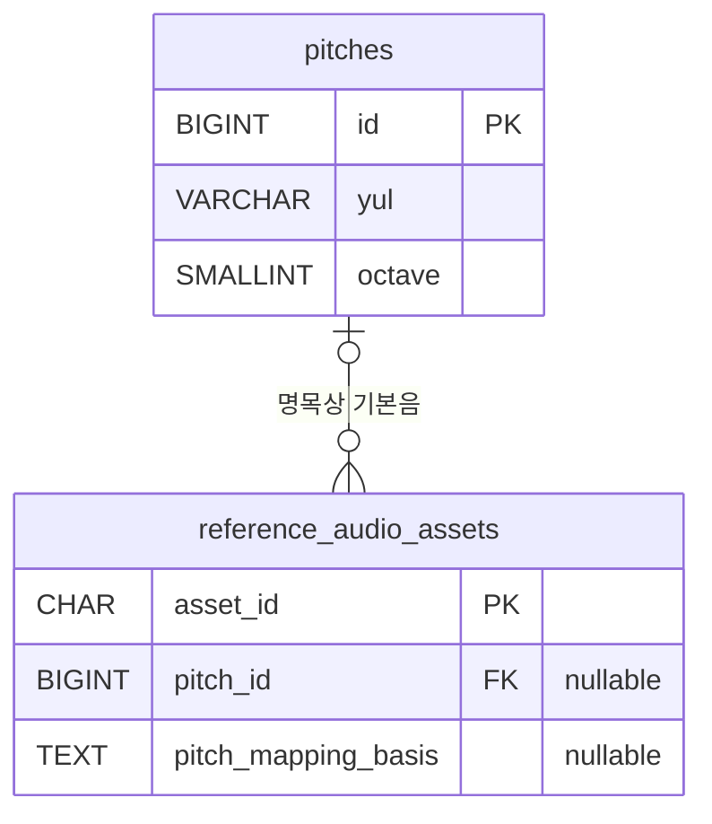
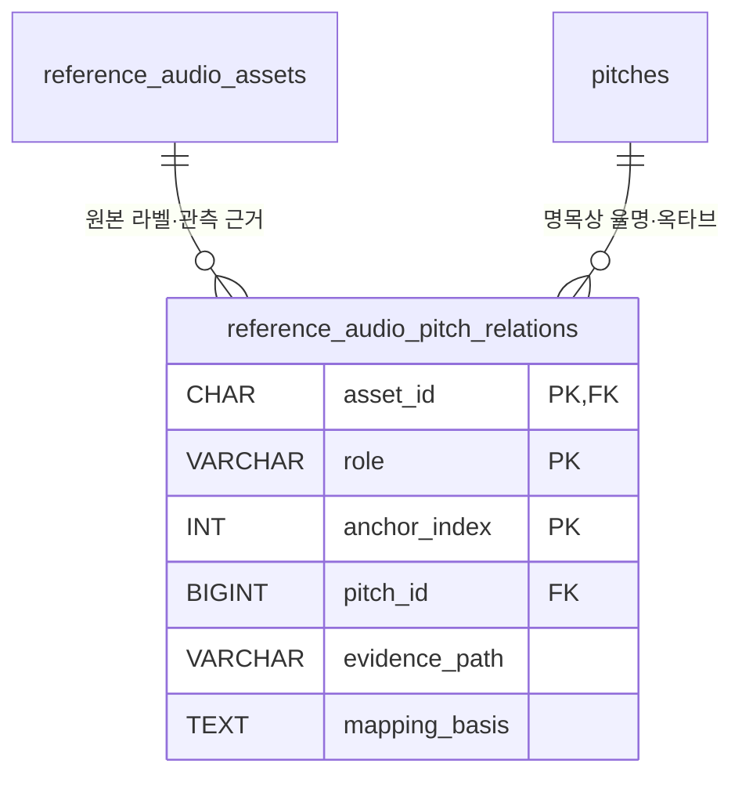

# DB 스키마

- 상태: 초안. [S15P31E102-3](https://ssafy.atlassian.net/browse/S15P31E102-3)에서 설계했고, 1차 MVP API 명세에 맞춘 V2 보완은 [S15P31E102-142](https://ssafy.atlassian.net/browse/S15P31E102-142)([보완안·합의 필요 항목](../plans/S15P31E102-142.md))입니다. V3의 녹음 원본 메타데이터는 [S15P31E102-179](https://ssafy.atlassian.net/browse/S15P31E102-179)(PRA-02 녹음 파일 규격), V4의 분석 시도·실패 코드 제약은 [S15P31E102-173](https://ssafy.atlassian.net/browse/S15P31E102-173)(PRA-03 분석 실패 사유)입니다. 아래 미결 사항이 남아 있습니다.
- 정본: SQL 파일입니다. ERD 그림과 SQL이 다르면 SQL을 따릅니다.

| 대상 | DB | 파일 | 적용 방식 |
| --- | --- | --- | --- |
| 운영 DB | `eolssu` | [V1__initial_schema.sql](../../backend/src/main/resources/db/migration/V1__initial_schema.sql), [V2__auth_user_practice_extensions.sql](../../backend/src/main/resources/db/migration/V2__auth_user_practice_extensions.sql), [V3__practice_session_recording_metadata.sql](../../backend/src/main/resources/db/migration/V3__practice_session_recording_metadata.sql), [V4__practice_session_analysis_attempt.sql](../../backend/src/main/resources/db/migration/V4__practice_session_analysis_attempt.sql), [V5__seed_danso_pitches.sql](../../backend/src/main/resources/db/migration/V5__seed_danso_pitches.sql), [V6__seed_danso_songs.sql](../../backend/src/main/resources/db/migration/V6__seed_danso_songs.sql) | Flyway 마이그레이션. 버전 순서대로 모두 적용한 결과가 정본 |
| 집계 DB | `eolssu_mart` | [data/mart/schema.sql](../../data/mart/schema.sql) | 일 배치 계정으로 직접 실행. 이미 만든 마트는 같은 폴더의 `alter_*.sql`을 한 번 실행 |

## ERD

V10 [카카오 연결 해제 이벤트](../../backend/src/main/resources/db/migration/V10__kakao_unlink_events.sql)은 `oauth_proofs.flow_started_at`·`user_social_accounts.oauth_started_at`과 `kakao_event_receipts`·`kakao_unlink_subjects`를 추가합니다. 이벤트/transaction ID 및 subject의 SHA-256만 새 테이블에 남기고48시간 뒤500개씩 정리합니다. 회원→subject 잠금과 원자적 영수증 처리로 재연결·미완료 티켓·중복을 보호합니다. 회원·기록·refresh 토큰은 건드리지 않습니다. 실제 운영 적용은 별도이며 [296 계약](../specs/kakao-webhook.md)을 따릅니다.

V9 [OAuth 일회용 증명값](../../backend/src/main/resources/db/migration/V9__oauth_one_time_proofs.sql)은 `oauth_proofs`를 추가합니다. state·mergeTicket 원문 대신 SHA-256, 브라우저 결속 해시·제공자·목적·연결 대상·만료·소비 시각을 저장합니다. state와 mergeTicket은10분이며 원자적 조건 갱신으로1회만 소비합니다. 회원을 잠근 후 증명값·연결·refresh를 처리합니다. 회원 삭제를 막는 FK는 두지 않고 완료 처리에서 현재 회원을 재확인합니다. 만료 행은 매분 최대500개 삭제하며 서버 장기 중단 시 재기동 후 정리합니다. 제공자 subject·이메일은 그때까지 서버 내부에만 남습니다. 사용자 승인과 변경 이유는 [211 계획](../plans/S15P31E102-211.md)에 있습니다.

- 원본: [ERDCloud](https://www.erdcloud.com/d/aB9vM5edsqHqmedcE)
- 2026-10-22 기준 내보내기(V1). V2~V5 변경은 아직 그림에 반영하지 않았습니다:

## 테이블 구성

V11 [평가 조율 정보](../../backend/src/main/resources/db/migration/V11__evaluation_tuning_metadata.sql)는 `evaluations.tuning_offset_cent DOUBLE NULL`, `tuning_out_of_range BOOLEAN NULL`을 추가한다(S15P31E102-304). 두 값은 함께 null이거나 함께 존재하며 flag는 0/1이다. 기존 행은 미수집인 null로 남고 점수·음표 판정을 변경하지 않는다. 편차는 AI가 보고한 추정값을 반올림 없이 보존하며, 범위 초과 flag가 true여도 편차를 0으로 바꾸지 않는다. 조회 계약은 [평가 API](../specs/practice-evaluation-api.md)를 따른다. 운영 `ops`는 Flyway를 끄므로 **새 백엔드 배포 전에 V11을 적용**해야 한다. 이전 코드는 새 nullable 컬럼을 무시할 수 있어 코드 롤백 시 컬럼을 지울 필요가 없다.

V16 [내 악보](../../backend/src/main/resources/db/migration/V16__user_sheets.sql)는 `user_sheets`만 새로 만들고 기존 테이블·데이터는 바꾸지 않는다(S15P31E102-390). 운영 `ops`는 Flyway를 끄므로 **내 악보 API를 배포하기 전에 V15 다음 V16을 적용**해야 한다. ERD 그림에는 아직 반영되지 않았다.

V8의 [song_model_audios](../../backend/src/main/resources/db/migration/V8__song_model_audio_metadata.sql)는 `(song_id, score_version)`별 모범 음원 URL·BPM/단위·실제 파일 길이·시작 위치·MIME·SHA-256·게시 상태를 저장한다. DRAFT가 기본이며 초기 데이터는 없다. 기존 곡/연습/평가 데이터와 V1~V7은 변경하지 않는다. 공개 조회와 적재 전 검증은 [카탈로그 API](../specs/catalog-read-apis.md#모범-연주-메타데이터)를 따른다. ERD 그림에는 아직 반영되지 않았다.

S15P31E102-339의 후속 전환에서는 모범 음원의 원본 위치를 `object_key`로 저장하고 앱 재생 URL은 서버가 발급한다. 수행 시간표는 `performance_object_key`와 `source_common_sha256`으로 같은 공통 악보 판본에 연결한다. `generation_metadata`에는 생성·임시 난이도·권리 상태 근거를 보존하며 사용자용 곡 설명과 분리한다. V15 직후에는 `audio_url`이 nullable 호환 컬럼으로 남지만 새 코드는 사용하지 않는다. 객체 키 BE 배포를 확인한 별도 후처리 도구가 이 컬럼을 삭제하며, 최종 스키마에는 저장 URL이 없다. V15 checksum과 Flyway 이력은 보존하고 후처리 receipt로 삭제 단계를 기록한다. 장단 연결은 선택값이며 악기·난이도는 계속 필수다. [실행 범위와 전환 순서](../specs/model-audio-catalog-load.md)를 따른다.

| 영역 | 테이블 | 설명 |
| --- | --- | --- |
| 기준 데이터 | `pitches`, `instruments`, `fingering_charts`, `jangdans`, `songs`, `notation_symbols` | 율명·악기·운지표·장단·곡·기호처럼 운영자가 넣는 데이터. 단소 율명(`pitches`)은 V5, 단소 악기 1개·장단 3개·1차 4곡(`instruments`·`jangdans`·`songs`)은 V6 마이그레이션이 `data/reference/` 값과 변환한 공통 악보 데이터로 넣는다 |
| 사용자 | `users`, `user_song_settings` | V12부터 소셜 전용 가입을 허용해 이메일·비밀번호는 NULL일 수 있으며 닉네임은 유지합니다. 비밀번호가 있으면 이메일도 있어야 합니다(`chk_users_auth_fields`). 가입·약관·소셜 연결·토큰 발급은 한 트랜잭션입니다. 탈퇴를 요청하면 `WITHDRAWAL_PENDING`으로 30일 보관하고, 요청 후 30일 미만에 로그인하면 취소합니다. 회원 잠금 이후의 시각이 만료 정각 이상이면 실제 삭제 여부와 관계없이 취소를 거절합니다. 30일 뒤 일괄 처리에서 개인정보 칸을 비우고 `DELETED`로 바꾸며 행은 남깁니다. 재가입은 새 행입니다. 곡별 BPM만 서버에 둡니다. |
| 인증 | `user_social_accounts`, `terms`, `user_term_agreements`, `email_verifications`, `refresh_tokens` | 신규 소셜 가입과 기존 회원의 간편 로그인 연결(제공자·제공자 ID 유일, 회원당 제공자별 1개), 버전별 약관과 동의 기록, 이메일 인증번호(서버 비밀키 HMAC)·인증 토큰(SHA-256), 리프레시 토큰 회전과 회원 단위 폐기(SHA-256). 저장 방식은 [조사 기록](../knowledge/backend/auth-token-storage.md) |
| 연습·평가 | `practice_sessions`, `evaluations`, `note_results` | 데이터 파이프라인이 읽는 기록. 세션당 평가 1개, 평가당 음표별 결과. 연습 기록 저장·메모·확인·삭제 칸은 사용자가 나중에 바꿉니다. 녹음 원본 메타데이터(`recording_bytes`·`recording_duration_ms`·`recording_sample_rate`·`recording_channels`)는 업로드 검사를 통과해 원본을 저장할 때 네 칸을 함께 채우고, 그 전에는 모두 NULL입니다(`chk_practice_sessions_recording_meta`). 분석은 세션마다 현재 시도 하나(`analysis_attempt`, 0은 시작 전·`analysis_started_at`)만 두고, `FAILED`일 때만 실패 코드(`fail_reason`)를 아래 6종 중 하나로 둡니다. |
| 성장 | `score_views` | 악보 화면 체류 구간 기록. 한 행이 한 구간이며 `counted_seconds`(자리 비움을 뺀 인정 시간, 상한 없음)의 합이 연습 시간입니다. 기준은 [연습 시간 집계 스펙](../specs/practice-time.md) |
| 내 악보 | `user_sheets` | V16. 회원이 만든 악보 한 개가 한 행입니다. 공통 악보 v1(`score_json`, 빈 악보는 NULL)·장단(장단 없는 곡 복사본은 NULL)·BPM과 단위·각 수·평가 가능 상태(`NEEDS_REVIEW`/`EVALUABLE`)와 생성 요청의 Idempotency-Key(회원·키 유일)를 둡니다. 제공 곡을 복사해도 곡과 연결하지 않습니다. 기준은 [내 악보 API 스펙](../specs/user-sheets.md) |
| 학습 | `lessons`, `lesson_progress` | '기초부터 배우기' 단계와 회원별 완료 표시. V14부터 단계는 악기가 아니라 학습 트랙(`DANSO`·`SOGEUM`·`DAEGEUM_JEONGAK`·`DAEGEUM_SANJO`)마다 9단계(트랙·단계 유일, `uq_lessons_track_seq`)이고 `content_json`에 단계 상세 문구를 둡니다. 진도는 회원·단계당 한 행이며 행이 있으면 완료입니다. 기준은 [학습 단계·진도 API 스펙](../specs/learning-progress-apis.md) |
| 집계 | `mart_daily_practice`, `mart_song_accuracy`, `mart_pitch_error` | 일 배치가 운영 DB를 읽어 만드는 통계. 외래키 없음. `mart_daily_practice.total_practice_seconds`는 그날(KST) 시작한 체류 구간의 인정 시간 합 |

공통 규칙은 운영 DB SQL 파일 머리말에 있습니다. 시각은 UTC로 저장하고, 상태 칸은 ENUM 대신 문자열과 CHECK 제약을 씁니다.

## 분석 실패 코드

`practice_sessions.fail_reason`은 `status = 'FAILED'`일 때만 있고 아래 값만 대소문자까지 같게 받습니다(`chk_practice_sessions_fail_reason`, V4). 기준은 [분석 실패 사유 스펙](../specs/practice-analysis-failure.md)입니다.

| 코드 | 원인 | 다음 행동 |
| --- | --- | --- |
| `NO_SOUND` | 녹음에서 연주 소리를 찾지 못함 | 다시 연주 |
| `TOO_SHORT` | 녹음이 너무 짧음 | 다시 연주 |
| `DECODE_ERROR` | 녹음 변환·디코딩 실패 | 다시 연주 |
| `UPLOAD_TIMEOUT` | 업로드 만료(녹음 시작 40분 뒤 배치) | 화면에 보이지 않음 |
| `TIMEOUT` | 분석 시도 제한 시간 초과 | 분석 다시 시도 |
| `SERVER_ERROR` | AI 연결 실패·처리 오류·결과 저장 실패 | 분석 다시 시도 |

V4는 V3(녹음 메타데이터) 다음에 적용됩니다. `outOfOrder`를 쓰지 않으므로 이미 적용한 번호보다 작은 버전은 나중에 넣을 수 없습니다.

## 기본음·시김새 자산

2026-11-02 운영edo1에서 Flyway V1~V12 성공, 카탈로그 두 테이블 부재, pitches11행을 읽기 전용으로 확인했다. 운영 미적용 개발 파일V13~V16은 최종 V13 하나로 통합했다. 과거 개발 커밋은 보존하며 운영 checksum repair/DB 변경은 하지 않았다. 아래 내용이 현재 배포 계약이고 세부 개발 이력은 [지식 기록](../knowledge/backend/reference-audio-catalog.md)에 남긴다.

V13 [기본음·시김새 자산](../../backend/src/main/resources/db/migration/V13__reference_audio_assets.sql)은 `reference_audio_assets`를 추가한다. `asset_id`와 `(dataset_id,label_id)`로 파일을 식별하고, 장기 보관 object key·M4A 메타데이터·출처 JSON·라벨 검수 상태·게시 상태를 저장한다. 기존 `pitches`의 의미와 사용자 녹음 보관 정책은 바꾸지 않는다. 미디어 초기 데이터는 없으며 [검증된 DRAFT 적재](../../infra/catalog/README.md)를 사용한다. 새 API의 `ops` 배포 전에 V13를 적용해야 한다. [조회·재생 계약](../specs/reference-audio-catalog.md).

같은 V13의 명목상 기준 음 관계는 `pitch_id BIGINT NULL` FK → `pitches.id`와 `pitch_mapping_basis TEXT NULL`을 추가한다. 기준 음 하나에 여러 기본음 클립이 대응하며 연결 없는 자산도 허용한다. 두 칸은 함께 null이거나 함께 존재해야 하며, 연결은 기본음계만 허용하고 고아 ID와 빈 근거를 거부한다. 기준 음 삭제/변경은 참조가 있으면 제한한다. `(dataset_id,status,pitch_id)` 인덱스로 게시 목록 필터를 지원한다. **현재 통합 백엔드는 오디오 V13과 학습 V14를 적용한 뒤 배포**한다. 기존 백엔드로 되돌릴 때 추가 칸을 삭제할 필요는 없다.

V13은 미디어를 자동 적재하지 않으며 이후 적재한 행의 기본음 FK는 명시적 매핑 전까지 null이다. [매핑 CLI](../../infra/catalog/README.md#명목상-기준-음-연결)가 파일/라벨/근거를 검증한 명시적 입력만 `(yul,octave)`로 연결한다. V13 적용 후 기본음219개(단소30·정악대금54·소금90·산조대금45)의 매핑을 제공하며 기본음 FK 밖의211개 중 시김새207개는 V13의 역할별 관계로 연결하고 개별 라벨 대안4개만 미연결로 남긴다. 이는 명목상 라벨 식별이고 실측 음높이 검수·채점 기준 승격은 아니다. inferred/채점 제외·게시 상태와 원본 metadata는 그대로 보존한다.

같은 V13의 라벨 대응 기준 음 시드는 `pitches`에 누락11행을 AUTO_INCREMENT ID로 추가한다. 기존 V5의11행 ID·반음과 악기의 범위 FK를 보존한다. 추가 대상은 `(임/남/무,-1)`, `(황/태/고/남,0)`, `(고/남,1)`, `(고/임,2)`이며 semitone=octave×12+율 순서다. 한자는 기존 scores review의 HANJA 표를 따른다. 사용자가 선택한 현재 범위 조회 방식에 따라 전역 목록22개, 단소 범위 `[5,29]` 목록15개가 된다. 별도 악기별 허용 목록 테이블은 만들지 않고 단소 전사용 `data/reference/pitches.json`도 그대로 둔다. **완전한 매핑 적용 전에 V13을 실행**해야 한다.

## V13 시김새의 역할별 기준 음

`reference_audio_pitch_relations`는 `(asset_id, role, anchor_index)` 복합 PK와 `pitches.id`의 non-null FK를 갖는다. 자산 삭제 시 해당 관계만 함께 삭제하며 pitch 삭제는 참조가 있으면 거부한다. `mapping_basis`는 필수이며 `evidence_path`는 상세 metadata의 JSON Pointer다.

| 역할 | 수량 | 경로·index 의미 |
| --- | ---: | --- |
| LABEL | 207 | `/label`; 행의 선택 율명. DB index=0, API sequenceIndex=null |
| SEQUENCE | 88 | `/label/evidence/sequenceDecision/orderedAnchors/{index}`; 원본 배열 순서 |
| LOWER_ANCHOR | 10 | `/label/gesture/lowerAnchor`; 시간순을 부여하지 않음 |
| DESTINATION | 10 | `/label/gesture/destination`; 시간순을 부여하지 않음 |

모든 시김새207자산에315관계를 적재하며 기존 기본음219개 FK와 합쳐426자산이 연결된다. V13은 위11개 pitches 기준 행을 추가하지만 미디어 자산이나 역할별 매핑은 자동 적재하지 않는다. 기존 `pitch_id` 필터는 기본음 전용이며 새 `relatedPitchId`는 scalar 또는 역할 관계의 일치를 중복 없이 조회한다. 근거의 분석창·측정 F0·대안은 원본 metadata에 남고 이 테이블은 해당 위치를 참조한다. 명시적 매핑은 전체 관계 집합의 멱등성과 근거 불변을 검사한다. [실행 절차](../../infra/catalog/README.md#시김새의-역할별-음-연결).

## 탈퇴 일괄 삭제 대상

[탈퇴 유예 만료와 삭제 경계](../specs/withdrawal-expiry.md): 아래 파일 삭제 전에 회원 행을 잠그고 대기 상태와 삭제 예정 시각을 재확인합니다. 기존 취소가 커밋됐으면 파일·DB를 보존합니다. 확인 이후 새 취소는 30일 기한 검사로 거절되므로 저장소 호출은 DB 잠금을 해제한 뒤 실행합니다.

USR-05 결정안: 탈퇴 요청 뒤 30일이 지나면(`purge_scheduled_at` 경과) 매일 04:00 KST에 회원 단위로 아래를 처리합니다. DB 처리(2~6)는 한 트랜잭션으로 묶고, 녹음 파일 삭제(1)는 트랜잭션에 묶이지 않으므로 먼저 지우고, 실패하면 그 회원의 DB 처리를 다음 일괄 처리로 미룹니다(S15P31E102-209에서 구현). 트랜잭션은 `users` 행을 먼저 잠그고, 인증번호(5)는 저장된 주소와 정확히 같은 행(`COLLATE utf8mb4_bin`)만 지웁니다. 요청 후 30일 미만에 로그인하면 `status`를 ACTIVE로 되돌리고 두 탈퇴 시각을 비웁니다.

| 순서 | 대상 | 처리 |
| --- | --- | --- |
| 1 | 녹음 파일(MinIO) | 연습 녹음 저장소의 삭제 기능으로 지웁니다. DB 행보다 먼저 지워 경로를 잃지 않게 합니다. |
| 2 | `note_results` → `evaluations` → `practice_sessions` | 회원의 세션과 그 평가를 지웁니다. 세션은 `DELETE ... WHERE user_id = ?` 한 문장으로 지울 수 있고, 다른 세션의 `parent_session_id`는 비워집니다. 집계 DB의 지난 통계는 남습니다. |
| 3 | `score_views`, `user_term_agreements`, `user_song_settings`, `lesson_progress`, `user_sheets` | 회원 행을 지웁니다. |
| 4 | `refresh_tokens`, `user_social_accounts` | 지웁니다. 소셜 연결을 지워야 같은 간편 로그인 계정으로 새 회원을 만들 수 있습니다. |
| 5 | `email_verifications` | 회원 이메일로 남은 행을 지웁니다. 이메일을 비우기 전에 처리합니다. |
| 6 | `users` | `email`·`password_hash`·`nickname`을 비우고 `status = 'DELETED'`, `deleted_at`을 채우며 두 탈퇴 시각을 비웁니다. 행은 남깁니다. |

`lesson_progress`(기초부터 배우기 완료 표시)는 USR-05 명세 목록에는 없지만 개인 학습 기록이므로 함께 지웁니다(2026-10-27 오은서 결정).

## 미결 사항

| 항목 | 내용 |
| --- | --- |
| V2 합의 항목 | `deleted_at` 의미 변경, 기본 표기 HANJA, `bpm_unit` 기본값 없음, 기록 소프트 삭제, 악보 스냅샷 방식 등. [S15P31E102-142](../plans/S15P31E102-142.md#합의가-필요한-변경)에서 관련 파트와 확인합니다. |
| `mission_id` 외래키 | missions 테이블은 MIS 작업에서 추가하고 그때 `practice_sessions.mission_id`에 외래키를 겁니다. |
| 재채점 정책 | `evaluations`는 세션당 1행입니다. 같은 세션을 다시 채점할 때 덮어쓸지, 이력을 남길지 정해야 합니다. |
| `practice_sessions` 주석 | V1은 "추가만 하고 status만 바뀐다"고 적혀 있지만 `ended_at`, `recording_url`, `fail_reason`과 V2의 `saved_at`·`memo`·`viewed_at`·`record_deleted_at`, V3의 `recording_bytes`·`recording_duration_ms`·`recording_sample_rate`·`recording_channels`(업로드 저장 때 함께 채움)와 V4의 `analysis_attempt`·`analysis_started_at`(분석 시도를 시작할 때 바꿈)도 나중에 바뀝니다. |
| 판정과 점수 축 | 점수는 음높이·박자·길이 3축인데 `note_results.verdict`에는 길이 판정 값이 없습니다. |
| `songs` 상태 칸 | `status`, `is_scorable`, `deleted_at` 세 칸이 공개 여부를 함께 나타냅니다. 역할을 나눌지 정해야 합니다. |
| DB 이름 | 영문명은 `eolssu`로 정했지만 현재 서버 DB는 `eolsu`입니다. 서버 DB 이름 변경은 Infra와 정해야 합니다. |
| 운영 DB 적용 | 백엔드의 `db` 프로필에 MyBatis·Flyway·MySQL 연결 구성이 있습니다. 실제 운영 DB 연결·V1~V3 적용과 기존 DB의 Flyway 편입은 별도 작업입니다. [실행 방법](../../backend/README.md#mysql-연결과-flyway)을 따릅니다. V2는 기존 장단·세션의 `bpm_unit`을 장단 이름으로 채우며, 4개 장단 밖의 이름, 개인정보가 남은 탈퇴 회원, 20~240 밖의 세션 BPM이 있으면 변경 전에 멈춥니다. V3은 칸만 추가하고 기존 행을 NULL로 두므로 적용 전 확인이 없습니다. |

Flyway는 이미 적용한 마이그레이션 파일을 수정하면 실행을 막습니다. 서버에 V1을 적용한 뒤에는 변경을 새 버전 파일로 추가합니다.

## 테스트 계정의 무기한 인증 세션 (S15P31E102-260)

V7에서 `refresh_tokens.expires_at`은 nullable입니다. NULL은 서버의 명시적 회원 허용 목록에 포함된 테스트 계정의 시간 만료 없는 세션입니다. 일반 계정은 기존 만료 시각을 그대로 저장합니다. access JWT는 같은 세션 해시에 묶이고 폐기·회원 상태·허용 목록을 확인합니다. [세부 계약](../specs/non-expiring-test-account.md)을 따릅니다.

## V12 소셜 가입·재인증 탈퇴

[V12](../../backend/src/main/resources/db/migration/V12__social_sign_up.sql)는 사용자 인증 필드 제약을 확장하고 oauth_proofs에 SIGNUP·WITHDRAW kind와 WITHDRAW purpose를 추가합니다. 두 티켓은 원문 대신 해시를 저장하며 10분·1회용·제공자 쿠키에 결속합니다. 탈퇴 증명은 회원 ID와 현재 연결 subject까지 결속합니다. 회원→카카오 subject→증명→연결/refresh 잠금 순서를 유지합니다. [356 계약](../specs/social-sign-up.md)을 따릅니다. 운영 eolssu는2026-11-02 10:23 KST에V12 적용·검증 완료했으며, 애플리케이션 배포는 별도입니다. 적용 영수증은 [356 계획](../plans/S15P31E102-356.md)에 기록했습니다.

V12의 oauth_proofs.social_account_id는 WITHDRAW 목적의 STATE와 티켓에 필수이며 현재 소셜 연결 행 ID와 비교한다. FK 없이 재연결 전 증명을 차단하고, LOGIN/LINK 목적에는 NULL만 허용한다.
