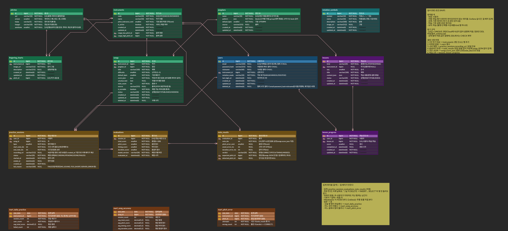

# DB 스키마

- 상태: 초안. [S15P31E102-3](https://ssafy.atlassian.net/browse/S15P31E102-3)에서 설계했고, 1차 MVP API 명세에 맞춘 V2 보완은 [S15P31E102-142](https://ssafy.atlassian.net/browse/S15P31E102-142)([보완안·합의 필요 항목](../plans/S15P31E102-142.md))입니다. V3의 녹음 원본 메타데이터는 [S15P31E102-179](https://ssafy.atlassian.net/browse/S15P31E102-179)(PRA-02 녹음 파일 규격), V4의 분석 시도·실패 코드 제약은 [S15P31E102-173](https://ssafy.atlassian.net/browse/S15P31E102-173)(PRA-03 분석 실패 사유)입니다. 아래 미결 사항이 남아 있습니다.
- 정본: SQL 파일입니다. ERD 그림과 SQL이 다르면 SQL을 따릅니다.

| 대상 | DB | 파일 | 적용 방식 |
| --- | --- | --- | --- |
| 운영 DB | `eolssu` | [V1__initial_schema.sql](../../backend/src/main/resources/db/migration/V1__initial_schema.sql), [V2__auth_user_practice_extensions.sql](../../backend/src/main/resources/db/migration/V2__auth_user_practice_extensions.sql), [V3__practice_session_recording_metadata.sql](../../backend/src/main/resources/db/migration/V3__practice_session_recording_metadata.sql), [V4__practice_session_analysis_attempt.sql](../../backend/src/main/resources/db/migration/V4__practice_session_analysis_attempt.sql), [V5__seed_danso_pitches.sql](../../backend/src/main/resources/db/migration/V5__seed_danso_pitches.sql), [V6__seed_danso_songs.sql](../../backend/src/main/resources/db/migration/V6__seed_danso_songs.sql) | Flyway 마이그레이션. 버전 순서대로 모두 적용한 결과가 정본 |
| 집계 DB | `eolssu_mart` | [data/mart/schema.sql](../../data/mart/schema.sql) | 일 배치 계정으로 직접 실행. 이미 만든 마트는 같은 폴더의 `alter_*.sql`을 한 번 실행 |

## ERD

V9 [OAuth 일회용 증명값](../../backend/src/main/resources/db/migration/V9__oauth_one_time_proofs.sql)은 `oauth_proofs`를 추가합니다. state·mergeTicket 원문 대신 SHA-256, 브라우저 결속 해시·제공자·목적·연결 대상·만료·소비 시각을 저장합니다. state와 mergeTicket은10분이며 원자적 조건 갱신으로1회만 소비합니다. 회원을 잠근 후 증명값·연결·refresh를 처리합니다. 회원 삭제를 막는 FK는 두지 않고 완료 처리에서 현재 회원을 재확인합니다. 만료 행은 매분 최대500개 삭제하며 서버 장기 중단 시 재기동 후 정리합니다. 제공자 subject·이메일은 그때까지 서버 내부에만 남습니다. 사용자 승인과 변경 이유는 [211 계획](../plans/S15P31E102-211.md)에 있습니다.

- 원본: [ERDCloud](https://www.erdcloud.com/d/aB9vM5edsqHqmedcE)
- 2026-10-22 기준 내보내기(V1). V2~V5 변경은 아직 그림에 반영하지 않았습니다:

## 테이블 구성

V8의 [song_model_audios](../../backend/src/main/resources/db/migration/V8__song_model_audio_metadata.sql)는 `(song_id, score_version)`별 모범 음원 URL·BPM/단위·실제 파일 길이·시작 위치·MIME·SHA-256·게시 상태를 저장한다. DRAFT가 기본이며 초기 데이터는 없다. 기존 곡/연습/평가 데이터와 V1~V7은 변경하지 않는다. 공개 조회와 적재 전 검증은 [카탈로그 API](../specs/catalog-read-apis.md#모범-연주-메타데이터)를 따른다. ERD 그림에는 아직 반영되지 않았다.

| 영역 | 테이블 | 설명 |
| --- | --- | --- |
| 기준 데이터 | `pitches`, `instruments`, `fingering_charts`, `jangdans`, `songs`, `notation_symbols` | 율명·악기·운지표·장단·곡·기호처럼 운영자가 넣는 데이터. 단소 율명(`pitches`)은 V5, 단소 악기 1개·장단 3개·1차 4곡(`instruments`·`jangdans`·`songs`)은 V6 마이그레이션이 `data/reference/` 값과 변환한 공통 악보 데이터로 넣는다 |
| 사용자 | `users`, `user_song_settings` | 가입은 이메일·비밀번호로만 하며, 탈퇴 완료 전까지 이메일·비밀번호·닉네임이 있어야 합니다(`users_chk_2`). 탈퇴를 요청하면 `WITHDRAWAL_PENDING`으로 30일 보관하고, 요청 후 30일 미만에 로그인하면 취소합니다. 회원 잠금 이후의 시각이 만료 정각 이상이면 실제 삭제 여부와 관계없이 취소를 거절합니다. 30일 뒤 일괄 처리에서 개인정보 칸을 비우고 `DELETED`로 바꾸며 행은 남깁니다. 재가입은 새 행입니다. 곡별 BPM만 서버에 둡니다. |
| 인증 | `user_social_accounts`, `terms`, `user_term_agreements`, `email_verifications`, `refresh_tokens` | 기존 회원에 붙이는 간편 로그인 연결(제공자·제공자 ID 유일, 회원당 제공자별 1개), 버전별 약관과 동의 기록, 이메일 인증번호(서버 비밀키 HMAC)·인증 토큰(SHA-256), 리프레시 토큰 회전과 회원 단위 폐기(SHA-256). 저장 방식은 [조사 기록](../knowledge/backend/auth-token-storage.md) |
| 연습·평가 | `practice_sessions`, `evaluations`, `note_results` | 데이터 파이프라인이 읽는 기록. 세션당 평가 1개, 평가당 음표별 결과. 연습 기록 저장·메모·확인·삭제 칸은 사용자가 나중에 바꿉니다. 녹음 원본 메타데이터(`recording_bytes`·`recording_duration_ms`·`recording_sample_rate`·`recording_channels`)는 업로드 검사를 통과해 원본을 저장할 때 네 칸을 함께 채우고, 그 전에는 모두 NULL입니다(`chk_practice_sessions_recording_meta`). 분석은 세션마다 현재 시도 하나(`analysis_attempt`, 0은 시작 전·`analysis_started_at`)만 두고, `FAILED`일 때만 실패 코드(`fail_reason`)를 아래 6종 중 하나로 둡니다. |
| 성장 | `score_views` | 악보 화면 체류 구간 기록. 한 행이 한 구간이며 `counted_seconds`(자리 비움을 뺀 인정 시간, 상한 없음)의 합이 연습 시간입니다. 기준은 [연습 시간 집계 스펙](../specs/practice-time.md) |
| 학습 | `lessons`, `lesson_progress` | 율명·단계·시김새 학습과 사용자별 진도 |
| 집계 | `mart_daily_practice`, `mart_song_accuracy`, `mart_pitch_error` | 일 배치가 운영 DB를 읽어 만드는 통계. 외래키 없음. `mart_daily_practice.total_practice_seconds`는 그날(KST) 시작한 체류 구간의 인정 시간 합 |

공통 규칙은 운영 DB SQL 파일 머리말에 있습니다. 시각은 UTC로 저장하고, 상태 칸은 ENUM 대신 문자열과 CHECK 제약을 씁니다.

## 분석 실패 코드

`practice_sessions.fail_reason`은 `status = 'FAILED'`일 때만 있고 아래 값만 대소문자까지 같게 받습니다(`chk_practice_sessions_fail_reason`, V4). 기준은 [분석 실패 사유 스펙](../specs/practice-analysis-failure.md)입니다.

| 코드 | 원인 | 다음 행동 |
| --- | --- | --- |
| `NO_SOUND` | 녹음에서 연주 소리를 찾지 못함 | 다시 연주 |
| `TOO_SHORT` | 녹음이 너무 짧음 | 다시 연주 |
| `DECODE_ERROR` | 녹음 변환·디코딩 실패 | 다시 연주 |
| `UPLOAD_TIMEOUT` | 업로드 만료(녹음 시작 40분 뒤 배치) | 화면에 보이지 않음 |
| `TIMEOUT` | 분석 시도 제한 시간 초과 | 분석 다시 시도 |
| `SERVER_ERROR` | AI 연결 실패·처리 오류·결과 저장 실패 | 분석 다시 시도 |

V4는 V3(녹음 메타데이터) 다음에 적용됩니다. `outOfOrder`를 쓰지 않으므로 이미 적용한 번호보다 작은 버전은 나중에 넣을 수 없습니다.

## 탈퇴 일괄 삭제 대상

[탈퇴 유예 만료와 삭제 경계](../specs/withdrawal-expiry.md): 아래 파일 삭제 전에 회원 행을 잠그고 대기 상태와 삭제 예정 시각을 재확인합니다. 기존 취소가 커밋됐으면 파일·DB를 보존합니다. 확인 이후 새 취소는 30일 기한 검사로 거절되므로 저장소 호출은 DB 잠금을 해제한 뒤 실행합니다.

USR-05 결정안: 탈퇴 요청 뒤 30일이 지나면(`purge_scheduled_at` 경과) 매일 04:00 KST에 회원 단위로 아래를 처리합니다. DB 처리(2~6)는 한 트랜잭션으로 묶고, 녹음 파일 삭제(1)는 트랜잭션에 묶이지 않으므로 먼저 지우고, 실패하면 그 회원의 DB 처리를 다음 일괄 처리로 미룹니다(S15P31E102-209에서 구현). 트랜잭션은 `users` 행을 먼저 잠그고, 인증번호(5)는 저장된 주소와 정확히 같은 행(`COLLATE utf8mb4_bin`)만 지웁니다. 요청 후 30일 미만에 로그인하면 `status`를 ACTIVE로 되돌리고 두 탈퇴 시각을 비웁니다.

| 순서 | 대상 | 처리 |
| --- | --- | --- |
| 1 | 녹음 파일(MinIO) | 연습 녹음 저장소의 삭제 기능으로 지웁니다. DB 행보다 먼저 지워 경로를 잃지 않게 합니다. |
| 2 | `note_results` → `evaluations` → `practice_sessions` | 회원의 세션과 그 평가를 지웁니다. 세션은 `DELETE ... WHERE user_id = ?` 한 문장으로 지울 수 있고, 다른 세션의 `parent_session_id`는 비워집니다. 집계 DB의 지난 통계는 남습니다. |
| 3 | `score_views`, `user_term_agreements`, `user_song_settings`, `lesson_progress` | 회원 행을 지웁니다. |
| 4 | `refresh_tokens`, `user_social_accounts` | 지웁니다. 소셜 연결을 지워야 같은 간편 로그인 계정으로 새 회원을 만들 수 있습니다. |
| 5 | `email_verifications` | 회원 이메일로 남은 행을 지웁니다. 이메일을 비우기 전에 처리합니다. |
| 6 | `users` | `email`·`password_hash`·`nickname`을 비우고 `status = 'DELETED'`, `deleted_at`을 채우며 두 탈퇴 시각을 비웁니다. 행은 남깁니다. |

`lesson_progress`(율명·단계·시김새 학습 진도)는 USR-05 명세 목록에는 없지만 개인 학습 기록이므로 함께 지웁니다(2026-10-27 오은서 결정).

## 미결 사항

| 항목 | 내용 |
| --- | --- |
| V2 합의 항목 | `deleted_at` 의미 변경, 기본 표기 HANJA, `bpm_unit` 기본값 없음, 기록 소프트 삭제, 악보 스냅샷 방식 등. [S15P31E102-142](../plans/S15P31E102-142.md#합의가-필요한-변경)에서 관련 파트와 확인합니다. |
| `mission_id` 외래키 | missions 테이블은 MIS 작업에서 추가하고 그때 `practice_sessions.mission_id`에 외래키를 겁니다. |
| 재채점 정책 | `evaluations`는 세션당 1행입니다. 같은 세션을 다시 채점할 때 덮어쓸지, 이력을 남길지 정해야 합니다. |
| `practice_sessions` 주석 | V1은 "추가만 하고 status만 바뀐다"고 적혀 있지만 `ended_at`, `recording_url`, `fail_reason`과 V2의 `saved_at`·`memo`·`viewed_at`·`record_deleted_at`, V3의 `recording_bytes`·`recording_duration_ms`·`recording_sample_rate`·`recording_channels`(업로드 저장 때 함께 채움)와 V4의 `analysis_attempt`·`analysis_started_at`(분석 시도를 시작할 때 바꿈)도 나중에 바뀝니다. |
| 판정과 점수 축 | 점수는 음높이·박자·길이 3축인데 `note_results.verdict`에는 길이 판정 값이 없습니다. |
| `songs` 상태 칸 | `status`, `is_scorable`, `deleted_at` 세 칸이 공개 여부를 함께 나타냅니다. 역할을 나눌지 정해야 합니다. |
| DB 이름 | 영문명은 `eolssu`로 정했지만 현재 서버 DB는 `eolsu`입니다. 서버 DB 이름 변경은 Infra와 정해야 합니다. |
| 운영 DB 적용 | 백엔드의 `db` 프로필에 MyBatis·Flyway·MySQL 연결 구성이 있습니다. 실제 운영 DB 연결·V1~V3 적용과 기존 DB의 Flyway 편입은 별도 작업입니다. [실행 방법](../../backend/README.md#mysql-연결과-flyway)을 따릅니다. V2는 기존 장단·세션의 `bpm_unit`을 장단 이름으로 채우며, 4개 장단 밖의 이름, 개인정보가 남은 탈퇴 회원, 20~240 밖의 세션 BPM이 있으면 변경 전에 멈춥니다. V3은 칸만 추가하고 기존 행을 NULL로 두므로 적용 전 확인이 없습니다. |

Flyway는 이미 적용한 마이그레이션 파일을 수정하면 실행을 막습니다. 서버에 V1을 적용한 뒤에는 변경을 새 버전 파일로 추가합니다.

## 테스트 계정의 무기한 인증 세션 (S15P31E102-260)

V7에서 `refresh_tokens.expires_at`은 nullable입니다. NULL은 서버의 명시적 회원 허용 목록에 포함된 테스트 계정의 시간 만료 없는 세션입니다. 일반 계정은 기존 만료 시각을 그대로 저장합니다. access JWT는 같은 세션 해시에 묶이고 폐기·회원 상태·허용 목록을 확인합니다. [세부 계약](../specs/non-expiring-test-account.md)을 따릅니다.
