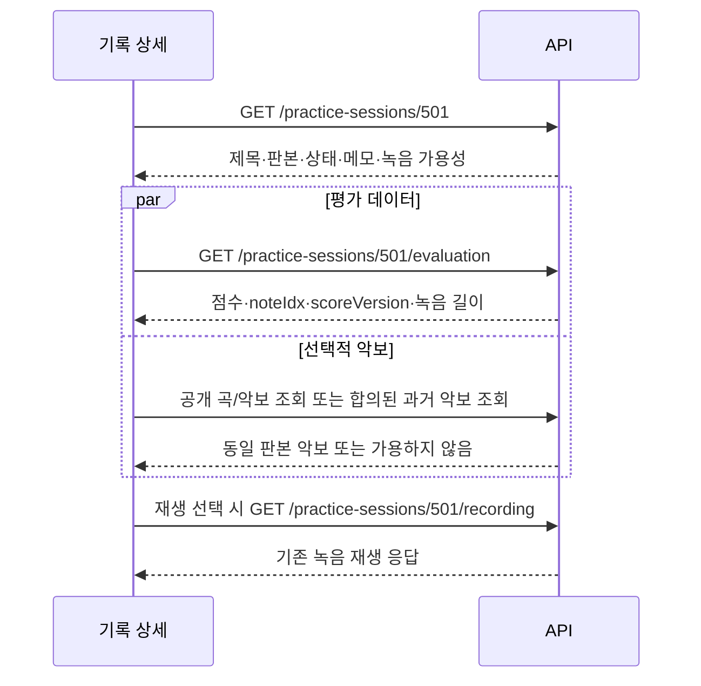

# 화면 흐름 개선 API 상세 제안

- 상태: **검토용 제안, 미구현·미합의**. 이 문서는 확정 계약을 대체하지 않는다.
- 작성일: 2026-11-04 KST. [S15P31E102-434](https://ssafy.atlassian.net/browse/S15P31E102-434), 관련 Story [S15P31E102-24](https://ssafy.atlassian.net/browse/S15P31E102-24).
- 기준 코드: `65d041d3c3b988458a92995442beb187d7d816f6`. 11월 3일 조사에 사용한 고정 스냅샷을 이어서 상세화했다. 이후 develop 변경은 포함하지 않는다.
- 독자: BE·FE 구현자와 리뷰어. 원안의 조사 항목 F1~F11을 요청·응답·오류·클라이언트 전환 단위로 구체화한다.
- DB 변경·데이터 이관·배포·복구는 [마이그레이션 상세안](screen-data-migration-plan.md)을 따른다. 원안 작성에는 요구사항 명세서와 Notion을 사용하지 않았다. 이후 담당 범위 결정은 연결된 범위 기록에 따로 남겼다.

## 문서의 상태와 적용 범위

이 문서는 **S15P31E102-434의 조사·설계 기록**이다. 아래 API·SQL·배포 단계는 검토용 예시이며 실행 지시나 확정 계약이 아니다. 기준 코드 이후의 제품 동작은 해당 기능 스펙에서 확인한다.

- **3번 계정 격리:** S15P31E102-452의 [MR !296](https://lab.ssafy.com/s15-final/S15P31E102/-/merge_requests/296)으로 develop에 병합됐다. 실제 변경·수치는 [구현 및 검증 기록](../frontend/account-session-isolation.md)을 따른다.
- **8번 내 악보:** 기능이 들어온 뒤 실제 구현·확정 API와 대조해 수정할 후속 항목으로 남긴다. 이 문서 작업에서 구현하거나 새로 연결하지 않는다.
- **나머지 항목:** Joseph Woo 담당 API와 확장 작업을 이번 개선에서 제외한 결정을 유지한다. 과거 악보 보관 A9/M2도 제외한다. [최신 범위와 후속 조건](screen-flow-improvement-integrated.md#current-scope)이 아래 원안의 우선순위·도입 순서보다 우선한다.

원안이 참조한 `screen-api-erd-audit.md` 원문은 확보하지 못했다. 원안의 F1~F11 번호는 기존 참조 식별자로만 보존하며 원문을 복원한 것으로 보지 않는다. 이번에 대조한 코드 근거는 [흐름별 근거 표](screen-flow-improvement-integrated.md#source-evidence)에 따로 기록한다.

## 1. 적용 범위와 우선순위

우선은 잘못된 판본으로 연습을 시작하거나 다른 계정의 기록을 표시하는 경로를 막고, 기록 상세가 목록 캐시·공개 악보 없이도 점수와 녹음을 보여 주도록 한다. 작품·편곡 테이블 분리는 이 개선의 선행 조건이 아니다.

| 구분 | 변경 제안 | 계약/DB 영향 | 원 조사 |
| --- | --- | --- | --- |
| A1, 우선 | 세션 생성 `expectedScoreVersion`, 생성/상태 응답 `scoreVersion` | 추가형 API, 기존 세션 버전 재사용 | F1 |
| A2, 우선 | 상태 응답 `songTitle`, 악보와 점수·녹음 상태 분리 | 추가형 API와 FE 변경, 새 테이블 없음 | F2 |
| A3, 우선 | 계정별 캐시·지연 응답 차단 | [FE 전환 상세](screen-data-migration-plan.md#account-cache), API 없음 | F3 |
| A4 | 기록의 이번 주 집계 추가 후 서버 페이지 소비 | 추가형 API, 집계 SQL | F7 |
| A5 | 레슨 후보에 검수된 `songId`·`instrumentId` | 추가형 API, 기존 JSON 데이터 보완 | F4 |
| A6 | 목록 전용 SQL·판본별 요청 공유 | 외부 API 변경 없이 우선 가능 | F5/F6 |
| A7, 선택 | 곡 상세 `includeScore=false` | opt-in 응답, DB 변경 없음 | F6 |
| A8 | 학습·내 악보·점수 추이의 기존 API 연결 | FE 연결과 로컬 데이터 전환 | F8 |
| A9, 조건부 | 세션 기준 과거 악보 조회 | 보존·접근 정책 합의와 revision 저장 필요 | F9 |
| A10, 조건부 | 전체/구간을 연주 당시 기준으로 분류 | 의미 변경, snapshot 또는 revision 필요 | F11 |
| A11, 보류 | 곡 검색·난이도·cursor 조회 | 규모 확인 뒤 opt-in 계약 | F10 |

이하에서 **현행**은 코드 사실, **제안**은 구현 시 채택할 구체 초안이다. 새 필드명·기본값·오류 details는 제안이며 이미 제공된다고 해석하지 않는다.

## 2. 공통 계약과 호환 원칙

- 경로는 `/api`를 포함한다. 본문 있는 성공/실패 응답은 현행 `{httpStatus,isSuccess,message,code,result}` envelope를 유지한다. SHT 삭제의 204처럼 본문 없는 응답은 예외다. `code`는 HTTP 상태 정수이며 오류 분기는 `result.errorCode`로 한다.
- DB ID는 JSON 문자열이다. 공개곡·PRA·EVA 악보 판본은 정수, SHT wire 판본/baseScoreVersion은 문자열이다. 시각은 UTC ISO 8601이다. `noteIdx`는 해당 판본의 음표 인덱스이며 화면 각 번호나 event 배열 인덱스로 바꾸지 않는다.
- PRA·REC·LRN·SHT·GRO는 기존 `access_token` 쿠키 인증과 소유권 검사를 유지한다. CAT 공개 조회는 기존 PUBLISHED·미삭제 조건을 유지한다. 숨김 곡의 공개 노출 확대는 이 제안에 포함하지 않는다.
- 현행 FE ApiJson은 `ignoreUnknownKeys=true`라 추가 응답 필드를 무시한다. 필드 삭제·타입 변경·새 enum 값까지 호환된다는 뜻은 아니다. 신 FE는 구 서버에 없는 필드에 nullable/default를 두고 **부재를 판본 1이나 점수 0으로 추정하지 않는다**.
- 서버 우선 배포 후 신 FE를 배포한다. 선택 기능은 응답 필드·명시적 호환 경로로 전환하며, 401·403·5xx를 구 서버 판정으로 사용하지 않는다.
- 계약 변경 시 저장소 관련 specs와 DTO·OpenAPI·테스트를 같은 구현 작업에서 갱신한다. 이 조사 문서만으로 확정 specs를 덮어쓰지 않는다.

예시는 가상의 ID와 고정 시각을 사용한다. `result` 발췌라고 명시한 JSON은 전체 HTTP 본문이 아니다.

## 3. A1 — 연습 세션 생성 시 기대 판본 확인

### 3.1 요청

현행 `POST /api/practice-sessions`에 다음 한 필드를 추가한다. 기존 요청 필드·범위는 그대로 유지한다.

| 필드 | 타입/필수 | 제안 규칙 |
| --- | --- | --- |
| `songId` | string, 필수 | 현행 양의 십진 문자열 검증 유지 |
| `bpm` | int, 필수 | 현행 20~240, 단위는 `bpmUnit` |
| `bpmUnit` | string, 선택 | `QUARTER`, `DOTTED_QUARTER`, `JEONGGAN`, `JANGDAN_BEAT`; 생략 시 현행 곡 기준 |
| `startNoteIdx` / `endNoteIdx` | int, 선택 | 시작 기본 0, 끝 기본 해당 판본 `noteCount-1`; `0 ≤ start ≤ end < noteCount` |
| `parentSessionId` | string, 선택 | 현행 본인·같은 곡·DONE 검사 유지 |
| `missionId` | string, 선택 | 현행 구현에 미션 정의가 없으므로 지정 시 404; 지원 기능으로 소개하지 않음 |
| `jangdanSoundOn` | boolean, 선택 | 현행 요청 해시에 반영되는 의미 유지 |
| **`expectedScoreVersion`** | **int, 이행 기간 선택** | **1~2147483647. 문자열·실수·boolean 금지. 생략/null은 이행 기간 legacy 요청으로 처리** |

`Idempotency-Key`는 현행 공백을 제외한 ASCII `!`~`~`(0x21~0x7E) 1~100자 규칙을 유지한다. 신 FE는 화면에 실제로 렌더링한 판본을 항상 보낸다. 목록의 오래된 버전이나 현재 서버 버전을 임의로 대입하지 않는다.

```http
POST /api/practice-sessions
Content-Type: application/json
Idempotency-Key: practice-attempt-example-001

{"songId":"101","bpm":72,"bpmUnit":"QUARTER","startNoteIdx":0,"endNoteIdx":59,"expectedScoreVersion":3}
```

### 3.2 성공/오류

제안 성공 응답은 기존 필드에 **저장된 세션의** `scoreVersion`을 더한다. 현행과 같이 같은 키 재전송도 생성 응답 형태와 201을 유지한다.

```json
{
  "httpStatus": "CREATED",
  "isSuccess": true,
  "message": "전체·구간·미션 연습 세션 생성 성공",
  "code": 201,
  "result": {
    "sessionId": "501",
    "songId": "101",
    "status": "RECORDING",
    "bpm": 72,
    "bpmUnit": "QUARTER",
    "startNoteIdx": 0,
    "endNoteIdx": 59,
    "startedAt": "2026-11-04T00:00:00Z",
    "scoreVersion": 3
  }
}
```

| 조건 | 상태/코드 | 후속 동작 |
| --- | --- | --- |
| 타입·양수·BPM·범위 위반 | 400 `INVALID_REQUEST` | 잘못된 입력 수정 |
| 미인증 | 401 `UNAUTHENTICATED` | 기존 로그인 복구 |
| 곡이 없거나 연주 불가, 다른 회원 부모 | 404 `RESOURCE_NOT_FOUND` | 새 세션 생성 중단; 다른 회원 정보 노출 없음 |
| 기대 판본 ≠ 잠근 현재 판본 | 409 `STATE_CONFLICT` | 업로드 중단·판본 변경 안내; 발견 시점은 아래 생명주기 참고 |
| 같은 회원·키에 다른 요청 해시 | 409 `IDEMPOTENCY_CONFLICT` | 원 요청 재전송 또는 새 시도 키 |
| 부모가 DONE 아님 | 409 `STATE_CONFLICT` | 기존 규칙 유지 |

판본 충돌에만 다음 details를 추가하는 안이다. 다른 `STATE_CONFLICT`와 구별한다.

```json
{
  "httpStatus": "CONFLICT",
  "isSuccess": false,
  "message": "지금 상태에서는 처리할 수 없어요. 상태를 다시 확인해 주세요",
  "code": 409,
  "result": {
    "errorCode": "STATE_CONFLICT",
    "details": {
      "reason": "SCORE_VERSION_MISMATCH",
      "expectedScoreVersion": 3,
      "currentScoreVersion": 4
    }
  }
}
```

### 3.3 원자성·멱등성

1. 입력 형태를 검증하고 요청 해시를 계산한다. 같은 회원·키의 기존 성공 세션을 먼저 조회한다.
2. 기존 세션이면 해시가 같을 때 같은 세션을 반환한다. 현행 replay의 `status`는 조회 당시 DB 값이므로 DONE으로 바뀔 수 있다. 최초 RECORDING 응답 전체의 바이트 재현을 약속하지 않는다. 곡이 숨겨지거나 최신 판본이 바뀌었다는 이유로 기존 성공 재전송을 새 요청처럼 거절하지 않는다.
3. 새 요청은 **동일 트랜잭션에서 곡 행 잠금 → 게시/채점 가능 상태·기대 판본 검사 → 범위 계산 → 세션 INSERT**를 한다. 게시 writer도 같은 곡 행을 수정하므로 검사와 INSERT 사이의 교체를 직렬화해야 한다. 잠금 대기 사이 다른 동일키 요청이 성공할 수 있으므로, 새 요청의 검증 오류를 반환하기 전 트랜잭션을 끝내고 최신 커밋을 보는 별도 조회로 기존 성공 키를 다시 확인한다. 있으면 해시 비교/replay를 우선한다. '동일키 T1 성공→게시→T2 잠금'을 잘못된 버전 충돌로 처리하지 않는다.
4. 동시 같은 키 요청은 `(user_id,idempotency_key)` 유일 제약으로 한 건만 남긴다. 중복키 예외로 실패한 트랜잭션을 종료한 뒤 새 읽기로 승자 세션을 조회해 해시를 비교하는 경계를 둔다. 이전 읽기 스냅샷이나 rollback-only 트랜잭션에서 재조회하지 않는다. 잠금 순서와 재조회 가시성은 MySQL 통합 테스트로 확인한다.
5. `PracticeSession` 및 멱등 재조회 SQL에도 `score_version`을 연결한다. 응답을 만들 때 최신 `songs.score_version`을 다시 읽어 쓰면 안 된다.

해시 전환안:

- 기대 판본 생략/null은 기존 `v1|songId|bpm|bpmUnit-or--|start-or-0|end-or--|parent-or--|mission-or--|jangdan-or-false` 문자열과 SHA-256을 **그대로** 유지한다.
- 명시 요청은 `v2` 구분자로 시작하고 기존 순서의 값과 기대 판본을 포함한다. 두 형식을 테스트 고정값으로 관리한다.
- 기존 DB의 `request_hash`를 다시 계산하지 않는다. 같은 키의 기존 생략 요청에 필드를 추가해 재전송하면 요청이 달라졌으므로 멱등 충돌이다.
- 판본 충돌은 세션을 만들지 않는다. FE가 악보를 갱신하고 사용자가 새로 시작하면 새로운 시도 키를 발급한다.

이 검사는 **생성 순간의 판본 번호 일치**를 보장한다. 세션 생성 후 악보를 덮어쓰면 현행 분석은 여전히 과거 악보를 잃는다. 또 `enable_scoring.py`는 숨표·검수 metadata를 바꾸면서 번호를 유지한다. 동일 번호가 JSON 전체 불변을 뜻하도록 바꾸려면 writer 정책부터 합의해야 한다. 연습 완료까지의 보장은 게시 불변 정책 또는 A9 revision 저장이 추가로 필요하다.

PRA-01 멱등성과 분석 재시도는 다르다. 현행 `POST /api/practice-sessions/{id}/retry`는 키 형식을 검사하지만 키를 저장해 영구 재현하는 구조가 아니다. PENDING 중 중복은 억제하지만 다시 실패한 뒤의 호출은 새 분석 시도가 될 수 있다. 이 개선에서 그 의미를 바꾸지 않는다.

부모와 자식 판본까지 같게 제한할지는 별도 비교 정책이다. 현행 생성 검사에 없던 조건을 이 필드 추가에 숨겨 넣지 않는다.

### 3.4 전환과 수용 기준

현행 FE는 녹음이 끝난 뒤 `AnalysisSession`에서 곡을 재조회하고 PRA-01을 호출한다. 최소 변경은 **실제 녹음에 사용한 판본·BPM 단위·범위를 take와 함께 캡처해 PRA-01까지 전달**하는 것이다. 분석 화면에서 재조회한 최신 버전을 expected에 넣으면 보호가 무효다. 이 경우 불일치는 녹음 완료 후 업로드 전에 발견된다. 시작 전 차단은 세션 생성 시점을 옮기는 별도 생명주기 변경이다. 구 take·pending 형식까지 포함한 [전환 절차](screen-data-migration-plan.md#82-실제-연주-판본의-전달)를 따른다.

서버의 선택 필드 수용 → 신 FE 항상 전송·성공 버전 대조 → 생략 요청 비율 확인 → 구 FE 지원 종료 합의 순서다. 필수화할 경우 기존 키의 성공 재전송을 보호한 뒤 **새 요청의 누락**을 거절하는 정책을 별도로 문서화한다. 이행 기간에는 구 FE의 잘못된 판본 시작 위험이 완전히 사라졌다고 보고하지 않는다.

M2의 검증된 원문만 분석하는 모드까지 채택한다면 구 요청 허용을 그대로 둘 수 없다. 그 모드 활성화 전에 신규 요청의 기대 판본 필수화와 신 FE 전환을 합의한다. **기존 성공 키 replay를 먼저 처리한 뒤**, 새 누락/null 요청은 400 INVALID_REQUEST와 details.reason=`EXPECTED_SCORE_VERSION_REQUIRED`, 번호는 있으나 검증된 불변 원문으로 연결할 수 없는 새 요청은 409 STATE_CONFLICT와 details.reason=`SCORE_REVISION_UNAVAILABLE`로 생성 전에 거절하는 안이다. 세션은 201로 만든 뒤 모두 분석 불가로 보내지 않는다. 이 정책은 M0 추가형 배포와 별도의 후속 계약 변경이다.

필수 검사: v3 실제 녹음 후 v4 게시·재조회가 있어도 expected=v3 유지 → 409/INSERT·업로드 0건, 일치 시 201, 기존 v1 해시 재전송, 동일 키의 다른 기대 판본 충돌, 곡 숨김 뒤 성공 요청 재생, 게시와 생성 양방향/동일키 삼자 경합, 성공 응답 버전과 DB 값 일치.

## 4. A2 — 목록 캐시 없이 기록 상세 구성

### 4.1 PRA-03 추가 응답

`GET /api/practice-sessions/{sessionId}`의 기존 필드에 다음 두 값을 추가한다. 접근 검사는 현행 본인·미삭제 세션 기준이다.

| 추가 필드 | 타입 | 데이터 출처/의미 |
| --- | --- | --- |
| `songTitle` | string | `songs.title`의 조회 시점 제목. 연주 당시 제목 스냅샷이라고 약속하지 않음 |
| `scoreVersion` | int | `practice_sessions.score_version`, 평가/음표 인덱스와 묶이는 판본 |

제안 `result` 전체 예시:

```json
{
  "sessionId": "501",
  "songId": "101",
  "songTitle": "예시곡",
  "scoreVersion": 3,
  "bpm": 72,
  "bpmUnit": "QUARTER",
  "startNoteIdx": 0,
  "endNoteIdx": 59,
  "status": "DONE",
  "evaluationId": "601",
  "failReason": null,
  "recordingAvailable": true,
  "startedAt": "2026-11-04T00:00:00Z",
  "endedAt": "2026-11-04T00:00:50Z",
  "retryable": false,
  "savedAt": "2026-11-04T00:01:00Z",
  "memo": "긴 음을 일정하게"
}
```

곡 JOIN에 공개/삭제 필터를 새로 붙이지 않는다. 세션의 곡 FK와 기존 보존 규칙을 따른다. 다른 회원·기록 삭제는 404를 유지한다. 기존 저장 기록의 `viewed_at` 첫 조회 처리와 마감이 지난 PENDING의 TIMEOUT 전환도 보존한다. 부작용 없는 단순 SELECT API로 재정의하지 않는다.

### 4.2 상세 로딩 순서와 실패 격리



그림의 `/api`는 공간상 생략했다. 평가 요청은 DONE 상태에서 수행하고, 진행/실패 상태에서는 기존 상태 표시·재시도를 사용한다.

| 가용 데이터 | 표시/동작 제안 |
| --- | --- |
| PRA-03 + EVA-01 성공, 같은 판본 악보 있음 | 점수·메모·녹음과 악보 오류 강조/따라가기 가능 |
| 점수/녹음 있음, 공개 곡 숨김 또는 판본 불일치 | 점수·메모·시간 기준 녹음 재생 유지; 악보 기반 따라가기/seek·오류 배치 비활성 |
| EVA-01 일시 실패 | 상세 기본정보 유지, 평가 영역 재시도. 실패를 0점으로 저장하지 않음 |
| `recordingAvailable=false` | 점수/메모 유지, 재생 불가 표시 |
| 재생 시 URL 발급/파일 접근 실패 | 재생 영역 오류·재시도. score 요청 성공 여부와 분리 |
| PRA-03 404 | 상세 접근 불가. 기존 캐시를 근거로 타인/삭제 기록을 표시하지 않음 |

EVA-01은 이미 점수·`scoreVersion`·notes·`recordingDurationMs`를 제공한다. 서버 평가 응답을 바꾸기 전에 `ApiEvaluationRepository`의 공개 곡 조회 실패 → 결과 전체 null 처리를 제거한다. `PracticeRecord`에 판본을 보관하고, PRA-03과 EVA-01의 sessionId/songId/version이 일치할 때 합친다.

EVA-01은 기존 200 성공 계약을 유지한다. 206/207 부분 성공 상태를 신설할 필요가 없다. 원본 notes를 보존하고 좌표 변환 불가를 '오류 음표 0개'로 표시하지 않는다. 목록 없는 상세의 전체/구간·각 번호는 일치 판본 근거가 있을 때만 계산하며, 시작 인덱스 0만으로 전체곡이라고 추정하지 않는다. 녹음 시간은 악보 event 수 대신 플레이어 positionMs/durationMs를 사용할 수 있다. 실패 세션에서도 업로드된 녹음 길이를 PRA-03 하나로 표시해야 한다면 기존 DB 컬럼을 이용한 nullable `recordingDurationMs` 추가를 별도 선택할 수 있다.

기존 기록 메모 저장은 생략=유지, JSON null=삭제다. 현행 FE의 `explicitNulls=false`는 nullable 값을 생략하므로 새 adapter에서도 wire 의미를 확인한다. FE의 기존 빈 문자열 삭제 경로를 바꾸려면 null이 실제 직렬화되는지 검증해야 한다.

구 서버에서 두 추가 필드가 없으면 기존 목록에 있는 제목을 임시 표시할 수 있으나 상세 진입의 필수 조건으로 삼지 않는다. 제목이 없으면 임시 일반 문구를 쓰고, 판본은 EVA-01에서 확인하기 전까지 악보 overlay를 켜지 않는다.

녹음 URL은 필요 시 발급받고 회원/세션별로 취급한다. 로그아웃 후 재사용하지 않는다. 만료 URL을 영구 캐시하지 않는다.

## 5. A4 — 기록 주간 집계와 페이지 조회

### 5.1 현행 쿼리 유지

```http
GET /api/users/me/practice-records?songId=101&sort=NEWEST&page=0&size=20
```

- `songId`: 선택. 생략하면 현행 가장 최근 저장한 곡을 펼친다.
- `sort`: `NEWEST` 기본값 또는 `OLDEST`.
- `page`: 0 이상, 기본 0. `size`: 1~100, 기본 20.
- 곡 요약 `songs`, 전체 `totalRecordCount`, 선택 곡 `items`, `totalElements/totalPages`를 유지한다.
- 정렬은 `started_at`와 `id`를 함께 사용한다. `songs`의 정렬은 `lastSavedAt` 내림차순·songId 내림차순이다.

### 5.2 제안 summary

`result.summary.thisWeek`를 추가한다. **저장한 기록 화면의 이번 주 집계**를 보존하기 위한 안이며 성장 화면의 전체 완료 연습 집계와 구분한다.

```json
{
  "summary": {
    "thisWeek": {
      "timeZone": "Asia/Seoul",
      "fromDate": "2026-11-02",
      "toDateExclusive": "2026-11-09",
      "recordCount": 7,
      "bestScore": 91
    }
  }
}
```

위는 추가 필드만 발췌했다. 규칙 제안:

| 항목 | 의미 |
| --- | --- |
| 기간 | 서버 Clock의 KST 이번 주 월요일 00:00 이상, 다음 월요일 00:00 미만 |
| 소속 날짜 | 연주 `started_at`; 저장 `saved_at`이나 평가 `evaluated_at`이 아님 |
| 모집단 | 본인·saved_at 존재·record_deleted_at 없음·평가 존재, 현행 REC 목록과 동일 |
| 범위 | 모든 곡의 기록. `songId`, 정렬, 현재 page/size에 영향받지 않음 |
| `recordCount` | 새 필드는 JSON 정수/서버 Long·FE Long으로 정의; 기간 내 세션 수, 없으면 0. 기존 totalRecordCount 타입은 변경하지 않음 |
| `bestScore` | nullable JSON 정수/Int, 0~100. 같은 모집단의 MAX(total_score), 없으면 **null** |
| 빈 기록/없는 곡 | 빈 페이지여도 전체 summary는 제공 |

저장 시점만 이번 주인 과거 연습은 제외한다. 이번 주 연습을 저장/삭제하면 집계가 변한다. 성장 summary로 대체하면 저장/삭제 조건과 최고점 기간이 달라지므로 동일 값이라고 취급하지 않는다. 현행 FE도 KoreanDateTime의 KST 주간 기준이다. 신 FE는 화면 진입 시 계산한 날짜가 아니라 응답 기간을 표시하고, 주 경계를 넘기면 summary를 갱신한다.

### 5.3 SQL/클라이언트 전환

기간을 애플리케이션에서 UTC 두 경계로 계산해 바인딩한다. `started_at` 열을 날짜 함수로 감싸는 방식보다 기존 시간 인덱스를 활용할 수 있는 조건을 우선 검토한다. 다음은 MyBatis 바인딩을 전제로 한 제안이다.

```sql
SELECT COUNT(*) AS record_count, MAX(e.total_score) AS best_score
FROM practice_sessions ps
JOIN songs s ON s.id = ps.song_id
JOIN evaluations e ON e.session_id = ps.id
WHERE ps.user_id = #{userId}
  AND ps.saved_at IS NOT NULL
  AND ps.record_deleted_at IS NULL
  AND ps.started_at >= #{fromUtc}
  AND ps.started_at < #{toUtc};
```

2026-11-02~11-09 KST의 경계 예시는 `2026-11-01T15:00:00Z` 이상, `2026-11-08T15:00:00Z` 미만이다. 기존 REC predicates를 공통화해 summary와 목록 조건이 갈라지지 않게 한다.

FE는 첫 요청에서 `songs`와 선택 곡 첫 페이지만 표시한다. 다른 곡을 펼칠 때 그 곡 page=0, 더보기 때 다음 페이지만 요청한다. `OLDEST` 변경은 page=0으로 초기화하고 서버에 다시 요청한다. 받은 일부 배열을 뒤집어 전체 오래된 순이라고 표시하지 않는다.

캐시 키는 `(회원, epoch, songId, sort, size)`와 page다. 저장/삭제/계정 변경은 summary와 해당 페이지를 무효화한다. 전체 건수는 배열 길이가 아닌 `totalRecordCount`, 곡 건수는 `songs[].recordCount`를 쓴다. 주간 summary가 없는 구 서버에서는 기존 전체 수집 경로를 유지하거나 기능 전환을 보류한다. 부분 페이지로 주간 수치를 계산하지 않는다.

페이지 요청 사이의 새 저장·삭제까지 고정하는 snapshot 계약은 아니다. sessionId 중복은 제거하고 새로고침 시 page=0부터 재구성한다. 현행 GetPracticeRecords의 read-only 트랜잭션 안에 주간 query도 포함하고, 요청당 Clock을 한 번 읽는다. 단일 응답의 요약·페이지 일관성은 실제 DB 격리 수준에서 검증한다. 이 단계에서 임의 cursor나 집계 테이블을 추가하지 않는다.

**묶음 순서도 전환 영향이다.** 현행 FE는 전체 기록의 최근 `startedAt`으로 곡 묶음 순서/날짜를 만들고, 서버 `songs[]`는 최근 `savedAt`을 사용한다. 오래된 연주를 뒤늦게 저장하면 순서가 달라진다. 서버 최근 저장 기준을 채택하고 라벨을 맞출지 합의하거나, FE의 최근 연주 의미를 보존하려면 `songs[].lastPlayedAt`(동일 모집단 MAX(started_at))을 추가하고 FE에서 그 값과 songId로 정렬한다. 후자는 추가형 제안이며 기본 선택 곡까지 최근 연주 기준으로 바꾸는 것은 별도 계약 변경이다.

## 6. A5 — 학습 후보의 안정적인 곡 ID

현행 `GET /api/lessons/{lessonId}`의 `result.songs[]`는 `title`, `meta`만 제공한다. 다음은 **기존 두 문자열을 보존하는** 추가형 제안이다.

```json
{
  "songs": [
    {"title":"예시곡","meta":"검수한 학습 안내","songId":"101","instrumentId":"2"},
    {"title":"미등록 후보곡","meta":"참고용 소개","songId":null,"instrumentId":null}
  ]
}
```

- 두 ID는 문자열 또는 null이며 함께 존재하거나 함께 null이다. title/meta는 교육 콘텐츠 문구이며 곡명을 자동 동기화하는 계약이 아니다.
- 검수자는 track→대상 악기의 명시적 매핑을 확인하고 후보를 songId에 연결한다. 제목만 같은 행을 자동 선택하지 않는다.
- content_json의 기존 `songs` 배열에 검수 ID를 추가하고 parser/도메인/응답을 확장한다. JSON 내부에는 DB FK가 없으므로 입력 검증과 정합성 검사를 구현한다.
- 서버는 연결 곡이 사라지거나 공개/연주 가능 조건을 잃으면 직접 연습 버튼용 ID 쌍을 null로 내리는 안을 검토한다. 목록마다 후보별 SQL을 추가하지 않고 필요한 ID를 일괄 조회한다.
- FE는 유효 ID와 선택 악기의 일치를 확인한 뒤 이동한다. null일 때는 소개만 표시한다. 이전 서버의 제목 fallback이 필요하면 선택 악기로 필터한 목록에서 **정확히 한 후보**일 때만 연결하고 모호하면 이동하지 않는다.

기존 로컬 LearnSongs에 머문 채 서버 응답 필드만 추가하면 문제가 해결되지 않는다. A8 학습 상세 API 연결과 함께 전환하고, 그 전에는 FE의 무악기 전체 조회부터 기존 instrumentId 필터로 제한한다.

## 7. A6/A7 — 목록 SQL과 곡 상세 중복 전송

### 7.1 외부 계약 변경 없는 개선

CAT-01 HTTP 목록에는 이미 `score`가 없다. `SongMapper.listPublished` 전용 Row로 score_json/umulsai_text를 SELECT에서 제외하고 장단을 LEFT JOIN한다. 장단 null을 허용하는 데이터와 일대일 FK 관계를 보존한다. `UserSheetMapper.findPage`도 목록 필드와 `(draft_json IS NOT NULL) AS has_draft`만 조회한다. 상세·편집·멱등 재조회까지 같은 projection으로 바꾸지 않는다.

FE의 공개 곡 캐시는 `(songId,scoreVersion)`로 분리하고 진행 중인 같은 요청을 공유한다. metadata의 최신 판본 조회와 검증된 특정 판본 본문을 구분한다. 현행 writer는 같은 번호에서 숨표·검수값을 바꿀 수 있으므로 이 키만으로 JSON 전체 불변/최신성을 보장하지 못한다. 우선 같은 화면 흐름의 요청 공유로 제한하고, 장기 캐시는 writer 불변 정책 또는 콘텐츠 검증자 계약 후 도입한다. 실패/취소 결과를 영구 저장하지 않고, 결과 화면에서 이미 받은 같은 판본 곡을 재요청하지 않는다.

### 7.2 선택적 `includeScore`

```http
GET /api/songs/101?includeScore=false
GET /api/songs/101/score
```

제안: query 생략 또는 `true`면 현행 상세를 그대로 반환한다. `false`면 기존 metadata를 반환하되 `score` 필드를 **생략**한다. 빈 JSON이나 null 악보로 표현하지 않는다. 그 밖의 query 값은 400이다. 기존 공개/숨김/삭제 404는 유지한다.

현행 CatalogSong.score는 nullable/default이며 getSong은 metadata score가 있을 때만 원문 동등성을 검사한다. 따라서 score 생략 수용을 위한 adapter 변경이 필수인 것은 아니다. false query 추가와 회귀 검증이 필요하며 DTO 분리는 선택적인 책임 정리다. 현행의 `score` 원문·`events` 투영·판본/BPM/noteCount 검증을 유지한다. `notationCapabilities`는 서버에 있지만 현행 FE DTO가 소비하지 않으므로 필요한 기능에서 별도 연결할 제안이다. 원본 events의 `yul`/`octave`와 서버 투영의 pitchId/noteIdx는 서로 대체하지 않는다. 서버 false 경로도 metadata 전용 SQL을 써야 DB LOB 전송까지 줄어든다.

두 요청의 songId·scoreVersion을 대조한다. 중간 게시로 다르면 조합하지 않고 metadata/악보를 한 번 다시 취득한 뒤 계속 충돌하면 명시적으로 실패시킨다. raw score 중복 동등성 검사가 사라지는 대신, CAT-04 원문과 투영 정합성 검사는 남겨야 한다.

이 옵션은 같은 원본 악보의 중복 bytes를 줄이며 요청 수는 여전히 두 번이다. 단일 요청으로 합치려면 CAT-04 metadata 확장이라는 별도 대안이 필요하다. 먼저 FE 중복 호출 공유와 목록 projection의 효과를 측정한다.

## 8. A8 — 기존 API 연결의 이전 제안

> 학습·성장 연결은 실행 제외다. 내 악보도 기능 도입 뒤 재검토한다. 아래 목록/생성의 POST 표기는 기준 코드 당시 계약이며, 취소된 SHT-03을 다시 연결하라는 뜻이 아니다. 도입 시점의 [내 악보 스펙](../../specs/user-sheets.md)에 따라 imports·목록·조회·확정 저장·초안·삭제 중 실제 제공되는 경로를 확인한다.

| 기능 | 현행 경로 | 연결 시 보존할 의미 |
| --- | --- | --- |
| 학습 목록 | `GET /api/lessons?track=…` | 서버 `requiredCount/completedCount/nextLessonId`; FE 고정 9단계 집계 제거 |
| 학습 상세/완료 | `GET /api/lessons/{id}`, `PUT /api/lessons/{id}/completion` | 완료 본문 `{"completed":true}` 또는 false; 응답의 서버 상태 반영 |
| 내 악보 목록/생성 | `GET/POST /api/users/me/sheets` | 실제 소유권·페이지·생성 멱등성; SampleRepository 교체 |
| 내 악보 조회/저장 | `GET/PUT /api/users/me/sheets/{id}/score` | 서버 `scoreData`, 문자열 판본, base version 충돌 처리 |
| 내 악보 초안/삭제 | `PUT /api/users/me/sheets/{id}/score/draft`, `DELETE /api/users/me/sheets/{id}` | 초안 revision과 정식 판본을 구별; 저장 성공 후 UI 반영 |
| 성장 점수 추이 | `GET /api/users/me/growth/scores?songId=…&scope=FULL&limit=5` | 판본·모델·BPM·단위·범위가 같은 비교 집합; 임의 시계열 합치기 금지 |

내 악보의 요청 필드·생성 방식 전체는 [현행 SHT 스펙](https://lab.ssafy.com/s15-final/S15P31E102/-/blob/65d041d3c3b988458a92995442beb187d7d816f6/docs/specs/user-sheets.md)을 따른다. import/export가 실제 구현됐다고 가정해 새 업로드 API를 연결하지 않는다. `EVALUABLE` 상태가 기존 공개곡 채점 API의 입력 지원을 뜻하는 것도 아니다.

회원 없는 `learn_done_<instrument>` 로컬 값은 현재 로그인 계정에 자동 이관하지 않는다. 서버 진도를 우선하고, 기존 값은 미귀속 legacy로 분리한다. 폐기 또는 사용자 선택 이관은 별도 합의다. 샘플 내 악보 ID/가짜 진행률도 운영 서버 자산으로 자동 업로드하지 않는다.

연결에서 놓치기 쉬운 현행 계약은 다음과 같다.

| 영역 | 구현 시 지킬 상세 |
| --- | --- |
| LRN track | `DANSO/SOGEUM/DAEGEUM_JEONGAK/DAEGEUM_SANJO`. instrument code·datasetId와 별도 명시적 매핑 |
| LRN 완료 | completed는 boolean 필수. 누락/null/문자열/숫자는 400. 완료 응답에는 requiredCount가 없으므로 목록 상태와 함께 반영 |
| LRN 초기화 | 서버 일괄 초기화 API 없음. 개별 PUT false를 채택한다면 부분 성공·재시도·동일 계정 검증 필요 |
| SHT 목록 | kind 선택, page 기본 0, size 기본 20/최대100. 현재 저장 kind는 JEONGGANBO |
| SHT 빈 악보 | scoreData=null, events=[], draft=null이 정상일 수 있음. 빈 편집 상태를 404로 취급하지 않음 |
| SHT 확정 저장 | 문자열 baseScoreVersion·정수 bpm·객체 score. 성공 시 판본 증가, draft 삭제·draftRevision=0 |
| SHT 초안 | 문자열 baseScoreVersion와 정수 draftRevision을 둘 다 대조; 충돌409. 초안은 목록 updatedAt을 바꾸지 않음 |
| SHT 선택 필드 | title 생략/null은 제목 유지. jangdanId null은 장단 제거이므로 유지하려면 기존 ID 전달 |
| SHT 삭제 | 204 성공에 JSON 본문 파싱하지 않음 |
| GRO 추이 | songId 선택, scope 기본 FULL, limit 기본5/범위1~100. 최근 N회를 오래된 순으로 표시; comparable 조건 보존 |

GRO comparable은 2개 이상이며 판본·모델·BPM·단위·범위가 모두 맞을 때 true다. 기존 FE의 점수·날짜만 있는 단순 point로 응답을 축소하면 이 조건을 잃는다. 새 API를 만들기 전에 Repository와 UiState가 기존 정보를 보존하도록 한다.

## 9. A9/A10 — 보존 정책에 따라 추가하는 계약

### 9.1 세션 판본 악보 조회 후보

당시 악보 재현을 제품에서 보장하기로 합의한 경우에만 다음 **신규 경로 후보**를 도입한다.

```http
GET /api/practice-sessions/501/score
```

사용자가 songId/version을 임의 지정하지 않고, 본인 세션의 `(song_id,score_version)`으로 서버가 결정한다. `result`는 CAT-04의 songId/scoreVersion/schemaVersion/noteCount/defaultBpm/bpmUnit/events/notationCapabilities/score에 sessionId를 추가하는 안이다. `defaultBpm`은 악보 기준이고 실제 연주 bpm은 PRA-03의 값을 사용한다.

| 조건 | 제안 응답 |
| --- | --- |
| 본인 미삭제 세션, 허용된 역사 악보 있음 | 200, 해당 판본만 반환 |
| 타인/없는/삭제 세션 | 404 `RESOURCE_NOT_FOUND` |
| 접근 가능한 세션이나 원본 판본 미복구/동일 번호 역사 원문 미검증 | 409 `STATE_CONFLICT`, details.reason=`SCORE_REVISION_UNAVAILABLE` |
| 곡의 숨김/삭제로 이력 콘텐츠 접근까지 금지하는 정책 | 404 유지안; 정책 합의 전 구현 보류 |

이 경로는 공개 CAT의 HIDDEN 노출을 바꾸지 않는다. 다만 소유 세션을 통한 과거 콘텐츠 접근이라는 정책을 새로 정의하므로 별도 합의가 필수다. 복합키 존재만으로 당시 원문 일치를 인정하지 않고 [M2 세션별 검증](screen-data-migration-plan.md#63-과거-판본-복구와-미복구-관리)을 통과해야 한다. 점수·메모·녹음 조회가 이 API 성공에 의존해서는 안 된다. private 응답 캐시와 로깅은 기존 본인 데이터 규칙을 따른다.

### 9.2 전체/구간의 연주 당시 기준

현행 `isFullSong`은 현재 `songs.note_count`를 사용한다. 당시 기준으로 전환한다면 `source_note_count` 또는 revision.note_count를 기준으로 `FULL/SECTION/UNKNOWN`을 계산한다.

호환안은 REC-01/02에 선택적 `practiceScope` 문자열을 추가하고 구 boolean을 이행 기간 유지하는 방식이다. 신 FE는 `practiceScope`를 우선하고 UNKNOWN을 구간으로 표시하지 않는다. 구 boolean의 현재 의미와 새 판정은 잠시 다를 수 있음을 명시한다. boolean 자체를 nullable로 바꾸는 방식은 구 FE를 깨므로 우선안으로 삼지 않는다.

GRO의 FULL/SECTION 필터도 같은 분류 함수로 전환해야 한다. 미복구 UNKNOWN을 어느 집계에서 제외/별도 표시할지는 제품 합의가 필요하다. 범위가 다른 과거 기록을 무조건 FULL로 보정하거나 `endNoteIdx`를 고쳐 데이터에 맞추지 않는다.

## 10. A11 — 규모가 확인된 뒤의 곡 탐색 계약 후보

현행 UI는 받은 목록에서 제목·난이도를 필터한다. 서버 탐색은 우선 구현 대상이 아니다. 재개한다면 기존 `GET /api/songs`에 `q`, `difficulty`, `afterSongId`, `limit`를 opt-in으로 추가하는 안을 비교한다.

- 선택안 예: limit 1~100, 페이지 요청 기본 20, songId 오름차순 cursor. 필터는 AND, 빈 결과는 200/빈 items. 검색어 trim·길이 상한·대소문자/한글 비교 규칙은 채택 시 명세화한다.
- 이전 무파라미터 호출을 갑자기 20개로 자르지 않는다. `limit` 사용 여부 등 페이지 모드 진입 조건을 명시하고 기존 `instrumentId`만 있는 호출도 보존한다.
- 페이지 모드에만 `nextAfterSongId`와 `hasMore`를 추가한다. 모든 목록 items의 기존 필드는 유지한다.
- 필터가 달라지면 cursor를 버린다. 임의 작품/artist/인기도/추천 필드는 추가하지 않는다.
- 난이도 4·5 표시는 FE 1~3과 별도 합의가 필요하다. cursor 설계가 해결하지 않는다.

이 절은 보류 후보이며 검색·페이지 범위를 확정한 상세 스펙이 아니다. 적용 조건은 실제 목록 규모·응답량·기기 필터 지연 측정과 화면 결정이다.

## 11. 검증과 근거

| 검증 대상 | 고정 입력 | 기대 결과 |
| --- | --- | --- |
| A1 계약·재전송 | v3/v4, 구 해시, 같은 키 병렬 요청 | 잘못된 판본 INSERT 없음, 성공 재생 버전 불변 |
| A2 독립 상세 | 목록 미방문, 숨김 곡, 현재 판본 변경, 녹음만 남은 세션 | 점수/메모/재생 유지, 틀린 악보 overlay 없음 |
| A3 계정 경계 | A 응답 지연 중 로그아웃→B 로그인 | A의 기록·URL·진도가 B 상태에 반영되지 않음 |
| A4 기간·페이지 | KST 월요일 경계, 미저장/삭제, 0/21/101건, 동일 started_at | 건수/최고점 모집단 일치, page 수집 범위 정상 |
| A5 후보 | 같은 제목 다른 악기, 같은 악기 동명곡, null/숨김 ID | 임의 마지막 행 선택 없음 |
| A6/A7 전송 | 큰 score, 장단 null, 버전 중간 변경 | 목록 본문 제외, metadata/score 혼합 없음 |
| A8 기존 연결 | 학습 선택 단계, 초안 충돌, 비교 불가 점수 | 서버 기준 상태·오류 의미 보존 |
| A9/A10 | 복구된/미복구 과거 판본, 96→100음표 | 허용한 판본만 표시, UNKNOWN과 SECTION 구분 |

주요 소스:

- [PracticeSessionController](https://lab.ssafy.com/s15-final/S15P31E102/-/blob/65d041d3c3b988458a92995442beb187d7d816f6/backend/src/main/kotlin/com/ssafy/eolssu/backend/feature/practice/api/PracticeSessionController.kt), [CreatePracticeSession](https://lab.ssafy.com/s15-final/S15P31E102/-/blob/65d041d3c3b988458a92995442beb187d7d816f6/backend/src/main/kotlin/com/ssafy/eolssu/backend/feature/practice/application/CreatePracticeSession.kt), [세션 생성 모델](https://lab.ssafy.com/s15-final/S15P31E102/-/blob/65d041d3c3b988458a92995442beb187d7d816f6/backend/src/main/kotlin/com/ssafy/eolssu/backend/feature/practice/domain/PracticeSessionCreation.kt).
- [PracticeRecordController](https://lab.ssafy.com/s15-final/S15P31E102/-/blob/65d041d3c3b988458a92995442beb187d7d816f6/backend/src/main/kotlin/com/ssafy/eolssu/backend/feature/record/api/PracticeRecordController.kt), [기록 SQL](https://lab.ssafy.com/s15-final/S15P31E102/-/blob/65d041d3c3b988458a92995442beb187d7d816f6/backend/src/main/resources/mybatis/record/PracticeRecordMapper.xml), [평가 응답](https://lab.ssafy.com/s15-final/S15P31E102/-/blob/65d041d3c3b988458a92995442beb187d7d816f6/backend/src/main/kotlin/com/ssafy/eolssu/backend/feature/evaluation/api/PracticeEvaluationController.kt).
- [SongController](https://lab.ssafy.com/s15-final/S15P31E102/-/blob/65d041d3c3b988458a92995442beb187d7d816f6/backend/src/main/kotlin/com/ssafy/eolssu/backend/feature/song/api/SongController.kt), [SongScoreController](https://lab.ssafy.com/s15-final/S15P31E102/-/blob/65d041d3c3b988458a92995442beb187d7d816f6/backend/src/main/kotlin/com/ssafy/eolssu/backend/feature/song/api/SongScoreController.kt), [LessonController](https://lab.ssafy.com/s15-final/S15P31E102/-/blob/65d041d3c3b988458a92995442beb187d7d816f6/backend/src/main/kotlin/com/ssafy/eolssu/backend/feature/lesson/api/LessonController.kt).
- [ErrorResponse](https://lab.ssafy.com/s15-final/S15P31E102/-/blob/65d041d3c3b988458a92995442beb187d7d816f6/backend/src/main/kotlin/com/ssafy/eolssu/backend/common/error/ErrorResponse.kt), [ErrorCode](https://lab.ssafy.com/s15-final/S15P31E102/-/blob/65d041d3c3b988458a92995442beb187d7d816f6/backend/src/main/kotlin/com/ssafy/eolssu/backend/common/error/ErrorCode.kt).
- [ApiJson/응답 파싱](https://lab.ssafy.com/s15-final/S15P31E102/-/blob/65d041d3c3b988458a92995442beb187d7d816f6/frontend/shared/src/commonMain/kotlin/com/ssafy/eolssu/core/network/HttpClients.kt), [곡 adapter](https://lab.ssafy.com/s15-final/S15P31E102/-/blob/65d041d3c3b988458a92995442beb187d7d816f6/frontend/shared/src/commonMain/kotlin/com/ssafy/eolssu/data/song/ApiSongRepository.kt), [주간 KST 계산](https://lab.ssafy.com/s15-final/S15P31E102/-/blob/65d041d3c3b988458a92995442beb187d7d816f6/frontend/shared/src/commonMain/kotlin/com/ssafy/eolssu/core/model/KoreanDateTime.kt), [기록 트랜잭션](https://lab.ssafy.com/s15-final/S15P31E102/-/blob/65d041d3c3b988458a92995442beb187d7d816f6/backend/src/main/kotlin/com/ssafy/eolssu/backend/feature/record/application/GetPracticeRecords.kt).
- [SHT 실제 DTO](https://lab.ssafy.com/s15-final/S15P31E102/-/blob/65d041d3c3b988458a92995442beb187d7d816f6/backend/src/main/kotlin/com/ssafy/eolssu/backend/feature/sheet/api/UserSheetController.kt), [GRO 비교 조건](https://lab.ssafy.com/s15-final/S15P31E102/-/blob/65d041d3c3b988458a92995442beb187d7d816f6/backend/src/main/kotlin/com/ssafy/eolssu/backend/feature/growth/application/GetScoreTrend.kt).
- FE 호출·상태·기존 스펙의 세부 근거는 [이번에 확인한 흐름별 근거](screen-flow-improvement-integrated.md#source-evidence)에 연결했다.

검증 범위는 고정 소스와 예시·문서 구조의 정적 대조다. 이 문서의 API를 구현하거나 실제 HTTP·DB·앱 테스트를 실행한 결과가 아니다. 독립 검토 및 링크/예시 검증 결과는 마이그레이션 문서 마지막에 함께 기록한다.
