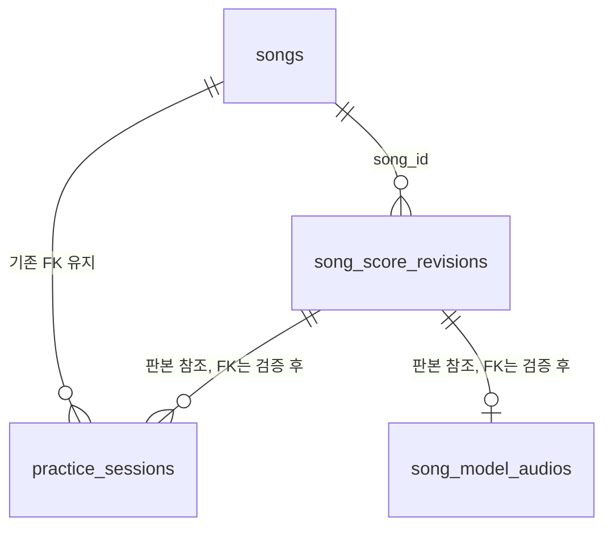

# 화면 흐름 개선 데이터·클라이언트 마이그레이션 상세안

- 상태: **검토용 제안, 미실행·미합의**. SQL은 실행 파일이 아닌 설계 예시다. 운영 DB·데이터·API를 변경하지 않았다.
- 작성일: 2026-11-04 KST. [S15P31E102-434](https://ssafy.atlassian.net/browse/S15P31E102-434), 관련 Story [S15P31E102-24](https://ssafy.atlassian.net/browse/S15P31E102-24).
- 기준: 코드 `65d041d3c3b988458a92995442beb187d7d816f6`, Flyway V1~V21, MySQL 8.4. 운영에 실제 적용된 버전·행 수·백업 상태는 이번에 조회하지 않았다.
- 독자: BE·FE 구현자, 데이터 게시 담당자, 배포 담당자. 원안의 개선을 별도로 채택할 경우 적용할 순서·데이터 조건·중단/복구 기준을 정의한다.
- API 필드·예시는 [API 상세안](screen-api-improvement-design.md)을 따른다. 원안 작성에는 요구사항 명세서와 Notion을 사용하지 않았다. 이후 담당 범위 결정은 연결된 범위 기록에 따로 남겼다.

## 문서의 상태와 적용 범위

이 문서는 **S15P31E102-434의 조사·설계 기록**이다. 아래 API·SQL·배포 단계는 검토용 예시이며 실행 지시나 확정 계약이 아니다. 기준 코드 이후의 제품 동작은 해당 기능 스펙에서 확인한다.

- **3번 계정 격리:** S15P31E102-452의 [MR !296](https://lab.ssafy.com/s15-final/S15P31E102/-/merge_requests/296)으로 develop에 병합됐다. 실제 변경·수치는 [구현 및 검증 기록](../frontend/account-session-isolation.md)을 따른다.
- **8번 내 악보:** 기능이 들어온 뒤 실제 구현·확정 API와 대조해 수정할 후속 항목으로 남긴다. 이 문서 작업에서 구현하거나 새로 연결하지 않는다.
- **나머지 항목:** Joseph Woo 담당 API와 확장 작업을 이번 개선에서 제외한 결정을 유지한다. 과거 악보 보관 A9/M2도 제외한다. [최신 범위와 후속 조건](screen-flow-improvement-integrated.md#current-scope)이 아래 원안의 우선순위·도입 순서보다 우선한다.

원안이 참조한 `screen-api-erd-audit.md` 원문은 확보하지 못했다. 원안의 F1~F11 번호는 기존 참조 식별자로만 보존하며 원문을 복원한 것으로 보지 않는다. 이번에 대조한 코드 근거는 [흐름별 근거 표](screen-flow-improvement-integrated.md#source-evidence)에 따로 기록한다.

## 1. 선택할 마이그레이션 경로

**API·조회·캐시 개선을 먼저 적용하고, 데이터 보존 약속에 필요한 최소 스키마만 선택한다.** source_note_count와 revision을 무조건 모두 추가하지 않는다.

| 경로 | 해결하는 문제 | 추가 스키마 | 해결하지 않는 문제 |
| --- | --- | --- | --- |
| M0 기본 | 기대 판본 검사, 독립 상세, 계정 캐시, 목록·페이지 비용 | 없음 | 과거 악보 본문 복구, 과거 전체/구간 판정 |
| M1 최소 snapshot | 악보 변경 후에도 연주 당시 FULL/SECTION 분류 유지 | `practice_sessions.source_note_count INT NULL` | 악보 재현·오류 음표 위치·분석 재시도에 필요한 원본 |
| M2 revision | 같은 songId의 여러 판본을 보존하고 당시 악보로 읽기/분석 | `song_score_revisions`·세션 검증 표시; 조건부 복합 FK | 이미 덮어쓴 원본 자동 복원, 역사 콘텐츠 접근 권한 자동 부여 |
| M3 콘텐츠 연결 | 레슨 제목 기반 곡 선택 해소 | 기존 lessons.content_json 보완 | 미귀속 로컬 학습 진도의 계정 귀속 |

M2를 곧 채택한다면 분류 기준은 revision.note_count를 사용해 M1의 중복 저장을 피할 수 있다. M1을 먼저 운영한 뒤 M2를 도입한다면 값 동등성 검증과 단일 읽기 기준을 정하고, 이전 컬럼 제거는 마지막에 별도로 검토한다.

공개 악보를 불변으로 두고 수정 시 새 songId를 만드는 정책도 M2의 대안이다. 단, 같은 곡 기록이 ID별로 갈라지는 표시·집계와 기존 곡 보관/숨김 정책을 먼저 합의해야 한다. 제목이 같다는 이유로 ID를 합치지 않는다.

## 2. 현행 스키마와 writer의 제약

| 대상 | 확인한 사실 | 이관에 주는 제약 |
| --- | --- | --- |
| songs | signed BIGINT id, INT score_version, JSON score_json, INT note_count, SMALLINT default_bpm | revision의 참조 타입을 맞춤 |
| practice_sessions | song_id·score_version 보관, note 범위, 본인·멱등 키 제약 | 원곡 음표 수와 본문은 별도 보관하지 않음 |
| song_model_audios | PK `(song_id,score_version)` | DB는 여러 판본 키를 수용하지만 모든 도구가 그러한 것은 아님 |
| user_sheets | 자체 score_version·draft_revision·score_json/draft_json | 공개곡 revision과 한 테이블로 합치지 않음 |
| `enable_scoring.py` | 숨표와 provenance.review를 바꾸면서 score_version 유지 | 동일 키가 JSON 전체 불변을 뜻한다는 가정은 현행에 성립하지 않음 |
| `load_model_audio.py` | 재사용 검증·INSERT 가드가 song당 음원 1개 전제 | revision별 판정으로 바꾸기 전 복수 음원 도입 불가 |
| `publish_model_audio.py` | song_id만으로 음원 JOIN, 해당 곡 음원 1개 검사 | 버전별 게시/숨김 대상 선택 수정이 선행되어야 함 |

M2의 권고 정책은 **전환 이후 보관된 공통 악보 JSON·음표수·BPM·단위를 불변으로 두고 내용이 달라지면 새 판본**을 만드는 것이다. 숨표 변경도 새 원문 판본으로 취급할지, 연주 타임라인 판본과 문서 판본을 따로 둘지는 합의 대상이다. 후자는 식별자·캐시·음원 관계가 늘어나므로 기본안으로 선제 도입하지 않는다.

음원 파일의 bytes가 같아도 새 판본의 note/tick/BPM/offset과 호환되는지 검증해야 한다. 기존 `source_common_sha256`을 새 원문 해시로 무조건 덮어쓰거나 재생성 증거 없이 새 판본 음원으로 복사하지 않는다. 같은 객체 키 재사용은 호환 검수와 출처 기록이 있을 때만 가능하다.

이후 SQL의 `:name`은 **구현할 배치 runner의 바인딩 자리**다. mysql 콘솔에 그대로 실행할 명령이 아니다. ID 목록은 검수 manifest에서 받으며 사용자 입력 문자열을 SQL에 연결하지 않는다.

## 3. M0 — DB 구조를 바꾸지 않는 배포

1. BE에 PRA-01 선택 기대 판본과 PRA-01/03 응답 확장을 추가한다. 세션 생성의 곡 조회·버전 검사·INSERT를 하나의 트랜잭션으로 묶는다. 중복키 예외 뒤에는 트랜잭션을 종료하고 새 읽기로 승자를 조회한다. 잠금 대기 중 같은 키가 성공한 경우를 위해 신규 요청의 검증 실패를 반환하기 전에도 새 읽기로 성공키를 재확인해 replay를 우선한다.
2. PRA-03에서 세션 버전·곡 제목을 읽고 EVA-01과 독립적으로 소비할 수 있게 한다. 공개곡 조건을 세션 소유권 조건으로 잘못 옮기지 않는다.
3. CAT·SHT 목록 SQL에 전용 Row를 둔다. score_json/umulsai_text/draft_json 본문을 빼되 기존 description·장단 pattern·목록 필드와 null 의미는 보존한다. 상세/편집 query는 유지한다.
4. REC의 주간 summary를 추가한다. 서버 최신 저장 정렬과 FE 최신 연주 정렬 중 채택할 의미를 정한다. 최근 연주 유지 시 `songs[].lastPlayedAt`을 추가한다.
5. 신 FE의 기본 모델/decoder를 먼저 준비하고, 실제 서버 응답 필드가 준비된 뒤 독립 상세·lazy pagination을 활성화한다. 구 서버에서도 일부 페이지로 전체 주간 수치를 계산하지 않도록 호환 경로를 남긴다.

**복구:** 새 FE 경로를 비활성화하고 기존 읽기 경로로 돌아갈 수 있다. 단, 계정 캐시 격리와 지연 응답 차단은 유지한다. expectedScoreVersion을 무시하는 구 BE로 회귀하면 신 FE의 판본 보호가 사라지므로 생성 차단 또는 동일 보호를 유지한 수정 릴리스가 필요하다. 선택 필드를 모르는 구 서버가 요청을 수용하는지에 기대어 안전하다고 판단하지 않는다.

## 4. 사전 진단과 이관 manifest

실행 담당자가 배포 대상 DB 이름·MySQL 버전·실제 DDL·Flyway 이력을 확인하고, 복구 가능한 백업과 복원 절차를 확인한다. 이 문서의 스냅샷에 V21까지 있다고 해서 다음 운영 파일명을 V22로 확정하지 않는다. 병합 직전 최신 develop의 다음 번호를 배정하고 이미 적용한 migration/checksum을 수정하지 않는다.

다음은 **읽기 전용 진단 SQL 후보**다. 결과를 이번에 실행한 것으로 보고하지 않는다.

```sql
SHOW CREATE TABLE songs;
SHOW CREATE TABLE practice_sessions;
SHOW CREATE TABLE song_model_audios;
SELECT installed_rank, version, description, success
FROM flyway_schema_history ORDER BY installed_rank;

-- 세션과 현재 판본의 차이. current_matched도 역사 원문 동일의 증명은 아니다.
SELECT
  COUNT(*) AS total_sessions,
  SUM(CASE WHEN ps.score_version = s.score_version THEN 1 ELSE 0 END) AS current_matched,
  SUM(CASE WHEN ps.score_version <> s.score_version THEN 1 ELSE 0 END) AS historical_version
FROM practice_sessions ps
JOIN songs s ON s.id = ps.song_id;

-- 현재 음표 수로도 범위가 맞지 않는 행을 별도 조사한다.
SELECT ps.id, ps.song_id, ps.score_version, s.score_version AS current_version,
       ps.start_note_idx, ps.end_note_idx, s.note_count
FROM practice_sessions ps
JOIN songs s ON s.id = ps.song_id
WHERE ps.start_note_idx < 0
   OR ps.end_note_idx < ps.start_note_idx
   OR (ps.score_version = s.score_version AND ps.end_note_idx >= s.note_count)
ORDER BY ps.id;

-- 같은 곡의 음원 판본 수와 게시 상태: 도구 수정 영향의 입력.
SELECT song_id, COUNT(*) AS audio_versions,
       MIN(score_version) AS min_version, MAX(score_version) AS max_version
FROM song_model_audios
GROUP BY song_id
ORDER BY song_id;

-- DB 판본과 공통 JSON 내부 판본의 타입/값이 같은지 확인한다.
SELECT id, score_version,
       JSON_EXTRACT(score_json, '$.score.scoreVersion') AS json_version
FROM songs
WHERE NOT (JSON_TYPE(JSON_EXTRACT(score_json, '$.score.scoreVersion')) <=> 'INTEGER')
   OR NOT (JSON_UNQUOTE(JSON_EXTRACT(score_json, '$.score.scoreVersion'))
           <=> CAST(score_version AS CHAR));
```

배치 manifest에는 대상 song/session ID 범위, 기대 판본, 원본/대상 해시와 해시 규칙, note_count 검수 근거, 원본 경로, 실행 코드 커밋, 적용 전후 건수, 마지막 완료 배치, UTC 수행 시각을 기록한다. 개인정보·세션 메모·녹음 URL·DB 비밀번호를 넣지 않는다. 배치 결과는 변경 성공/실패/결과 불명확을 구분한다.

연결이 끊기거나 timeout이면 같은 배치를 바로 재실행하지 않고 저장 결과를 먼저 읽는다. 원본과 같은 결과면 완료 확인, 아직 미적용이면 해당 배치만 재시도, 일부 불일치면 원인을 해결한 뒤 진행한다.

## 5. M1 — 연주 당시 음표 수 snapshot

### 5.1 확장 DDL

```sql
ALTER TABLE practice_sessions
  ADD COLUMN source_note_count INT NULL AFTER score_version,
  ADD CONSTRAINT chk_sessions_source_note_count
    CHECK (
      source_note_count IS NULL
      OR (source_note_count > 0 AND end_note_idx < source_note_count)
    );
```

현행 `start_note_idx >= 0`, `end_note_idx >= start_note_idx` 제약은 유지한다. NULL은 **당시 원곡 음표 수 미확인**, 0은 유효 대체값이 아니다. nullable 확장이므로 구 writer는 계속 INSERT할 수 있으나 그 행은 UNKNOWN이다. 기존 데이터에 NOT NULL/임의 기본값을 한 번에 강제하지 않는다.

### 5.2 새 행 쓰기

PRA-01 트랜잭션에서 곡 행을 잠그고 얻은 `score_version`, `note_count`, `bpmUnit`, 상태와 함께 범위를 검증한다. 같은 트랜잭션에서 세션에 `score_version`과 `source_note_count`를 저장한다. 마지막에 현재 곡을 다시 조회해 값을 채우는 비동기 보정은 당시 값을 잃으므로 사용하지 않는다.

채점 불가·note_count=0 곡은 현행 연습 가능 검사를 통과하지 않아야 한다. 곡 게시 writer가 버전/note_count를 바꾸는 동시성 검사도 수행한다. 모든 앱 서버가 새 writer로 바뀐 시점을 기록한 뒤 신규 세션의 NULL 발생 건수를 확인한다.

### 5.3 기존 행 백필

현재 버전 번호가 같다는 것만으로는 부족하다. 해당 곡의 같은 버전에서 **음표 수가 바뀌지 않았다는 게시 이력/원본 근거**를 확인한 범위만 채운다. 숨표만 바뀐 사례는 note_count 동일의 근거가 될 수 있지만 모든 곡의 모든 과거 변경을 증명하지는 않는다.

```sql
UPDATE practice_sessions ps
JOIN songs s ON s.id = ps.song_id
SET ps.source_note_count = s.note_count
WHERE ps.source_note_count IS NULL
  AND ps.score_version = s.score_version
  AND s.note_count > 0
  AND ps.start_note_idx >= 0
  AND ps.end_note_idx >= ps.start_note_idx
  AND ps.end_note_idx < s.note_count
  AND ps.id BETWEEN :firstSessionId AND :lastSessionId
  AND s.id IN (:verifiedSongIds);
```

이 SQL은 검수부터 커밋까지 대상 게시가 동결된 경우의 예시다. 동결 대신 행 잠금을 사용한다면 **잠금 획득 후 manifest의 기대 판본·검수 note_count·필요한 원문 해시를 다시 대조**하고, SQL도 곡별 검수 값을 SET/WHERE에 바인딩하거나 검수 manifest staging 데이터와 JOIN해야 한다. 검수 뒤 잠금 전에 바뀐 곡을 verifiedSongIds만 보고 처리하지 않는다.

작은 ID 구간별로 적용하고 예상 변경 수와 재조회 결과를 대조한다. 이미 채운 값을 덮어쓰지 않으므로 동일 대상 재실행은 0건이어야 한다. 배치 크기는 복제 지연·잠금 시간을 보고 정하며 임의 대량 전체 UPDATE를 배포 migration에 포함하지 않는다.

복구 불가 판본은 NULL을 남긴다. `end_note_idx+1`, 녹음 길이, 평가 음표 개수로 원곡 길이를 만들어내면 구간 연주를 전체 연주로 오판할 수 있다.

### 5.4 읽기 전환

```sql
CASE
  WHEN ps.source_note_count IS NULL THEN 'UNKNOWN'
  WHEN ps.start_note_idx = 0
       AND ps.end_note_idx = ps.source_note_count - 1 THEN 'FULL'
  ELSE 'SECTION'
END
```

REC DTO와 GRO 통계의 FULL/SECTION을 같은 기준으로 바꾼다. 기존 SQL의 `ELSE 1` 또는 `NOT(FULL 조건)`을 단순 치환하면 UNKNOWN이 SECTION으로 들어갈 수 있으므로 세 값을 명시적으로 처리한다. [API A10](screen-api-improvement-design.md#92-전체구간의-연주-당시-기준)의 추가형 scope와 구 boolean 이행 규칙을 함께 적용한다.

전환 전에는 기존 판정과 새 판정을 병렬 계산해 차이 건수를 검토한다. 예: v1 96음표 전체 0~95 → v2 100음표 이후에도 FULL, v1 100음표 부분 0~79 → v2 80음표 이후에도 SECTION. 모르는 과거 행은 UNKNOWN이다.

**완료 기준:** 새 writer 이후 신규 NULL 0건, 범위 위반 0건, 검수된 백필 범위 누락 0건, UNKNOWN 건수와 처리 정책 기록, REC/GRO 동일 판정. 과거 NULL이 남으면 NOT NULL 전환을 하지 않는다.

**복구:** 읽기 전환만 이전으로 돌리고 컬럼/값은 보존한다. 구 writer로 회귀한 기간의 세션은 NULL이 생길 수 있어 구간과 시각을 기록한다. 정확한 당시 값 없이 일괄 보정하지 않는다. 이 snapshot은 악보 본문이나 과거 분석 원본을 복구하지 않는다.

## 6. M2 — 악보 판본 보관

### 6.1 최소 테이블

```sql
CREATE TABLE song_score_revisions (
  song_id BIGINT NOT NULL,
  score_version INT NOT NULL,
  score_json JSON NOT NULL,
  note_count INT NOT NULL,
  default_bpm SMALLINT NOT NULL,
  bpm_unit VARCHAR(20) NOT NULL,
  created_at DATETIME(6) NOT NULL DEFAULT CURRENT_TIMESTAMP(6),
  PRIMARY KEY (song_id, score_version),
  CONSTRAINT fk_song_revision_song
    FOREIGN KEY (song_id) REFERENCES songs(id),
  CONSTRAINT chk_song_revision_version CHECK (score_version >= 1),
  CONSTRAINT chk_song_revision_notes CHECK (note_count >= 0),
  CONSTRAINT chk_song_revision_bpm CHECK (default_bpm BETWEEN 30 AND 400),
  CONSTRAINT chk_song_revision_unit
    CHECK (bpm_unit IN ('QUARTER','DOTTED_QUARTER','JEONGGAN','JANGDAN_BEAT'))
) ENGINE=InnoDB DEFAULT CHARSET=utf8mb4 COLLATE=utf8mb4_0900_ai_ci;

ALTER TABLE practice_sessions
  ADD COLUMN score_revision_verified BOOLEAN NOT NULL DEFAULT FALSE,
  ADD CONSTRAINT chk_sessions_revision_verified
    CHECK (score_revision_verified IN (0, 1));
```

이 예시는 악보 원문·음표수·기준 BPM·단위 보존을 최소 범위로 삼는다. 세션의 연주 BPM 범위(20~240)와 곡의 기본 BPM 범위(30~400)를 혼동하지 않는다. score_json 안의 schemaVersion과 DB score_version은 다른 개념이다.

당시 제목·소개·난이도·악기 메타데이터까지 독립 보존해야 한다면 필요한 snapshot 필드를 추가해야 한다. 최소 테이블만으로 그 보장을 하지 않는다. 새 surrogate revision ID는 필요하지 않다. 세션의 `score_revision_verified`는 보관 행의 존재와 **이 세션에 사용된 원문이라는 검증**을 구별하는 권고 필드다. false를 기본값으로 두어 기존 행과 구 writer를 자동 신뢰하지 않는다. 검증 근거/허용 시점은 6.3에 정의한다.



그림의 복합 관계는 목표 논리 관계다. 초기 확장 단계에 FK가 이미 걸린다는 뜻이 아니다. `songs(id,score_version)`에서 revisions로 역방향 FK까지 즉시 걸면 revision→songs와 순환해 새 곡 INSERT 순서가 어려워지므로 최소안에서 제외한다. 현재 포인터의 유효성은 게시 트랜잭션과 대조 검사로 유지한다.

### 6.2 현재 판본 보관

1. 게시 writer를 동결하거나 곡별 잠금과 새 writer 전환을 준비한다.
2. 선택 행의 공통 JSON schema, note_count, BPM과 단위, 참조 음표의 정합성을 기존 decoder/검증기로 검사한다. 누락 단위를 임의 QUARTER로 채우지 않는다.
3. 검수 manifest에 현재 원문을 기록한 후 다음 배치로 저장한다. 검수부터 커밋까지 게시 동결을 유지하거나, 잠금 획득 후 manifest의 기대 버전/원문/음표수/단위를 재검증한다. 불일치한 현재 행을 새 검수 없이 복사하지 않는다.

```sql
INSERT INTO song_score_revisions
  (song_id, score_version, score_json, note_count, default_bpm, bpm_unit)
SELECT s.id, s.score_version, s.score_json, s.note_count, s.default_bpm,
       COALESCE(j.bpm_unit,
         JSON_UNQUOTE(JSON_EXTRACT(s.score_json, '$.music.bpmUnit')))
FROM songs s
LEFT JOIN jangdans j ON j.id = s.jangdan_id
WHERE s.id BETWEEN :firstSongId AND :lastSongId
  AND NOT EXISTS (
    SELECT 1 FROM song_score_revisions r
    WHERE r.song_id = s.id AND r.score_version = s.score_version
  );
```

`NOT EXISTS`는 이미 있는 동일 행을 건너뛰기 위한 장치다. **같은 키에 다른 본문이 있으면 실패**해야 하므로 적용 전후 별도 동등성 검사가 필수다. `ON DUPLICATE KEY UPDATE score_json=…`로 판본을 덮어쓰지 않는다. JSON 비교는 키 순서·숫자 표현을 고려해 합의한 canonical 비교기를 사용한다. 음원 파일 bytes의 SHA-256과 DB JSON canonical 해시는 동일 알고리즘 입력이 아니다.

PUBLISHED만 복사하면 HIDDEN/DRAFT/삭제표시 곡을 참조한 세션을 놓칠 수 있다. 참조 관계를 조사해 범위를 정한다. `created_at`은 **이 테이블에 보관한 시각**이지 과거 제작/게시시각의 복원값이 아니다.

이미 같은 번호로 원문을 수정한 이력은 한 복합키로 모두 구분할 수 없다. 도입 이전 세션의 정확한 원문 보장은 확인된 대상에만 한다. 현재 원문 보관 성공을 모든 과거 세션의 완전 복구로 보고하지 않는다.

### 6.3 과거 판본 복구와 미복구 관리

세션/음원이 요구하는 키 중 없는 원본을 다음처럼 찾는다.

```sql
SELECT ps.song_id, ps.score_version, COUNT(*) AS affected_sessions
FROM practice_sessions ps
LEFT JOIN song_score_revisions r
  ON r.song_id = ps.song_id AND r.score_version = ps.score_version
WHERE r.song_id IS NULL
GROUP BY ps.song_id, ps.score_version;

SELECT a.song_id, a.score_version
FROM song_model_audios a
LEFT JOIN song_score_revisions r
  ON r.song_id = a.song_id AND r.score_version = a.score_version
WHERE r.song_id IS NULL;
```

복구 후보는 당시 검수 원본·버전이 확인되는 보관 bundle/백업 등이다. 곡 ID·판본·note 수·내용 해시·출처가 검증된 것만 INSERT한다. 최신 JSON을 1~현재버전-1로 복사하거나 빈 JSON을 넣어 참조만 맞추지 않는다. note_results는 녹음 평가 결과이므로 전체 원본 악보를 재구성할 증거로 충분하지 않다.

미복구 키는 manifest에 영향 세션 수·읽기 제한을 기록하고 점수·메모·녹음은 기존 권한으로 계속 제공한다. 같은 번호 여러 내용 문제를 해결할 근거가 없으면 해당 과거 세션의 정확한 overlay/재분석도 보장하지 않는다. 조회 폴백으로 현재 악보를 대신 반환하지 않는다.

**세션별 신뢰 판정:** revision이 있어도 `score_revision_verified=false`이면 역사 악보 API는 SCORE_REVISION_UNAVAILABLE을 반환하고 정확한 overlay/재분석에는 쓰지 않는다. true를 저장할 수 있는 경우는 다음뿐이다.

- 검수 manifest가 해당 세션의 실제 원문과 보관 원문의 동일성을 증명하여 검수된 세션 ID/복합키 범위를 명시한 경우. 범위·해시·검수 근거를 재확인한 배치에서만 true로 바꾼다.
- 불변 writer 전환 후 **새로 발행해 한 번도 다른 내용에 사용하지 않은 판본**을 신 FE가 실제 take에서 명시적으로 전달했고, 서버가 그 판본과 일치하는 revision을 선택해 세션을 생성한 경우. 같은 트랜잭션에서 true를 쓴다.

생성일이 전환 이후라는 사실만으로 true를 쓰지 않는다. 앱이 전환 전 같은 번호의 다른 악보를 캐시하거나 오래된 take를 가지고 있을 수 있다. 검증 없는 legacy 요청·기존 번호는 false를 유지한다. 콘텐츠 fingerprint 계약을 추가하지 않는 최소안에서는 이 제한을 받아들인다. 불명 세션을 단순히 최신 판본으로 재지정하지 않는다.

FK는 참조 존재만 확인하며 이 검증 표시를 대체하지 않는다. M1의 음표 수 근거가 별도로 있으면 FULL/SECTION만 판정할 수 있지만 정확한 원문 복구로 승격하지 않는다. M2만 적용한 미검증 세션은 revision.note_count도 당시 분류 근거라고 추정하지 않는다.

### 6.4 게시 writer 전환

모든 쓰기 경로를 다음 흐름으로 준비한다. **writer 배포와 새 판본의 실제 발행 허용을 분리한다.** 구 reader가 남은 동안은 현재 판본의 보관/검수 쓰기만 허용하고, 기존 곡의 버전 증가는 reader 전환·검증 뒤에 연다. 신규 곡은 DRAFT song INSERT → revision INSERT 순서로 같은 트랜잭션에서 준비한다.

1. 대상 songs 행 잠금. 작업자가 검수한 현재 버전/내용 해시와 일치하는지 확인한다.
2. 새 `(songId,nextVersion)`이 없고 새 원문의 schema/note/BPM·음원 연결이 검수됐는지 검사한다. DB score_version과 JSON의 `score.scoreVersion`, 배포 common/performance artifact의 판본 식별자를 함께 대조한다.
3. 새 revision INSERT. 충돌 시 내용이 같으면 재시도 결과 확인, 다르면 실패한다.
4. **음원이 준비된 경우** 새 판본 음원 metadata를 해당 복합키에 INSERT하고 원본·연주 시간표·음원 해시의 연결을 확인한다. 음원 없는 악보를 이 이관 때문에 금지하지 않는다. 준비되지 않았으면 기존 모범 음원 not-found 처리를 유지한다. 객체 파일은 DB 트랜잭션 전에 준비·검증하되 게시 전에는 기존 정책상 비공개 상태를 유지한다.
5. 같은 트랜잭션에서 songs의 현재 score_version/score_json/note_count/default_bpm을 새 판본으로 바꾼다. 현행 reader는 장단 단위를 JSON보다 우선하므로 기존 jangdan_id의 단위 일치를 확인하거나 검수한 연결 변경/NULL 처리도 같은 트랜잭션에 포함한다. 현재 본문은 호환/비교 용도로 당분간 유지한다.
6. COMMIT 후 현재 포인터·revision·음원의 정합성을 재조회한다. 실패/결과 불명확은 실제 저장 상태부터 확인한다.

같은 DB의 revision과 현재 본문 갱신을 별도 커밋으로 나누지 않는다. 게시/세션 생성은 songs→revision→audio/session 순서로 잠금을 통일하고, 여러 곡은 ID 순서로 처리한다. 파일 업로드와 큰 원본 검증은 잠금 전에 수행하고 잠금 안에서는 기대값이 바뀌지 않았는지 확인한다. 외부 객체 업로드는 DB rollback으로 되돌아가지 않으므로 미게시 객체의 잔여물은 별도 확인 대상으로 기록한다. 자동 삭제는 이 설계에서 실행하지 않는다.

`load_model_audio`의 검증/재사용 가드, `publish_model_audio`의 JOIN/UPDATE는 `(song_id,score_version)`으로 대상화한다. '곡을 숨김'이 현재 음원만 숨기는지 모든 역사 음원 접근까지 막는지 정책을 구분한다. `enable_scoring`의 같은 버전 JSON 변경을 그대로 둔 채 불변 revision을 선언하지 않는다. DB를 직접 수정하는 운영 절차도 같은 정책을 따라야 한다.

**판본 번호를 자동 감소시켜 롤백하지 않는다.** 이미 v4 세션이 생겼는데 현재를 v3로 돌리면 구 reader가 v4를 못 읽을 수 있다. 새 판본 게시 후의 복구는 기존 revision 보존·영향 기능 일시 차단·revision 지원 코드를 유지한 수정 릴리스를 우선한다. 같은 음악 내용으로 복구하더라도 새 게시 판본을 만드는 선택은 음원 정합성을 다시 검수한다.

### 6.5 reader 전환과 선택적 FK

reader 대상은 공개 CAT만이 아니다. 분석 기준 음표 조회, 평가 noteIdx→위치 변환, 취약구간, 기록 각 범위, 성장 FULL/SECTION을 모두 세션 판본 기준으로 전환한다. 공개 CAT은 현재 포인터를 통해 읽고, 역사 조회는 세션 소유권과 합의된 콘텐츠 정책을 먼저 검사한다.

전환 초기는 shadow 비교로 현재 판본의 원문·투영·note 수 동등성을 확인한다. 과거 판본이 없거나 세션의 검증 표시가 false이면 history unavailable을 명시하고 현재 본문으로 대체하지 않는다. M1 snapshot과 검증된 revision.note_count가 동시에 있다면 불일치 행을 조사하고 어느 값을 정본으로 삼을지 합의한다.

엄격한 reader 전환 전에 진행 중 RECORDING/PENDING·재시도 대상과 구 pending take를 집계한다. 검증 가능한 건은 검수하고, 기존 reader에서 완료될 건은 완료를 확인한 뒤 전환한다. 남은 미검증 세션은 재분석 불가/재연주 안내 정책을 합의해야 한다. 기존 성공 평가를 재작성하거나 무검수 상태를 true로 바꿔 전환하지 않는다. 필수 reader가 준비된 뒤에만 새 판본 발행을 허용한다.

**전환 후 신규 legacy 요청도 처리해야 한다.** 엄격한 분석 모드를 켜기 전에 기대 판본 누락/null 신규 요청의 지원 종료·신 FE 전환을 합의하고 PRA-01 생성 단계에서 거절한다. 명시 요청도 검증 가능한 불변 원문으로 연결할 수 없으면 INSERT 전에 거절한다. 상세 오류는 [API A1 전환](screen-api-improvement-design.md#34-전환과-수용-기준)에 따른다. 기존 성공 요청 replay는 유지하되 그 세션의 분석 가능 여부까지 새로 보장하지 않는다. 최초 불변 판본 발행·생성 허용 목록·엄격 reader 활성화를 조율하고, 허용 판본이 준비되지 않으면 연습 시작을 잠시 막고 갱신 안내를 한다. 구 앱 지원 종료가 합의되지 않았다면 M0를 유지하고 M2 엄격 전환을 보류한다. '신규 세션 생성 성공 후 모두 분석 거절' 상태로 배포하지 않는다.

다음 FK는 **모든 기존 참조가 복구되고 모든 writer가 새 흐름으로 전환된 뒤에만** 적용한다.

```sql
ALTER TABLE practice_sessions
  ADD INDEX idx_sessions_song_revision (song_id, score_version),
  ADD CONSTRAINT fk_sessions_song_revision
    FOREIGN KEY (song_id, score_version)
    REFERENCES song_score_revisions(song_id, score_version);

ALTER TABLE song_model_audios
  ADD CONSTRAINT fk_model_audio_revision
    FOREIGN KEY (song_id, score_version)
    REFERENCES song_score_revisions(song_id, score_version);
```

audio는 이미 복합 PK가 있어 같은 순서의 인덱스를 중복 생성하지 않는다. 실제 환경에 세션 인덱스가 이미 있는지도 확인한다. 참조/피참조 열 타입과 인덱스 요구는 [MySQL 8.4 FK 문서](https://dev.mysql.com/doc/refman/8.4/en/create-table-foreign-keys.html)를 따른다.

미복구 행이 1개라도 있으면 전역 FK는 보류하고 검수된 신규 쓰기 경로·정합성 검사로 관리한다. `foreign_key_checks=0`이나 가짜 revision으로 통과시키지 않는다. 기존 song_id FK는 확장 단계에서 유지한다. 과거 revision 삭제는 보관·탈퇴·콘텐츠 정책 검토 없이 cascade로 추가하지 않는다.

**최종 수축은 후속 선택:** 구 BE/도구가 사라지고 복구 기간이 끝나기 전 songs.score_json 제거를 하지 않는다. 이 개선의 완료 조건은 컬럼 삭제가 아니다. 중복 현재 본문을 계속 유지하면 게시 트랜잭션이 두 저장값의 일치를 책임져야 한다.

## 7. M3 — 레슨 연결 데이터와 로컬 진도

검수 manifest는 `(lessonId,track,candidateIndex,기존 title/meta,선택 songId,instrumentId)`를 포함한다. 내용이 예상과 다른 레슨은 자동 덮어쓰지 않는다. 제목만 매칭하거나 첫/마지막 검색 결과를 고르지 않는다.

기존 lessons.content_json의 선택 후보에만 ID 쌍을 추가한다. 나머지 goal/tasks/source 등은 보존한다. 읽기 parser는 없는 필드를 null로 처리하고, 존재하면 ID 타입/쌍/악기/공개 가능 조건을 검사한다. 모든 후보가 없을 때도 레슨 콘텐츠 자체는 제공한다. 같은 키로 재실행하면 변화 0건, 다른 목표 매핑이면 별도 검수로 처리한다.

FE 학습 API 연결은 서버 requiredCount·optional 단계·completedAt를 정본으로 사용한다. 기존 `learn_done_<instrument>` 값은 회원 정보가 없어 자동 귀속할 수 없다. 서버 진도를 내려받아 표시하고 legacy 값은 별도 이름으로 격리한다. 사용자 선택 이관을 채택한다면 트랙/단계 ID를 명시적으로 매핑한 뒤 각 완료 PUT의 성공을 확인하고 처리 완료 표식을 회원별로 남긴다. 네트워크 실패를 완료로 간주하지 않는다.

로컬 샘플 내 악보는 실사용 문서인지 확인할 정보가 없으므로 임의 서버 업로드하지 않는다. API 연결 후 신규 서버 ID와 문자열 판본을 사용하고 기존 샘플 객체가 서버 객체를 덮어쓰지 않게 한다.

## 8. FE 전환 — 계정·시도·페이지 상태

<a id="account-cache"></a>

### 8.1 A3 계정 캐시 격리

현행 SignedInMember에는 member ID와 Mutex가 있고 계정 변경 이벤트/epoch는 없다. 다음 `AccountSession(memberId,epoch)`는 **신규 FE 내부 상태 제안**이다. 모듈/아키텍처를 새로 쪼개는 작업은 필요하지 않다.

1. 로그인/가입/소셜가입/계정 병합 성공, 로그아웃·탈퇴로 인증 주체가 바뀌는 모든 경로에서 epoch를 증가시킨다.
2. 기록 목록·상세·성장·진도·본인 악보·서명 재생 URL과 진행 중 UI 상태를 즉시 비운다. A→B 전환 중 실패를 A 캐시로 대체하지 않는다.
3. 사용자 동작 때 `(memberId,epoch)`를 캡처한다. 인증 Mutex/whileSignedIn 임계영역 안에서 **요청 발송 전** 현재 값과 대조하고, 달라졌으면 전송하지 않는다. A의 완료/악보 생성/take 제출이 대기 중 B 쿠키로 전송되지 않아야 한다.
4. 응답·낙관 갱신·저장/삭제 성공 반영 직전에도 같은 값을 대조한다. 다르면 폐기한다. A→B→A의 늦은 A 응답도 epoch로 차단한다. 기존 인증 Mutex/whileSignedIn의 쿠키 보호를 유지하며 epoch 검사로 대체하지 않는다. 전체 목록 순회 하나를 장시간 lock에 묶는 방식 대신 개별 요청과 lazy pagination으로 범위를 줄인다.
5. 네트워크 실패 시 이전 데이터를 남기는 정책은 같은 계정·같은 epoch 안에서만 허용한다. 401에서 다른 계정의 stale 상태를 되살리지 않는다.

다른 계정 캐시를 서버에서 삭제하는 작업은 아니다. 공개 카탈로그 캐시는 본인 정보가 섞이지 않는 경우 별도로 유지할 수 있다. 소유 세션으로 읽은 역사 악보는 공개 카탈로그 캐시에 섞지 않는다.

### 8.2 실제 연주 판본의 전달

현행 FE는 녹음 시작 전에 PRA-01을 호출하지 않는다. 녹음 완료 후 AnalysisSession에서 곡을 다시 조회하고 세션을 생성한다. 따라서 필드만 추가해 '녹음 전에 충돌을 막았다'고 보고하면 틀리다.

최소 전환은 실제 녹음에 사용한 불변 메타데이터 `(songId,scoreVersion,bpm,bpmUnit,startNoteIdx,endNoteIdx)`를 RecordedTake와 함께 캡처하고 화면 이동→AnalysisSession→createAndSend→재전송까지 전달하는 것이다. 녹음 완료 후 재조회한 최신 scoreVersion으로 덮어쓰지 않는다. 세션 성공의 판본/범위를 캡처 값과 대조한 뒤 업로드한다.

현행 생명주기를 유지하면 충돌 발견 시점은 **녹음 완료 후 업로드 전**이다. 기존 take를 다른 판본으로 자동 제출하지 않고 재연주/재선택을 안내한다. 실제 파일의 임시 보관·삭제는 기존 녹음 자원 정책을 따르며 이 제안 때문에 즉시 파기하지 않는다.

같은 take 재시도는 최초 key와 요청 본문을 함께 유지한다. 구 take에 판본이 없다면 최신 판본으로 채우지 않는다. 이미 sessionId가 있는 PendingRecording은 기존 세션으로 업로드를 재개하며 PRA-01을 다시 만들어 다른 세션에 옮기지 않는다. 현행 pending 영속 형식은 회원 ID·세션 ID·시작 시각·곡 ID·BPM·경로의 6칸이다. 형식을 확장하면 명시적 schemaVersion을 둔 새 형식과 구 6칸 reader를 함께 제공하고, 구 세션의 판본/범위는 PRA-03에서 확인한다. 파싱 실패 원본을 조용히 삭제하거나 타 계정으로 이관하지 않는다. 인증이 바뀌면 재개 요청 자체를 전송하지 않는다.

녹음 시작 전 검사를 제품 목표로 삼으면 PRA-01 시점을 앞당기는 별도 생명주기 변경이 필요하다. 취소/화면 이탈로 남는 RECORDING 세션, 세션 만료, 업로드 시간 제한, idempotency 키 생존 기간과 재시작 흐름을 함께 설계·검증해야 한다. 판본 이력 없이 이 시점만 이동해도 녹음 도중 게시 변경은 해결되지 않는다.

### 8.3 기록 상세와 페이지

기록 상세의 최초 입력은 sessionId다. 목록 cache가 없어도 PRA-03→EVA-01로 모델을 만들고 악보/재생을 독립 상태로 로드한다. 본인·판본 확인 전에는 stale cached overlay를 표시하지 않는다.

페이지는 `(memberId,epoch,songId,sort,size,page)`별로 보관한다. 요청 도중 곡·정렬이 바뀌면 이전 결과를 새 선택에 붙이지 않는다. summary와 items의 loading/error를 나누고, 더보기 실패 시 이미 받은 같은 계정 페이지는 유지한다. 삭제 시 선택 상세·목록·summary를 함께 무효화하며 뒤 페이지를 당겨 채우는 과정에서 중복/건수 오류를 검사한다.

성장 점수 추이는 서버 비교 조건을 그대로 사용한다. 내 악보의 정식 버전과 draft revision은 별개로 관리하고 409를 무조건 덮어쓰기 재시도로 바꾸지 않는다. 기존 API 연결만으로 PDF import/export 지원을 표시하지 않는다.

## 9. 배포 단계와 중단·복구 기준

| 단계 | 담당/산출물 | 진입·완료 기준 | 중단·복구 |
| --- | --- | --- | --- |
| R0 결정 | BE·FE·기획: M1/M2, 역사 접근·통계·구 앱 지원 범위 | 제안별 채택/보류와 책임자가 기록됨 | 미정 항목의 종속 구현/배포 보류, M0 독립 작업 가능 |
| R1 사전점검 | BE·Infra: 실제 DDL/Flyway·백업·writer 목록·검수 manifest | 대상/예상 건수/복원 방법 확인 | 환경·checksum 불일치 시 조사부터 |
| R2 확장 | BE: nullable 열 또는 revision 테이블, 추가형 API | 구 BE/FE 호환 검사 통과 | DDL 실패 시 실제 구조 확인, 무조건 전체 재실행 금지 |
| R3 새 writer | BE·게시 담당: 원자 생성/버전 보존 writer | 신규 보관 누락 0, 같은 버전 덮어쓰기 차단. 버전 증가는 아직 금지 | 구 게시 도구 중지, 새 판본 발행 차단 |
| R4 백필 | BE·데이터 담당: 배치 receipt/미복구 목록 | 배치별 동등성·재실행·건수 검증 | 불일치 배치만 중단, 완료된 배치는 보존 |
| R5 reader/FE | BE·FE: 비교 결과·실기기 증거 | 독립 상세·계정·페이지·판본 시험, 미검증 진행 세션 처리, 신규 legacy 요청 정책 완료 후 새 판본 발행 허용 | 첫 새 판본 발행 전에는 읽기 복귀 가능. 이후 current-only reader로 복귀 금지, 판본 지원 수정본 사용 |
| R6 제약 강화 | BE·Infra: FK·필수화·수축별 별도 변경 | 미복구 0, 구 writer 제거, 지원 종료 합의 | 조건 미충족이면 이 단계만 보류 |

모든 변경을 한 migration/한 번의 배포로 묶지 않는다. 순서는 **확장 → 새 쓰기 → 검수 백필 → 읽기 전환 → 선택적 제약/수축**이다. M0의 계정 캐시 개선은 DB 결정과 독립적으로 진행할 수 있다.

MySQL의 CREATE/ALTER 등 DDL은 일반 DML 트랜잭션처럼 사용자 ROLLBACK으로 되돌릴 수 없다. atomic DDL도 여러 migration 문장 전체를 하나의 rollback 단위로 만들어 주는 뜻이 아니다. 따라서 기본 복구는 추가 열/테이블을 남기고 앱 동작을 되돌리거나 후속 수정 migration으로 정합성을 회복하는 방식이다. [암시적 커밋](https://dev.mysql.com/doc/refman/8.4/en/implicit-commit.html), [atomic DDL](https://dev.mysql.com/doc/refman/8.4/en/atomic-ddl.html).

운영 DDL의 lock/실행시간·온라인 처리 가능 여부는 실제 테이블 크기·인덱스·MySQL 조건에서 리허설한다. `LOCK=NONE`/무중단/즉시 완료를 검증 없이 약속하지 않는다. 승인된 실행 시간과 중단 기준은 리허설 결과로 정한다.

판본 수, 백필 성공/미복구 수, 신규 NULL, 기대 판본 충돌, 동일 키 내용 충돌, 구 요청 생략 비율, history 조회 실패 이유, DB 잠금/지연을 확인한다. 이 값은 필요한 관측 제안이며 기존 Prometheus metric 이름이 있다고 가정하지 않는다. member ID/키/원문/URL을 metric label로 넣지 않는다.

## 10. 검증 계획과 실제 수행 범위

### 10.1 구현 후 필수 검사

| 층 | 고정 데이터/시나리오 | 통과 조건 |
| --- | --- | --- |
| 계약 | 구/신 요청·응답, v1/v2 해시, 누락/null/오류 타입 | 호환 경로와 400/401/404/409 구별 |
| MySQL 확장 | 빈 DB, V21 스냅샷, 기존 세션/음원/미복구 판본 | 새 migration 적용, 구 reader/writer 영향 확인 |
| M1 백필 | 검수 가능 동일 판본·불명 판본·구간 연습 | 확인된 값만 채움, 반복 0건, UNKNOWN 유지 |
| M2 백필 | 같은 키/같은 내용, 같은 키/다른 내용, 없는 과거 원본 | 같은 내용 재사용, 충돌 실패, 가짜 복원 없음 |
| 게시/생성 경합 | 생성이 먼저 잠금, 게시가 먼저 잠금, 동일키2개+게시1개 삼자 경합 | 혼합 판본 없음, 하나의 세션, 성공 replay 버전 불변 |
| reader | 현행/이력/숨김/삭제/다른 회원/없는 revision/같은 키 미검증 세션 | 검증된 원문만 제공, 점수/녹음 실패 전파 없음 |
| FK 강화 | orphan 0/1건, 기존 audio 복합 PK | 0건에서만 강화; 누락을 숨기지 않음 |
| FE | A→B→A 늦은 응답, 계정 전환 대기 중 mutation, 목록 미방문 상세, 녹음 중 판본 변경 | 이전 계정 mutation HTTP 0건, 계정 혼입·현재 판본 대입·잘못된 overlay 없음 |
| 페이지/통계 | KST 주 경계, 저장/삭제, 늦게 저장한 과거 연주 | 주간·정렬 합의 의미 유지, 부분 목록 집계 금지 |
| 회귀/복구 | 확장 후 구 BE, 새 writer 뒤 읽기 복귀, 일부 백필 실패 | 데이터 보존, 불명 상태 재조회, 구 writer 위험 차단 |

기존 검사 기반은 `CreatePracticeSessionTests`, `PracticeSessionApiDatabaseTests`, `PracticeRecordApiDatabaseTests`, `SongScoreApiDatabaseTests`, `UserSheetApiDatabaseTests`, `LessonApiDatabaseTests` 및 FE Repository 테스트다. 새 코드와 SQL에 맞는 핵심 사례를 추가한다. 목록 projection은 응답 동등성과 SQL 횟수/선택 열을 검증하고 임의 성능 개선율을 정하지 않는다.

[backend 실행 기준](https://lab.ssafy.com/s15-final/S15P31E102/-/blob/65d041d3c3b988458a92995442beb187d7d816f6/backend/README.md)과 [실제 Gradle](https://lab.ssafy.com/s15-final/S15P31E102/-/blob/65d041d3c3b988458a92995442beb187d7d816f6/backend/build.gradle.kts)에 있는 명령은 backend 디렉터리에서 다음과 같다. **이번 문서 작업에서 실행한 명령이 아니다.**

```powershell
.\gradlew.bat clean build
.\gradlew.bat databaseTest
```

DB 검사는 README 조건에 맞는 폐기 가능한 MySQL 8.4에서 수행한다. 운영 DB를 테스트 대상으로 사용하지 않는다. API·마이크·재생·화면 전환은 Android 폰/태블릿·iOS에서 실제 확인하고 기기/OS/앱 버전·관찰을 남긴다. Windows에서의 문서 검증은 iOS 확인이 아니다.

### 10.2 문서 게시 시 확인 범위

이번 434 문서 MR에서는 기준 코드의 주요 흐름·SQL·DTO를 읽기 전용으로 대조하고, 문서 링크·앵커·JSON 예시·코드 fence·공백을 검사한다. 실제 결과는 [통합 문서의 검증 기록](screen-flow-improvement-integrated.md#document-verification)에 남긴다.

제공된 원안에 적힌 링크 150개·JSON 5개 등의 과거 검증 수치는 원본 조사 파일과 당시 산출물을 확보하지 못해 이번 검증 결과로 재사용하지 않는다. DDL·DML·HTTP·DB·앱·성능 검사는 실행하지 않는다. 위 단위·DB·E2E 항목은 제안을 별도로 채택할 때 수행할 계획이다.

## 11. 구현 전 결정 목록

| 결정 | 권고 기본안 | 다른 선택의 영향 |
| --- | --- | --- |
| 과거 보존 범위 | 점수/메모/녹음 분리 먼저; 당시 악보 보장 시 M2 | 분류만 보장하면 M1으로 축소 가능 |
| 판본 의미 | 도입 이후 원문 불변, 변경은 새 판본 | 같은 번호 수정 유지 시 version-only cache/정확한 과거 재현 불가 |
| 숨김 콘텐츠의 역사 접근 | 공개 CAT 유지, 본인 세션 경로는 별도 합의 | 보존 테이블이 있어도 접근 허용을 자동 유추할 수 없음 |
| 기대 판본 필수화 | 서버 선택 필드→신 FE 전송→사용 현황 뒤 종료 | 구 앱 종료일 없이 즉시 필수화하면 기존 연습 실패 |
| 충돌 발견 시점 | 실제 take 메타 캡처, 현행 완료 후 생성 유지 | 녹음 전 차단은 세션 생명주기 변경 추가 |
| 주간 모집단 | 현행 저장·미삭제·startedAt·KST | 전체 DONE으로 바꾸면 UI/통계 의미 변경 |
| 곡 묶음 최근 기준 | 기존 FE 의미 유지 시 lastPlayedAt 추가 | 현행 서버 lastSavedAt 채택 시 라벨·순서 합의 |
| 미복구 분류 | UNKNOWN 명시 | SECTION/0/현재 악보로 대체하면 기록 의미 훼손 |
| 미귀속 로컬 진도 | 서버 진도 우선, legacy 격리 | 사용자 선택 이관은 별도 UX·ID 매핑 필요 |

## 12. 추가 근거

- [V1](https://lab.ssafy.com/s15-final/S15P31E102/-/blob/65d041d3c3b988458a92995442beb187d7d816f6/backend/src/main/resources/db/migration/V1__initial_schema.sql), [V2](https://lab.ssafy.com/s15-final/S15P31E102/-/blob/65d041d3c3b988458a92995442beb187d7d816f6/backend/src/main/resources/db/migration/V2__auth_user_practice_extensions.sql), [V8](https://lab.ssafy.com/s15-final/S15P31E102/-/blob/65d041d3c3b988458a92995442beb187d7d816f6/backend/src/main/resources/db/migration/V8__song_model_audio_metadata.sql), [V15](https://lab.ssafy.com/s15-final/S15P31E102/-/blob/65d041d3c3b988458a92995442beb187d7d816f6/backend/src/main/resources/db/migration/V15__model_audio_object_keys.sql), [V16](https://lab.ssafy.com/s15-final/S15P31E102/-/blob/65d041d3c3b988458a92995442beb187d7d816f6/backend/src/main/resources/db/migration/V16__user_sheets.sql), [V20](https://lab.ssafy.com/s15-final/S15P31E102/-/blob/65d041d3c3b988458a92995442beb187d7d816f6/backend/src/main/resources/db/migration/V20__user_sheet_drafts.sql).
- [곡 SQL](https://lab.ssafy.com/s15-final/S15P31E102/-/blob/65d041d3c3b988458a92995442beb187d7d816f6/backend/src/main/resources/mybatis/song/SongMapper.xml), [기록 SQL](https://lab.ssafy.com/s15-final/S15P31E102/-/blob/65d041d3c3b988458a92995442beb187d7d816f6/backend/src/main/resources/mybatis/record/PracticeRecordMapper.xml), [성장 SQL](https://lab.ssafy.com/s15-final/S15P31E102/-/blob/65d041d3c3b988458a92995442beb187d7d816f6/backend/src/main/resources/mybatis/growth/PracticeStatsMapper.xml), [내 악보 SQL](https://lab.ssafy.com/s15-final/S15P31E102/-/blob/65d041d3c3b988458a92995442beb187d7d816f6/backend/src/main/resources/mybatis/sheet/UserSheetMapper.xml).
- [같은 판본 검수 갱신](https://lab.ssafy.com/s15-final/S15P31E102/-/blob/65d041d3c3b988458a92995442beb187d7d816f6/infra/catalog/enable_scoring.py), [곡/음원 적재](https://lab.ssafy.com/s15-final/S15P31E102/-/blob/65d041d3c3b988458a92995442beb187d7d816f6/infra/catalog/load_model_audio.py), [음원 게시](https://lab.ssafy.com/s15-final/S15P31E102/-/blob/65d041d3c3b988458a92995442beb187d7d816f6/infra/catalog/publish_model_audio.py). 이 세 writer를 포함해 도입 시점의 전체 쓰기 경로를 다시 검색해야 한다.
- [인증 주체/Mutex](https://lab.ssafy.com/s15-final/S15P31E102/-/blob/65d041d3c3b988458a92995442beb187d7d816f6/frontend/shared/src/commonMain/kotlin/com/ssafy/eolssu/core/network/SignedInMember.kt), [녹음 후 분석/세션 생성](https://lab.ssafy.com/s15-final/S15P31E102/-/blob/65d041d3c3b988458a92995442beb187d7d816f6/frontend/shared/src/commonMain/kotlin/com/ssafy/eolssu/feature/result/AnalysisSession.kt), [녹음 pending 영속 형식](https://lab.ssafy.com/s15-final/S15P31E102/-/blob/65d041d3c3b988458a92995442beb187d7d816f6/frontend/shared/src/commonMain/kotlin/com/ssafy/eolssu/data/practice/RecordingUploads.kt), [연습 경로](https://lab.ssafy.com/s15-final/S15P31E102/-/blob/65d041d3c3b988458a92995442beb187d7d816f6/frontend/shared/src/commonMain/kotlin/com/ssafy/eolssu/feature/practice/PracticeRoute.kt).
- FE 세부 파일과 과거 조사 출처는 [이번에 확인한 흐름별 근거](screen-flow-improvement-integrated.md#source-evidence), API source는 [상세안 근거](screen-api-improvement-design.md#11-검증과-근거)를 따른다.
