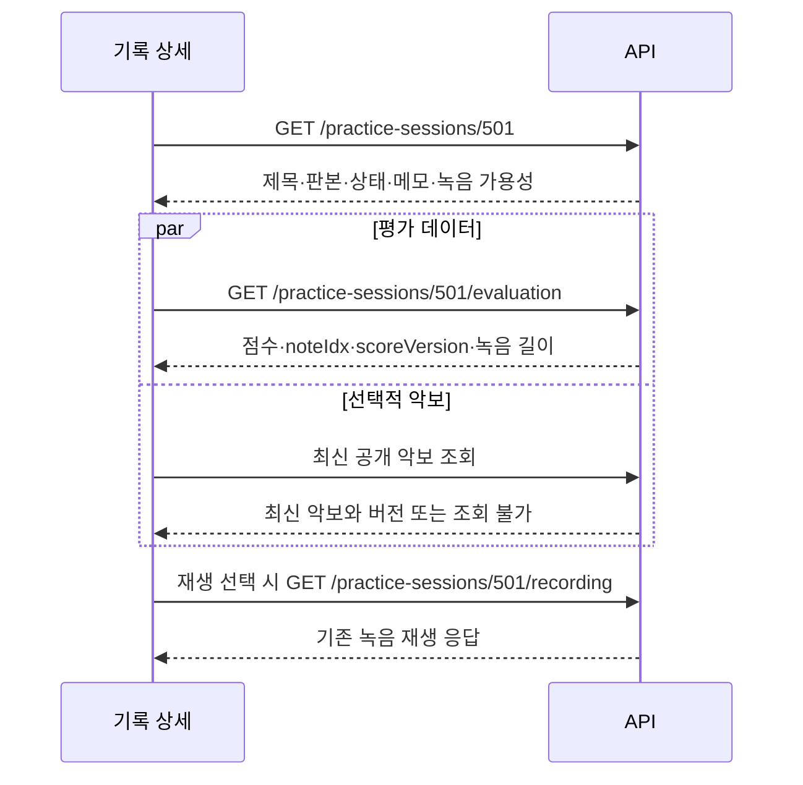

# 화면 흐름 개선 통합 설계안

이 문서는 S15P31E102-434에서 조사한 화면 흐름 개선 12개를 정리한 기록이다. **3번 계정 격리는 구현·병합됐고, 8번 내 악보는 기능 도입 뒤 검토·수정할 후속 항목이다. 나머지는 이번 개선에서 제외한다.** 이번 MR은 조사 문서를 저장소에 남기는 작업이다.

| 읽으려는 내용 | 위치 |
| --- | --- |
| 어떤 기능이며 무엇이 달라지는가 | [12개 개선안](#features) |
| 이미 반영한 항목과 추후 검토 조건 | [현재 범위](#execution-order) · [8번 내 악보](#my-sheets-follow-up) |
| 요청·응답·DB 이관의 세부 검토안 | [API 상세안](screen-api-improvement-design.md) · [데이터 이관안](screen-data-migration-plan.md) |
| 판단에 사용한 코드와 검증 한계 | [흐름별 근거](#source-evidence) · [문서 검증](#document-verification) |

아래 각 항목은 **쓰는 곳과 기능 → 현재 구현 → 개선안 → 기대 효과** 순서로 읽으면 된다. 악보의 “판본”은 수정 전후를 구별하는 버전을 뜻한다.

“현재 구현”은 원안이 조사한 코드 `65d041d3` 기준이며, 구현 완료 보고가 아니다. 관련 조사 Task는 S15P31E102-434, Story는 S15P31E102-24다. [API 원안](screen-api-improvement-design.md) · [이관 원안](screen-data-migration-plan.md)

<a id="current-scope"></a>

## 적용 범위 — 반영 완료·후속 검토·제외

2026-11-04 사용자의 최신 지시에 따라 **Notion API 명세에서 joseph woo가 담당하는 기능과 그 기능을 확장하는 작업을 모두 제외한다.** 해당 API를 바꾸지 않고 FE만 연결·개선하는 경우도 그 기능의 확장이면 제외한다. 기존 API를 사용하는 화면의 공통 계정 격리는 3번의 FE 범위로만 유지한다.

담당자는 2026-11-04에 확인해 둔 [담당 범위 기록](../frontend/screen-improvement-scope.md)을 재사용했다. 이번 문서 MR에서는 Notion을 다시 조회하거나 수정하지 않았다. 원 확인의 근거는 [Notion API 명세](https://app.notion.com/p/API-3fea0252aa45804cb9f0f896ec0310ad)의 `구현 contains joseph woo` 필터 결과다. 열린 페이지의 20개 항목과 하단 개수 20을 확인했다. 공동 담당인 CAT-04도 제외한다. 아래 경로에서 공개 API의 공통 접두사 `/api`는 생략했고, 내부 분석 API는 명세 경로 그대로 적었다.

| 명세 ID | 제외하는 API | 제외 이유 |
| --- | --- | --- |
| 내부 분석 | `POST /v1/analyses` | joseph woo 담당 분석 기능과 그 확장 |
| CAT-01 | `GET /songs` | 담당 곡 목록·탐색 기능과 그 확장 |
| CAT-02 | `GET /songs/{songId}` | 담당 곡 상세 기능과 그 확장 |
| CAT-04 | `GET /songs/{songId}/score` | joseph woo·찬형박 공동 담당 악보 조회도 제외 |
| PRA-01 | `POST /practice-sessions` | 담당 세션 생성 기능과 그 확장 |
| PRA-02 | `POST /practice-sessions/{id}/recording` | 담당 녹음 제출 기능과 그 확장 |
| PRA-03 | `GET /practice-sessions/{id}` | 담당 세션 상세 기능과 그 확장 |
| PRA-04 | `POST /practice-sessions/{id}/retry` | 담당 분석 재시도 기능과 그 확장 |
| EVA-01 | `GET /practice-sessions/{id}/evaluation` | 담당 평가 조회 기능과 그 확장 |
| REC-01 | `PUT /practice-sessions/{id}/record` | 담당 기록 저장 기능과 그 확장 |
| REC-02 | `GET /users/me/practice-records` | 담당 기록 목록·집계 기능과 그 확장 |
| REC-03 | `GET /practice-sessions/{id}/recording` | 담당 녹음 재생 기능과 그 확장 |
| REC-04 | `DELETE /practice-sessions/{id}/record` | 담당 기록 삭제 기능과 그 확장 |
| LRN-01 | `GET /lessons` | 담당 학습 목록 기능과 그 확장 |
| LRN-02 | `GET /lessons/{id}` | 담당 학습 상세 기능과 그 확장 |
| LRN-03 | `PUT /lessons/{id}/completion` | 담당 학습 완료·진도 기능과 그 확장 |
| GRO-01 | `GET /users/me/growth/summary` | 담당 성장 요약 기능과 그 확장 |
| GRO-02 | `GET /users/me/growth/calendar` | 담당 연습 달력 기능과 그 확장 |
| GRO-03 | `GET /users/me/growth/scores` | 담당 점수 추이 기능과 그 확장 |
| GRO-04 | `POST /users/me/score-views` | 담당 악보 화면 체류 시간 기록 기능과 그 확장 |

**구현으로 반영한 항목은 S15P31E102-452의 FE 계정 격리뿐이다.** [MR !296](https://lab.ssafy.com/s15-final/S15P31E102/-/merge_requests/296)이 2026-11-04 develop에 병합됐다. 전후 측정과 남은 실기기·iOS 검증은 [452 검증 기록](../frontend/account-session-isolation.md)을 따른다. S15P31E102-453·454·456은 분리된 로컬 초안으로 보존하며 이번 반영본에 적용·Push·배포하지 않는다. 해당 초안의 구현·검증 기록을 이번 적용 결과로 보고하지 않는다. 이 문서 수정으로 API 계약이나 DB를 변경하지 않는다.

후속 요청으로 필터 없는 **전체 69행**의 담당자를 대조했다. `구현`은 API 구현 담당, `연결`은 FE 연결 담당, `테스터`는 검증 담당이다. 위 20개 API의 담당자 확인은 맞지만 관련 FE까지 모두 Joseph Woo 담당이라는 뜻은 아니다.

| API 구현 담당 | 행 수 | 주요 범위 |
| --- | ---: | --- |
| Joseph Woo 단독 | 19 | 곡 목록·상세, 연습·평가 결과·기록·학습·성장·내부 분석 |
| Joseph Woo·찬형 박 공동 | 1 | CAT-04 악보 조회 |
| 찬형 박 단독 | 10 | CAT-03·05~10, 기본음·시김새 음원 API 3개 |
| 은서 | 37 | 인증·회원, EVA-02~04, PRA-06, SHT 10개 |
| 담당 미기재 | 2 | 취소된 AI-01/02 |

취소된 SHT-03도 은서 37행에 포함된다. FE 연결은 연습·기록·학습·성장의 상당 부분이 권영민이고, 카탈로그·일부 회원 화면은 찬형 박이다. PRA-02/03 연결은 권영민·Joseph Woo 공동이다. 앞서 FE 연결·최적화까지 제외한 것은 요청의 확장 범위를 보수적으로 해석한 **작업 범위 판단**이며, FE 담당자 확인 결과와 구분한다. 이번 확인만으로 제외 코드를 재개하지 않는다.

8번 내 악보(SHT) API 10개는 **은서 담당**으로 확인했다. FE 연결은 일부 권영민이며 SHT-11/12/13은 미기재다. **내 악보 기능이 들어온 뒤 실제 구현과 대조해 수정할 후속 항목**이다. 지금은 미착수이며 구현 일정을 정하지 않는다. SHT-03 새 악보 만들기는 취소 표시가 있으므로 기존 제안을 그대로 실행하지 않고 현행 제품 범위·Task를 먼저 확인한다.

아래에 남긴 API·SQL·게시·배포 설계는 제외 결정을 되돌리는 실행 지시가 아니다. 현재 범위가 충돌할 때는 이 절과 [12개 항목별 판단](#execution-order)을 따른다.

<a id="latest-policy"></a>

## 이전 설계의 악보 정책 — 참고·실행 제외

> 다음은 담당자 기준으로 범위를 축소하기 전에 정리한 정책이다. 관련 구현은 이번 반영에서 제외하며, 452의 완료 조건이나 후속 실행 순서로 사용하지 않는다.

**설계 방향: 악보는 최신 버전만 제공한다. 과거 연습의 점수·메모·녹음은 유지하고, 성장 점수 비교와 악보 위 오류 표시는 현재 악보와 버전이 맞는 기록에만 제공한다.**

근거는 2026-11-04 사용자가 과거 악보 표시는 제외하고, 최신 버전에서만 이전 연습과 비교하며 버전이 달라지면 안내하도록 요청한 것과 통합 MD 반영 요청이다. 과거 악보 본문 보관·복원·재분석은 이번 범위에서 제외한다. 실제 버전 변경 빈도를 측정했다는 뜻은 아니다.

| 상황 | 제공할 동작 |
| --- | --- |
| 새 연습 | 최신 악보를 표시하고, 그 버전으로 제출·평가 |
| 과거 기록과 실제 최신 악보 버전이 같음 | 점수·메모·녹음과 악보 위 오류 표시·따라가기 제공 |
| 과거 기록과 최신 악보 버전이 다름 | 점수·메모·녹음 유지, 변경 안내, 오류 표시·악보 기반 따라가기 제한 |
| 최신 버전 기록이 없거나 1개뿐임 | 빈 목록 또는 해당 점수만 표시, 비교할 기록 부족 안내 |
| 연습 횟수·시간·연속일 집계 | 구버전 연습도 계속 포함 |

`scoreVersion`은 연주·평가·표시 기준을 대조하는 값이다. 앱 배포 때마다 올리지 않고, 연주·채점·음표 위치에 영향을 주는 악보 내용을 바꿀 때 올린다. 과거 기록의 전체곡·구간 표시까지 보존할지는 별도 선택안이다.

11번/A9/M2는 기존 결정대로 제외한다. 10번/M1을 포함한 관련 기능도 최신 담당자 기준에 따라 이번 실행에서 제외한다. 원안 링크와 아래 상세 설계는 이전 제안의 참고 자료이며 코드·배포 완료를 뜻하지 않는다.

<a id="features"></a>

## 12개 개선안과 현재 범위

### 1. 연주한 악보와 평가에 쓸 악보의 버전 맞추기 — 이번 실행 제외

**쓰는 곳과 기능**

연습 화면에서 녹음한 뒤 분석 화면으로 넘어가 평가를 요청할 때 사용한다. 사용자가 연주한 악보와 서버가 평가할 악보가 맞는지 확인하는 기능이다.

**조사 당시 구현 (`65d041d3`)**

앱은 녹음을 마친 뒤 곡 정보를 다시 조회하고 서버에 연습 세션을 만든다. 세션에는 악보 버전을 저장하지만, 생성 요청에는 앱이 실제 녹음에 사용한 버전을 전달하고 대조하는 필드가 없다. 녹음 도중 서버의 악보가 바뀌면 다시 조회한 최신 버전이 연주 당시 버전과 달라질 수 있다.

**개선안**

녹음할 때 사용한 곡 ID·악보 버전·빠르기·연주 범위를 녹음 정보와 함께 보관한다. 세션 생성 요청에 그 버전을 보내고, 서버가 현재 버전과 비교한다. 다르면 업로드를 멈추고 재연주를 안내한다. 생성 후 분석 전에 바뀐 경우도 악보 변경 실패로 구별하고 같은 녹음의 분석 재시도를 막는다. 기존 성공 요청의 재전송은 최초 요청 키와 세션을 유지한다.

**기대 효과**

버전이 다른 악보로 녹음을 제출하는 일을 막는다. 예를 들어 1번 버전으로 연주했는데 서버가 2번 버전으로 바뀌었다면, 업로드 전에 차이를 발견할 수 있다. 첫 확인 시점은 **녹음 완료 후 업로드 전**이며, 분석에 사용할 악보를 읽을 때도 버전을 검사한다. 변경된 녹음은 최신 악보로 다시 연주하도록 안내한다. 과거 원본을 복원해 평가를 끝내는 기능은 제공하지 않는다. [상세 계약 A1](#a1)

### 2. 예전 연습 기록의 점수·메모·녹음 열기 — 이번 실행 제외

**쓰는 곳과 기능**

기록 목록에서 지난 연습을 눌렀을 때 여는 상세 화면이다. 점수와 메모를 확인하고 녹음을 다시 듣는 데 사용한다.

**조사 당시 구현 (`65d041d3`)**

기록 상세가 목록에서 받아둔 정보와 공개 곡 조회에 의존하는 부분이 있다. 평가 데이터를 가져오는 코드도 공개 곡 조회가 실패하면 결과 전체를 비어 있는 값으로 처리한다. 곡이 숨겨졌거나 악보 조회가 실패하면, 남아 있는 점수와 녹음까지 보여주기 어려워질 수 있다.

**개선안**

세션 ID만으로 제목·상태·연주 당시 버전·현재 제공 가능한 버전을 조회한다. 점수, 최신 악보, 녹음 재생은 각각 불러온다. 실제 받은 최신 악보와 연주 당시 버전이 맞을 때만 오류 위치와 악보 따라가기를 켠다. 버전이 다르면 변경 안내와 점수·메모·녹음을 제공한다.

**기대 효과**

목록을 미리 불러오지 않아도 상세를 열 수 있다. 악보를 가져오지 못해도 조회 가능한 점수·메모·녹음은 계속 제공한다. 예를 들어 숨겨진 곡의 지난 연습에서도 점수를 확인하고 녹음을 들을 수 있으며, 악보 위 오류 표시는 같은 버전을 확보한 경우에만 제공한다. [상세 계약 A2](#a2)

### 3. 로그아웃과 계정 변경 때 개인 데이터 정리하기 — 구현·병합 완료

**반영 결과:** S15P31E102-452 · MR !296 병합 완료. FE의 인증 세대·캐시·요청 및 응답 경계만 다룬다. API 계약·서버 로직·DB를 바꾸거나 다른 기능의 연결을 확대하지 않는다.

**쓰는 곳과 기능**

한 기기에서 로그아웃하거나 다른 계정으로 로그인할 때 적용한다. 기록·학습 진도·내 악보·녹음 재생 정보를 해당 계정에 맞게 관리하는 공통 기능이다.

**조사 당시 구현 (`65d041d3`)**

로그인 사용자 ID와 인증 처리의 동시 접근을 제어하는 장치는 있다. 다만 계정이 바뀐 시점을 구별하는 번호와, 그 변경을 기준으로 화면의 임시 저장 데이터와 늦게 도착한 응답을 일괄 처리하는 체계가 없다.

**개선안**

로그인 상태가 바뀔 때마다 계정 전환 번호를 증가시키고 개인 데이터를 비운다. 요청을 보내기 직전과 응답을 화면에 반영하기 직전에 사용자 ID와 전환 번호를 모두 확인한다. 이전 계정에서 시작한 요청은 새 계정 상태에 반영하지 않는다.

**기대 효과**

A 계정의 늦은 기록 응답이 B 계정 화면에 섞이거나, A 계정에서 대기하던 저장 요청이 B 계정으로 발송되는 문제를 막는다. A→B→A처럼 같은 계정으로 돌아와도 이전 로그인 시점의 응답을 구별할 수 있다. [FE 전환 A3](#account-cache)

### 4. 기록 목록과 이번 주 연습 요약 불러오기 — 이번 실행 제외

**쓰는 곳과 기능**

기록 화면의 이번 주 연습 횟수·최고점, 곡별 기록 펼치기, 더보기와 정렬에 사용한다.

**조사 당시 구현 (`65d041d3`)**

서버는 기록을 페이지 단위로 조회하는 기능을 제공한다. 앱은 전체 기록을 수집해 주간 수치와 곡별 표시 정보를 만드는 경로를 사용한다. 기록이 늘어나면 화면에 당장 표시하지 않을 데이터까지 불러오게 된다.

**개선안**

서버가 이번 주 연습 횟수와 최고점을 별도 요약값으로 제공한다. 앱은 처음에 선택한 곡의 첫 페이지만 받고, 다른 곡을 펼치거나 더보기를 누를 때 다음 데이터를 요청한다. 주간 집계는 한국 시간 기준의 연주 시작 시각과 저장·삭제 조건을 맞춘다.

**기대 효과**

첫 화면을 구성하기 위해 받아야 하는 기록량과 요청을 줄일 수 있다. 목록을 일부만 받아도 이번 주 수치는 전체 대상 기록을 기준으로 정확히 표시한다. 화면이 빨라지는 정도는 기록량별 측정으로 확인한다. 곡 순서를 최근 연주 기준으로 둘지 최근 저장 기준으로 둘지는 합의가 필요하다. [상세 계약 A4](#a4)

### 5. 학습에서 소개한 곡을 연습 화면으로 연결하기 — 이번 실행 제외

**쓰는 곳과 기능**

레슨에서 소개하는 곡을 눌러 해당 악기의 연습 화면으로 이동할 때 사용한다.

**조사 당시 구현 (`65d041d3`)**

레슨 API의 곡 후보에는 제목과 안내 문구만 있다. 앱의 로컬 학습 곡 정보와 제목 기반 연결도 남아 있다. 제목만으로 곡을 찾으면 같은 제목의 다른 악기 곡이나 동명곡을 확실히 구별하기 어렵다.

**개선안**

레슨 데이터에 검수된 곡 ID와 악기 ID를 넣고, 앱이 학습 상세 API에서 받은 ID로 이동하게 한다. 연결할 곡을 확인하지 못했거나 공개·연습 가능 조건을 잃은 경우에는 소개를 표시하고 직접 연습 이동을 제한하는 안을 적용한다.

**기대 효과**

사용자가 선택한 레슨·악기에 맞는 곡을 열 수 있다. 같은 제목의 단소 곡과 대금 곡이 있어도 제목 검색 결과의 순서에 기대지 않고 연결한다. 서버 응답 추가, 레슨 데이터 보완, 앱 연결을 함께 적용해야 한다. [상세 계약 A5·이관 M3](#a5-m3)

### 6. 곡 목록과 악보를 불러올 때 중복 작업 줄이기 — 이번 실행 제외

**쓰는 곳과 기능**

곡 선택 목록, 내 악보 목록, 곡 상세와 악보 표시, 연습 결과 화면에서 데이터를 불러올 때 적용한다.

**조사 당시 구현 (`65d041d3`)**

공개 곡 목록의 HTTP 응답에는 이미 악보 본문이 없다. 다만 서버의 목록용 DB 조회는 큰 악보 본문까지 읽는 구조다. 곡 상세와 악보 전용 API를 함께 사용하는 흐름에서는 같은 악보 본문을 중복으로 전송하거나 이미 받은 곡을 다시 요청하는 부분도 있다.

**개선안**

목록용 DB 조회에서 제목·난이도 등 필요한 열만 읽는다. 앱은 같은 화면 흐름에서 진행 중인 동일 곡·버전 요청을 공유한다. 추가로 곡 상세에서 악보 본문을 생략하는 선택 옵션을 도입해, 악보 전용 API와 함께 쓸 때 중복 전송량을 줄이는 안을 검토한다.

**기대 효과**

DB에서 서버로 전달하는 불필요한 본문과 서버의 처리 부담을 줄이고, 앱의 중복 요청·다운로드를 줄일 수 있다. 상세의 본문 생략 옵션만 적용하면 두 API 호출은 유지되며 전송량이 줄어든다. 버전 번호를 유지한 채 본문을 바꾸는 게시 도구가 있어, 장기 캐시는 악보 변경 정책을 정한 뒤 도입한다. [상세 설계 A6·A7](#a6-a7)

### 7. 계정 기준으로 학습 진도 저장하기 — 이번 실행 제외

**쓰는 곳과 기능**

학습 목록에서 진행률과 다음 레슨을 보여주고, 레슨 완료를 저장하는 기능이다.

**조사 당시 구현 (`65d041d3`)**

서버에는 학습 목록·상세·완료 API가 있다. 앱에는 고정 9단계 집계와 기기에 저장한 학습 완료 값이 남아 있으며, 기존 로컬 값에는 어느 계정의 진도인지 구별할 정보가 없다.

**개선안**

앱을 기존 학습 API에 연결한다. 필수 단계 수·완료 수·다음 레슨은 서버 응답으로 표시하고, 완료 요청이 성공하면 서버의 상태를 반영한다. 이전 로컬 진도의 처리 방식은 별도로 결정한다.

**기대 효과**

로그인 계정에 맞는 진도를 저장하고 표시할 수 있다. 선택 단계와 필수 단계가 구분되어 있어도 서버가 정한 기준으로 진행률을 계산한다. 기존 기기의 진도를 특정 계정에 옮기려면 사용자 선택과 단계 매핑이 추가로 필요하다. [기존 API 연결 A8](#a8)

<a id="my-sheets-follow-up"></a>

### 8. 내 악보를 실제 계정에 저장하고 다시 편집하기 — 기능 도입 후 검토·수정

**후속 착수 조건:** 내 악보 기능이 실제로 도입되면 이 항목을 다시 열어 구현·계약과 대조한다. 지금은 기능을 구현하거나 API를 연결하지 않는다. 도입 뒤에도 별도 Task·담당자·완료 조건을 확인하고 진행한다.

**그때 확인하고 수정할 내용**

- 실제 목록·조회·확정 저장·초안·삭제 경로와 FE 저장소 연결이 일치하는지 확인한다.
- 버전 충돌, 임시 저장 복구, 삭제 실패를 화면이 어떻게 처리하는지 확인한다.
- 재로그인·계정 변경 후 소유권 검사가 유지되고 이전 계정의 캐시·지연 요청이 새 계정에 섞이지 않는지 452의 계정 격리와 함께 검사한다.
- API 구현 담당은 은서로 확인했던 기록을 참고하되, 도입 시점의 제품 범위·담당자를 다시 확인한다. **취소된 SHT-03 생성 API는 자동으로 다시 연결하지 않는다.** imports 등은 [확정 스펙과 실제 제공 상태](../../specs/user-sheets.md)를 확인한다.

아래 현재 구현·개선안은 `65d041d3` 당시 조사 내용이다. 452에서 production 샘플 목록은 이미 제거했으므로, 기능 도입 시 남아 있는 차이만 수정한다.

**쓰는 곳과 기능**

내 악보 목록에서 악보를 만들고, 열고, 초안을 저장하고, 편집을 확정하거나 삭제하는 기능이다.

**조사 당시 구현 (`65d041d3`)**

서버에는 내 악보의 목록·생성·조회·저장·초안·삭제 API가 있다. 앱에는 샘플 데이터를 사용하는 저장소가 남아 있어 실제 사용자 소유 악보와 연결하는 작업이 필요하다.

**개선안**

샘플 저장소를 서버 API 연결로 교체한다. 확정 저장은 편집을 시작한 악보 버전을 확인하고, 초안 저장은 악보 버전과 초안 버전을 함께 확인한다. 이미 변경된 내용과 충돌하면 사용자에게 알리고 처리한다. 저장·삭제의 성공 여부를 확인한 뒤 화면에 반영한다.

**기대 효과**

사용자가 만든 악보를 자기 계정의 실제 데이터로 관리할 수 있다. 오래 열어 둔 편집 화면에서 저장할 때 다른 저장 결과를 덮어쓰는 문제도 감지한다. 빈 악보, 초안, 확정 저장 상태를 구분해 편집을 이어갈 수 있다. [기존 API 연결 A8](#a8)

### 9. 최신 악보로 연습한 기록끼리 성장 추이 보기 — 이번 실행 제외

**쓰는 곳과 기능**

성장 화면에서 점수 변화·최고점·항목별 향상을 보여주는 기능이다.

**조사 당시 구현 (`65d041d3`)**

서버는 최근 연습을 조회한 뒤 악보 버전·평가 모델·빠르기·단위·범위가 같은지 검사한다. 조회 대상 자체를 현재 악보 버전으로 제한하지 않아 구버전 점수가 포함될 수 있다.

**개선안**

서버가 현재 공개 악보 버전과 일치하는 기록을 먼저 고른 뒤 최근 N개를 조회한다. 응답에 비교 기준인 `currentScoreVersion`을 더하고 기존 `comparable`과 빠르기·범위·평가 모델 조건을 유지한다. 성장 요약의 최고점·항목별 향상·평균 점수도 같은 버전 기준을 적용한다. 연습 횟수·시간·연속일·달력은 구버전 기록을 포함한다.

**기대 효과**

구버전 고득점이 현재 최고점에 섞이지 않으며, 최신 기록이 부족하면 그 이유를 안내한다. 저장된 과거 기록 자체는 유지한다. [성장 API 수정안](#growth-current)

### 10. 지난 기록의 전체곡·구간 연습 구분 유지하기 — 이번 실행 제외

**쓰는 곳과 기능**

과거 기록에도 당시의 전체곡·구간 구분을 정확히 표시하려는 기능이다.

**조사 당시 구현 (`65d041d3`)**

세션에는 연주한 음표 범위가 남지만, 전체곡 여부는 현재 곡의 음표 수와 비교한다. 악보 길이가 바뀌면 과거 전체곡 연주가 구간 연주로 바뀔 수 있다.

**개선안**

이전 설계는 성장 비교에서 구버전을 먼저 제외하고, 기록 화면은 당시 기준을 확인할 수 없으면 범위를 생략하거나 ‘이전 악보의 연습’으로 안내하는 안이었다. 당시 분류까지 보존하려면 M1의 음표 수 저장을 별도로 검토했다. 최신 지시에 따라 이 분류 보정도 REC 기능의 확장이므로 제외한다. 현재 음표 수로 과거 전체곡이 일부로 표시될 수 있는 기록 목록 문제는 이번 452에서 고치지 않는다.

**기대 효과**

과거 악보 보관 없이도 잘못된 분류와 비교를 막는다. 과거 범위 표시 생략과 M1 채택 중 어떤 방식을 제공할지는 아직 확정하지 않았다. [분류 계약 A10](#scope) · [선택안 M1](#m1)

### 11. 과거에 연주한 악보 그대로 다시 보기 — 기존 제외 유지

**쓰는 곳과 기능**

과거 기록에서 연주 당시 악보를 복원해 열거나 그 악보로 다시 분석하는 기능이다.

**조사 당시 구현 (`65d041d3`)**

세션에는 악보 버전이 남지만, 공개 곡에는 현재 악보 본문을 저장한다. 번호만으로 덮어쓴 원본을 복원할 수는 없다.

**변경한 결정**

2026-11-04 사용자 요청에 따라 이번 범위에서 제외한다. 버전별 악보 테이블·과거 악보 조회 API·원본 백필·과거 악보 재분석을 만들지 않는다. 버전이 달라진 기록에는 안내를 표시하고 점수·메모·녹음만 유지한다.

**기대 효과**

과거 원본 복원과 별도 접근 정책에 필요한 구현·운영 범위를 줄이는 제안이었다. 최신 지시에서는 제출 검증과 최신 버전 비교의 확장도 실행 대상에서 제외한다. [제외한 A9·M2](#history-api)

### 12. 곡이 많아졌을 때 서버에서 검색하기 — 이번 실행 제외

**쓰는 곳과 기능**

곡 선택 화면에서 제목이나 난이도로 곡을 찾고 결과를 더 불러오는 기능이다.

**조사 당시 구현 (`65d041d3`)**

앱이 받은 곡 목록에서 제목과 난이도를 필터링한다.

**개선안**

곡 수와 응답량, 기기의 검색 지연을 측정한 뒤 서버 검색과 페이지 조회 도입을 판단한다. 도입한다면 서버가 조건에 맞는 곡만 반환하고, 앱은 다음 목록을 필요할 때 요청한다.

**기대 효과**

곡이 많아질 경우 전체 목록 다운로드와 기기의 필터 처리량을 줄일 수 있다. 현재 제안에서는 규모 확인 후 검토할 보류 항목이다. [탐색 후보 A11](#search)

<a id="execution-order"></a>

## 이번에 할 일과 제외한 일

기존의 `3 → 1 → 2 → 9` 순서는 더 이상 실행 계획이 아니다. **구현 반영은 3번 FE 계정 격리로 끝냈다. 8번은 기능 도입 후 다시 검토한다.** 제외한 항목을 자동으로 다음 순위에 넣지 않는다.

| 번호 | 기능 | 현재 판단 | 이유와 경계 |
| --- | --- | --- | --- |
| 1 | 연주 버전 확인 | 제외 | PRA·내부 분석 기능과 그 확장 |
| 2 | 기록 상세 독립화 | 제외 | PRA·EVA·REC·CAT 기능과 그 확장 |
| 3 | 계정 데이터 격리 | **구현·병합 완료** | S15P31E102-452 · MR !296. API 변경 없이 FE 공통 계정 경계 보호 |
| 4 | 기록 페이지 조회·주간 집계 | 제외 | REC 목록·집계 기능과 그 확장 |
| 5 | 레슨에서 정확한 곡 열기 | 제외 | LRN·CAT 연결과 데이터 보완도 해당 기능의 확장 |
| 6 | 목록·악보 중복 로딩 개선 | 제외 | CAT 조회·응답·요청 공유 개선을 포함한 확장. 묶여 있던 SQL 개선도 이번에는 진행하지 않음 |
| 7 | 계정별 학습 진도 | 제외 | LRN API를 그대로 연결하더라도 학습 기능 확장에 해당 |
| 8 | 내 악보 실제 저장 | **기능 도입 후 검토·수정** | 미착수. 기능이 들어오면 실제 계약·저장·초안·충돌·계정 경계를 대조. 취소된 SHT-03 자동 연결 금지 |
| 9 | 최신 악보 기준 성장 비교 | 제외 | GRO 집계·점수 추이 기능과 그 확장 |
| 10 | 과거 전체곡·구간 분류 보존 | 제외 | REC/GRO 분류와 PRA 저장 모델의 확장. 기록 목록의 기존 오분류 보정도 제외 |
| 11 | 과거 악보 원본 보관 | 기존 제외 유지 | 앞서 사용자가 A9/M2를 제외했으며 다시 도입하지 않음 |
| 12 | 서버 곡 검색 | 제외 | CAT 탐색·페이지 조회 기능의 확장 |

### 완료한 일과 남겨 둔 일

1. **3번은 구현·병합 완료다.** 전후 측정과 자동 검증은 [452 기록](../frontend/account-session-isolation.md)에 있다. 실기기·iOS 검증은 해당 기록의 미검증 범위를 따른다.
2. **434는 조사 결과를 문서 MR로 공유한다.** 제안의 채택이나 API·DB 변경 완료를 의미하지 않는다.
3. **8번은 내 악보 기능 도입 뒤 검토한다.** 현행 구현과 확정 API를 대조해 필요한 수정만 별도 작업으로 정한다.
4. **나머지 항목은 제외한다.** 이전 우선순위나 아래 참고 설계만으로 다시 착수하지 않는다.

## 이전 API·데이터·배포 상세 설계 — 참고 자료

아래는 원안의 요청·응답, SQL 예시, 데이터 이관과 복구 조건을 보존한 참고 자료다. **A3는 452로 반영 완료됐고, SHT는 기능 도입 후 검토하며, 나머지는 실행에서 제외한다.** 명령형으로 남아 있는 단계도 해당 설계를 향후 채택했을 때의 조건이다. 이번 변경·배포 지시로 사용하지 않는다.

<a id="common"></a>

### 1. 공통 API 계약과 호환 원칙 — 참고

- 경로는 `/api`를 포함한다. 본문 있는 성공/실패 응답은 현행 `{httpStatus,isSuccess,message,code,result}` envelope를 유지한다. SHT 삭제의 204처럼 본문 없는 응답은 예외다. `code`는 HTTP 상태 정수이며 오류 분기는 `result.errorCode`로 한다.
- DB ID는 JSON 문자열이다. 공개곡·PRA·EVA 악보 판본은 정수, SHT wire 판본/baseScoreVersion은 문자열이다. 시각은 UTC ISO 8601이다. `noteIdx`는 해당 판본의 음표 인덱스이며 화면 각 번호나 event 배열 인덱스로 바꾸지 않는다.
- PRA·REC·LRN·SHT·GRO는 기존 `access_token` 쿠키 인증과 소유권 검사를 유지한다. CAT 공개 조회는 기존 PUBLISHED·미삭제 조건을 유지한다. 숨김 곡의 공개 노출 확대는 이 제안에 포함하지 않는다.
- 현행 FE ApiJson은 `ignoreUnknownKeys=true`라 추가 응답 필드를 무시한다. 필드 삭제·타입 변경·새 enum 값까지 호환된다는 뜻은 아니다. 신 FE는 구 서버에 없는 필드에 nullable/default를 두고 **부재를 판본 1이나 점수 0으로 추정하지 않는다**.
- 서버 우선 배포 후 신 FE를 배포한다. 선택 기능은 응답 필드·명시적 호환 경로로 전환하며, 401·403·5xx를 구 서버 판정으로 사용하지 않는다.
- 계약 변경 시 저장소 관련 specs와 DTO·OpenAPI·테스트를 같은 구현 작업에서 갱신한다. 이 조사 문서만으로 확정 specs를 덮어쓰지 않는다.

예시는 가상의 ID와 고정 시각을 사용한다. `result` 발췌라고 명시한 JSON은 전체 HTTP 본문이 아니다.

<a id="m0"></a>

### 2. 기본 개선 M0와 분석 실패 사유 확장 — A3 외 실행 제외

A1·A2·A4·A6·A7 및 분석 실패 사유 확장은 이번 실행에서 제외한다. A3는 API 변경 없이 FE 계정 격리만 유지한다.

<a id="a1"></a>

#### A1 연습 세션에 실제 연주 판본 전달 — 참고·실행 제외

##### 요청

현행 `POST /api/practice-sessions`에 다음 한 필드를 추가한다. 기존 요청 필드·범위는 그대로 유지한다.

| 필드 | 타입/필수 | 제안 규칙 |
| --- | --- | --- |
| `songId` | string, 필수 | 현행 양의 십진 문자열 검증 유지 |
| `bpm` | int, 필수 | 현행 20~240, 단위는 `bpmUnit` |
| `bpmUnit` | string, 선택 | `QUARTER`, `DOTTED_QUARTER`, `JEONGGAN`, `JANGDAN_BEAT`; 생략 시 현행 곡 기준 |
| `startNoteIdx` / `endNoteIdx` | int, 선택 | 시작 기본 0, 끝 기본 해당 판본 `noteCount-1`; `0 ≤ start ≤ end < noteCount` |
| `parentSessionId` | string, 선택 | 현행 본인·같은 곡·DONE 검사 유지 |
| `missionId` | string, 선택 | 현행 구현에 미션 정의가 없으므로 지정 시 404; 지원 기능으로 소개하지 않음 |
| `jangdanSoundOn` | boolean, 선택 | 현행 요청 해시에 반영되는 의미 유지 |
| **`expectedScoreVersion`** | **int, 이행 기간 선택** | **1~2147483647. 문자열·실수·boolean 금지. 생략/null은 이행 기간 legacy 요청으로 처리** |

`Idempotency-Key`는 현행 공백을 제외한 ASCII `!`~`~`(0x21~0x7E) 1~100자 규칙을 유지한다. 신 FE는 화면에 실제로 렌더링한 판본을 항상 보낸다. 목록의 오래된 버전이나 현재 서버 버전을 임의로 대입하지 않는다.

```http
POST /api/practice-sessions
Content-Type: application/json
Idempotency-Key: practice-attempt-example-001

{"songId":"101","bpm":72,"bpmUnit":"QUARTER","startNoteIdx":0,"endNoteIdx":59,"expectedScoreVersion":3}
```

##### 성공/오류

제안 성공 응답은 기존 필드에 **저장된 세션의** `scoreVersion`을 더한다. 현행과 같이 같은 키 재전송도 생성 응답 형태와 201을 유지한다.

```json
{
  "httpStatus": "CREATED",
  "isSuccess": true,
  "message": "전체·구간·미션 연습 세션 생성 성공",
  "code": 201,
  "result": {
    "sessionId": "501",
    "songId": "101",
    "status": "RECORDING",
    "bpm": 72,
    "bpmUnit": "QUARTER",
    "startNoteIdx": 0,
    "endNoteIdx": 59,
    "startedAt": "2026-11-04T00:00:00Z",
    "scoreVersion": 3
  }
}
```

| 조건 | 상태/코드 | 후속 동작 |
| --- | --- | --- |
| 타입·양수·BPM·범위 위반 | 400 `INVALID_REQUEST` | 잘못된 입력 수정 |
| 미인증 | 401 `UNAUTHENTICATED` | 기존 로그인 복구 |
| 곡이 없거나 연주 불가, 다른 회원 부모 | 404 `RESOURCE_NOT_FOUND` | 새 세션 생성 중단; 다른 회원 정보 노출 없음 |
| 기대 판본 ≠ 잠근 현재 판본 | 409 `STATE_CONFLICT` | 업로드 중단·판본 변경 안내; 발견 시점은 아래 생명주기 참고 |
| 같은 회원·키에 다른 요청 해시 | 409 `IDEMPOTENCY_CONFLICT` | 원 요청 재전송 또는 새 시도 키 |
| 부모가 DONE 아님 | 409 `STATE_CONFLICT` | 기존 규칙 유지 |

판본 충돌에만 다음 details를 추가하는 안이다. 다른 `STATE_CONFLICT`와 구별한다.

```json
{
  "httpStatus": "CONFLICT",
  "isSuccess": false,
  "message": "지금 상태에서는 처리할 수 없어요. 상태를 다시 확인해 주세요",
  "code": 409,
  "result": {
    "errorCode": "STATE_CONFLICT",
    "details": {
      "reason": "SCORE_VERSION_MISMATCH",
      "expectedScoreVersion": 3,
      "currentScoreVersion": 4
    }
  }
}
```

##### 원자성·멱등성

1. 입력 형태를 검증하고 요청 해시를 계산한다. 같은 회원·키의 기존 성공 세션을 먼저 조회한다.
2. 기존 세션이면 해시가 같을 때 같은 세션을 반환한다. 현행 replay의 `status`는 조회 당시 DB 값이므로 DONE으로 바뀔 수 있다. 최초 RECORDING 응답 전체의 바이트 재현을 약속하지 않는다. 곡이 숨겨지거나 최신 판본이 바뀌었다는 이유로 기존 성공 재전송을 새 요청처럼 거절하지 않는다.
3. 새 요청은 **동일 트랜잭션에서 곡 행 잠금 → 게시/채점 가능 상태·기대 판본 검사 → 범위 계산 → 세션 INSERT**를 한다. 게시 writer도 같은 곡 행을 수정하므로 검사와 INSERT 사이의 교체를 직렬화해야 한다. 잠금 대기 사이 다른 동일키 요청이 성공할 수 있으므로, 새 요청의 검증 오류를 반환하기 전 트랜잭션을 끝내고 최신 커밋을 보는 별도 조회로 기존 성공 키를 다시 확인한다. 있으면 해시 비교/replay를 우선한다. '동일키 T1 성공→게시→T2 잠금'을 잘못된 버전 충돌로 처리하지 않는다.
4. 동시 같은 키 요청은 `(user_id,idempotency_key)` 유일 제약으로 한 건만 남긴다. 중복키 예외로 실패한 트랜잭션을 종료한 뒤 새 읽기로 승자 세션을 조회해 해시를 비교하는 경계를 둔다. 이전 읽기 스냅샷이나 rollback-only 트랜잭션에서 재조회하지 않는다. 잠금 순서와 재조회 가시성은 MySQL 통합 테스트로 확인한다.
5. `PracticeSession` 및 멱등 재조회 SQL에도 `score_version`을 연결한다. 응답을 만들 때 최신 `songs.score_version`을 다시 읽어 쓰면 안 된다.

해시 전환안:

- 기대 판본 생략/null은 기존 `v1|songId|bpm|bpmUnit-or--|start-or-0|end-or--|parent-or--|mission-or--|jangdan-or-false` 문자열과 SHA-256을 **그대로** 유지한다.
- 명시 요청은 `v2` 구분자로 시작하고 기존 순서의 값과 기대 판본을 포함한다. 두 형식을 테스트 고정값으로 관리한다.
- 기존 DB의 `request_hash`를 다시 계산하지 않는다. 같은 키의 기존 생략 요청에 필드를 추가해 재전송하면 요청이 달라졌으므로 멱등 충돌이다.
- 판본 충돌은 세션을 만들지 않는다. FE가 악보를 갱신하고 사용자가 새로 시작하면 새로운 시도 키를 발급한다.

이 검사는 **생성 순간의 판본 번호 일치**를 보장한다. 분석 시에는 세션 버전과 실제 읽은 악보 버전을 다시 비교한다. 원안의 `enable_scoring.py`처럼 연주에 영향을 주는 내용을 같은 번호에서 바꾸면 검사가 무효가 되므로 [게시 규칙](#writer)을 적용한다. 과거 원문 보관은 요구하지 않는다.

##### 세션 생성 후 분석 전에 악보가 바뀐 경우

- 버전과 악보 본문을 같은 조회 결과에서 읽고, 세션 버전과 맞는 본문으로 만든 음표만 분석에 전달한다. 검사 후 다른 최신 본문을 다시 읽어 바꿔 끼우지 않는다.
- 불일치면 `FAILED`, `failReason=SCORE_VERSION_MISMATCH`, `retryable=false`로 안내하는 계약을 추가한다. 일반 `SERVER_ERROR`와 구별해 같은 녹음의 자동·수동 분석 재시도를 막고 최신 악보로 재연주하도록 한다.
- `POST /api/practice-sessions/{id}/retry`도 해당 실패를 재시도 대상으로 받지 않는다. 이미 성공한 PRA-01 요청의 멱등 재전송과는 별개다.
- DB의 실패 사유 CHECK 제약에 새 값을 허용하도록 신규 Flyway 마이그레이션을 적용한다. 기존 migration 파일을 수정하지 않고, 제약 확장 후 새 서버가 실패 사유를 저장하게 한다. 이는 과거 악보 보관 테이블과 무관한 작은 스키마 변경이다.
- 같은 버전의 분석 입력을 확보한 뒤 게시가 바뀌어도 확보한 입력을 다른 내용으로 바꾸지 않는다. 완료된 평가를 삭제하거나 최신 버전으로 재표기하지 않는다.
- 이 방식은 변경 중인 녹음의 평가 완료를 보장하지 않는다. 변경을 감지하면 재연주를 요구하는 제품 정책이다.

PRA-01 멱등성과 분석 재시도는 다르다. 현행 `POST /api/practice-sessions/{id}/retry`는 키 형식을 검사하지만 키를 저장해 영구 재현하는 구조가 아니다. PENDING 중 중복은 억제하지만 재시도 가능한 사유로 다시 실패한 뒤의 호출은 새 분석 시도가 될 수 있다. 이번 변경은 여기에 악보 변경 실패의 재시도 금지만 추가한다.

부모와 자식 판본까지 같게 제한할지는 별도 비교 정책이다. 현행 생성 검사에 없던 조건을 이 필드 추가에 숨겨 넣지 않는다.

##### FE에서 녹음에 쓴 판본과 재시도 정보 유지

현행 FE는 녹음 시작 전에 PRA-01을 호출하지 않는다. 녹음 완료 후 AnalysisSession에서 곡을 다시 조회하고 세션을 생성한다. 따라서 필드만 추가해 '녹음 전에 충돌을 막았다'고 보고하면 틀리다.

최소 전환은 실제 녹음에 사용한 불변 메타데이터 `(songId,scoreVersion,bpm,bpmUnit,startNoteIdx,endNoteIdx)`를 RecordedTake와 함께 캡처하고 화면 이동→AnalysisSession→createAndSend→재전송까지 전달하는 것이다. 녹음 완료 후 재조회한 최신 scoreVersion으로 덮어쓰지 않는다. 세션 성공의 판본/범위를 캡처 값과 대조한 뒤 업로드한다.

현행 생명주기를 유지하면 충돌 발견 시점은 **녹음 완료 후 업로드 전**이다. 기존 take를 다른 판본으로 자동 제출하지 않고 재연주/재선택을 안내한다. 실제 파일의 임시 보관·삭제는 기존 녹음 자원 정책을 따르며 이 제안 때문에 즉시 파기하지 않는다.

같은 take 재시도는 최초 key와 요청 본문을 함께 유지한다. 구 take에 판본이 없다면 최신 판본으로 채우지 않는다. 이미 sessionId가 있는 PendingRecording은 기존 세션으로 업로드를 재개하며 PRA-01을 다시 만들어 다른 세션에 옮기지 않는다. 현행 pending 영속 형식은 회원 ID·세션 ID·시작 시각·곡 ID·BPM·경로의 6칸이다. 형식을 확장하면 명시적 schemaVersion을 둔 새 형식과 구 6칸 reader를 함께 제공하고, 구 세션의 판본/범위는 PRA-03에서 확인한다. 파싱 실패 원본을 조용히 삭제하거나 타 계정으로 이관하지 않는다. 인증이 바뀌면 재개 요청 자체를 전송하지 않는다.

녹음 시작 전 검사를 제품 목표로 삼으면 PRA-01 시점을 앞당기는 별도 생명주기 변경이 필요하다. 취소/화면 이탈로 남는 RECORDING 세션, 세션 만료, 업로드 시간 제한, idempotency 키 생존 기간과 재시작 흐름을 함께 설계·검증해야 한다. 판본 이력 없이 이 시점만 이동해도 녹음 도중 게시 변경은 해결되지 않는다.

<a id="a1-rollout"></a>

##### 전환과 수용 기준

현행 FE는 녹음이 끝난 뒤 `AnalysisSession`에서 곡을 재조회하고 PRA-01을 호출한다. 최소 변경은 **실제 녹음에 사용한 판본·BPM 단위·범위를 take와 함께 캡처해 PRA-01까지 전달**하는 것이다. 분석 화면에서 재조회한 최신 버전을 expected에 넣으면 보호가 무효다. 이 경우 불일치는 녹음 완료 후 업로드 전에 발견된다. 시작 전 차단은 세션 생성 시점을 옮기는 별도 생명주기 변경이다. 구 take·pending 형식까지 포함한 [전환 절차](#a1)를 따른다.

서버의 선택 필드 수용 → 신 FE 항상 전송·성공 버전 대조 → 생략 요청 비율 확인 → 구 FE 지원 종료 합의 순서다. 필수화할 경우 기존 키의 성공 재전송을 보호한 뒤 **새 요청의 누락**을 거절하는 정책을 별도로 문서화한다. 이행 기간에는 구 FE의 잘못된 판본 시작 위험이 완전히 사라졌다고 보고하지 않는다.

과거 원문 테이블·복구 상태에 따른 생성 허용 모드는 도입하지 않는다. 신규 실패 사유 `SCORE_VERSION_MISMATCH`를 서버와 FE가 함께 처리하도록 한다. 구 FE가 알 수 없는 실패 사유를 받는 경우에도 최신 버전 자동 대입이나 무한 재시도로 연결되지 않는지 확인한다. 기대 판본 필수화 시점은 구 앱 지원 정책에 따라 별도로 정한다.

필수 검사: v3 실제 녹음 후 v4 게시·재조회가 있어도 expected=v3 유지 → 409/INSERT·업로드 0건, 일치 시 201, 기존 v1 해시 재전송, 동일 키의 다른 기대 판본 충돌, 곡 숨김 뒤 성공 요청 재생, 게시와 생성 양방향/동일키 삼자 경합, 성공 응답 버전과 DB 값 일치.

<a id="a2"></a>

#### A2 목록 방문 없이 기록 상세 열기 — 참고·실행 제외

##### PRA-03 추가 응답

`GET /api/practice-sessions/{sessionId}`의 기존 필드에 다음 세 값을 추가하는 안이다. 접근 검사는 현행 본인·미삭제 세션 기준이다.

| 추가 필드 | 타입 | 데이터 출처/의미 |
| --- | --- | --- |
| `songTitle` | string | `songs.title`의 조회 시점 제목. 연주 당시 제목 스냅샷이라고 약속하지 않음 |
| `scoreVersion` | int | `practice_sessions.score_version`, 평가/음표 인덱스와 묶이는 판본 |
| `currentScoreVersion` | int 또는 null | 현재 공개·미삭제이며 악보 본문이 있는 곡의 버전. 제공할 수 없으면 null. 본문 파싱 성공까지 보장하지 않음 |

제안 `result` 전체 예시:

```json
{
  "sessionId": "501",
  "songId": "101",
  "songTitle": "예시곡",
  "scoreVersion": 3,
  "currentScoreVersion": 4,
  "bpm": 72,
  "bpmUnit": "QUARTER",
  "startNoteIdx": 0,
  "endNoteIdx": 59,
  "status": "DONE",
  "evaluationId": "601",
  "failReason": null,
  "recordingAvailable": true,
  "startedAt": "2026-11-04T00:00:00Z",
  "endedAt": "2026-11-04T00:00:50Z",
  "retryable": false,
  "savedAt": "2026-11-04T00:01:00Z",
  "memo": "긴 음을 일정하게"
}
```

세션 자체의 JOIN/WHERE에 공개·삭제 필터를 붙여 과거 기록을 없애지 않는다. 공개 여부는 currentScoreVersion의 제공 가능성을 판단할 때만 사용한다. 세션의 곡 FK와 기존 보존 규칙을 따른다. 다른 회원·기록 삭제는 404를 유지한다. 기존 저장 기록의 `viewed_at` 첫 조회 처리와 마감이 지난 PENDING의 TIMEOUT 전환도 보존한다. 부작용 없는 단순 SELECT API로 재정의하지 않는다.

##### 상세 로딩 순서와 실패 격리



그림의 `/api`는 공간상 생략했다. 평가 요청은 DONE 상태에서 수행한다. 진행/실패 상태는 해당 상태와 허용된 재시도를 표시하되, SCORE_VERSION_MISMATCH이면 같은 녹음의 재시도 대신 최신 악보로 재연주하도록 안내한다.

| 가용 데이터 | 표시/동작 제안 |
| --- | --- |
| PRA-03 + EVA-01 성공, 실제 최신 악보 버전 일치 | 점수·메모·녹음과 악보 오류 강조/따라가기 가능 |
| 점수/녹음 있음, 현재 버전과 불일치 | ‘악보가 변경되어 음표별 결과를 표시할 수 없어요’ 안내, 점수·메모·시간 기준 녹음 재생 유지, 악보 기반 따라가기/seek·오류 배치 비활성 |
| 점수/녹음 있음, currentScoreVersion=null 또는 악보 조회 실패 | 악보 조회 불가 안내, 점수·메모·시간 기준 녹음 재생 유지 |
| EVA-01 일시 실패 | 상세 기본정보 유지, 평가 영역 재시도. 실패를 0점으로 저장하지 않음 |
| `recordingAvailable=false` | 점수/메모 유지, 재생 불가 표시 |
| 재생 시 URL 발급/파일 접근 실패 | 재생 영역 오류·재시도. score 요청 성공 여부와 분리 |
| PRA-03 404 | 상세 접근 불가. 기존 캐시를 근거로 타인/삭제 기록을 표시하지 않음 |

EVA-01은 이미 점수·`scoreVersion`·notes·`recordingDurationMs`를 제공한다. 서버 평가 응답을 바꾸기 전에 `ApiEvaluationRepository`의 공개 곡 조회 실패 → 결과 전체 null 처리를 제거한다. `PracticeRecord`에 판본을 보관하고, PRA-03과 EVA-01의 sessionId/songId/version이 일치할 때 합친다.

EVA-01은 기존 200 성공 계약을 유지한다. 206/207 부분 성공 상태를 신설할 필요가 없다. 원본 notes를 보존하고 좌표 변환 불가를 '오류 음표 0개'로 표시하지 않는다. 목록 없는 상세의 전체/구간·각 번호는 일치 판본 근거가 있을 때만 계산하며, 시작 인덱스 0만으로 전체곡이라고 추정하지 않는다. 녹음 시간은 악보 event 수 대신 플레이어 positionMs/durationMs를 사용할 수 있다. 실패 세션에서도 업로드된 녹음 길이를 PRA-03 하나로 표시해야 한다면 기존 DB 컬럼을 이용한 nullable `recordingDurationMs` 추가를 별도 선택할 수 있다.

기존 기록 메모 저장은 생략=유지, JSON null=삭제다. 현행 FE의 `explicitNulls=false`는 nullable 값을 생략하므로 새 adapter에서도 wire 의미를 확인한다. FE의 기존 빈 문자열 삭제 경로를 바꾸려면 null이 실제 직렬화되는지 검증해야 한다.

구 서버에서 추가 필드가 없으면 기존 목록의 제목을 임시 표시할 수 있으나 상세 진입의 필수 조건으로 삼지 않는다. 버전 부재를 일치로 추정하지 않는다. EVA-01의 연주 버전과 실제 조회한 최신 악보 버전을 확인하기 전까지 overlay를 켜지 않는다. currentScoreVersion이 같다고 응답했어도 그 뒤 게시가 바뀔 수 있으므로 실제 악보 응답을 다시 대조한다.

녹음 URL은 필요 시 발급받고 회원/세션별로 취급한다. 로그아웃 후 재사용하지 않는다. 만료 URL을 영구 캐시하지 않는다.

**제외한 A2 설계의 참고 사항:** 기록 상세의 최초 입력은 sessionId다. 목록 cache가 없어도 PRA-03→EVA-01로 모델을 만들고 악보/재생을 독립 상태로 로드하는 안이었다. 이 상세 독립화는 A3/452의 계정 격리에 포함하지 않는다.

<a id="account-cache"></a>

#### A3 계정 캐시 격리와 지연 요청 차단 — FE 범위 유지

**현재 대상:** S15P31E102-452. 기존 API 호출의 계정 경계를 보호하는 FE 변경만 포함하며, PRA·EVA·REC·LRN·GRO·CAT의 계약이나 기능을 확장하지 않는다.

원안 기준 SignedInMember에는 member ID와 Mutex가 있고 계정 변경 이벤트/epoch는 없었다. 다음 `AccountSession(memberId,epoch)`는 452에서 다루는 FE 내부 계정 경계다. 구현·실측 결과는 452의 저장소 문서에서 확인한다.

1. 로그인/가입/소셜가입/계정 병합 성공, 로그아웃·탈퇴로 인증 주체가 바뀌는 모든 경로에서 epoch를 증가시킨다.
2. 기록 목록·상세·성장·진도·본인 악보·서명 재생 URL과 진행 중 UI 상태를 즉시 비운다. A→B 전환 중 실패를 A 캐시로 대체하지 않는다.
3. 사용자 동작 때 `(memberId,epoch)`를 캡처한다. 인증 Mutex/whileSignedIn 임계영역 안에서 **요청 발송 전** 현재 값과 대조하고, 달라졌으면 전송하지 않는다. A의 완료/악보 생성/take 제출이 대기 중 B 쿠키로 전송되지 않아야 한다.
4. 응답·낙관 갱신·저장/삭제 성공 반영 직전에도 같은 값을 대조한다. 다르면 폐기한다. A→B→A의 늦은 A 응답도 epoch로 차단한다. 기존 인증 Mutex/whileSignedIn의 쿠키 보호를 유지하며 epoch 검사로 대체하지 않는다. 인증 잠금은 개별 요청 단위로 적용한다. 목록의 lazy pagination 전환은 A4의 제외 범위이므로 여기서 도입하지 않는다.
5. 네트워크 실패 시 이전 데이터를 남기는 정책은 같은 계정·같은 epoch 안에서만 허용한다. 401에서 다른 계정의 stale 상태를 되살리지 않는다.

다른 계정 캐시를 서버에서 삭제하는 작업은 아니다. 공개 카탈로그 캐시는 본인 정보가 섞이지 않는 경우 별도로 유지할 수 있다. 과거 악보 조회나 기록 상세 독립화는 이 계정 경계 작업에 포함하지 않는다.

<a id="a4"></a>

#### A4 주간 집계와 기록 페이지 조회 — 참고·실행 제외

##### 현행 쿼리 유지

```http
GET /api/users/me/practice-records?songId=101&sort=NEWEST&page=0&size=20
```

- `songId`: 선택. 생략하면 현행 가장 최근 저장한 곡을 펼친다.
- `sort`: `NEWEST` 기본값 또는 `OLDEST`.
- `page`: 0 이상, 기본 0. `size`: 1~100, 기본 20.
- 곡 요약 `songs`, 전체 `totalRecordCount`, 선택 곡 `items`, `totalElements/totalPages`를 유지한다.
- 정렬은 `started_at`와 `id`를 함께 사용한다. `songs`의 정렬은 `lastSavedAt` 내림차순·songId 내림차순이다.

##### 제안 summary

`result.summary.thisWeek`를 추가한다. **저장한 기록 화면의 이번 주 집계**를 보존하기 위한 안이며 성장 화면의 전체 완료 연습 집계와 구분한다.

```json
{
  "summary": {
    "thisWeek": {
      "timeZone": "Asia/Seoul",
      "fromDate": "2026-11-02",
      "toDateExclusive": "2026-11-09",
      "recordCount": 7,
      "bestScore": 91
    }
  }
}
```

위는 추가 필드만 발췌했다. 규칙 제안:

| 항목 | 의미 |
| --- | --- |
| 기간 | 서버 Clock의 KST 이번 주 월요일 00:00 이상, 다음 월요일 00:00 미만 |
| 소속 날짜 | 연주 `started_at`; 저장 `saved_at`이나 평가 `evaluated_at`이 아님 |
| 모집단 | 본인·saved_at 존재·record_deleted_at 없음·평가 존재, 현행 REC 목록과 동일 |
| 범위 | 모든 곡의 기록. `songId`, 정렬, 현재 page/size에 영향받지 않음 |
| `recordCount` | 새 필드는 JSON 정수/서버 Long·FE Long으로 정의; 기간 내 세션 수, 없으면 0. 기존 totalRecordCount 타입은 변경하지 않음 |
| `bestScore` | nullable JSON 정수/Int, 0~100. 같은 모집단의 MAX(total_score), 없으면 **null** |
| 빈 기록/없는 곡 | 빈 페이지여도 전체 summary는 제공 |

저장 시점만 이번 주인 과거 연습은 제외한다. 이번 주 연습을 저장/삭제하면 집계가 변한다. 성장 summary로 대체하면 저장/삭제 조건과 최고점 기간이 달라지므로 동일 값이라고 취급하지 않는다. 현행 FE도 KoreanDateTime의 KST 주간 기준이다. 신 FE는 화면 진입 시 계산한 날짜가 아니라 응답 기간을 표시하고, 주 경계를 넘기면 summary를 갱신한다.

##### SQL/클라이언트 전환

기간을 애플리케이션에서 UTC 두 경계로 계산해 바인딩한다. `started_at` 열을 날짜 함수로 감싸는 방식보다 기존 시간 인덱스를 활용할 수 있는 조건을 우선 검토한다. 다음은 MyBatis 바인딩을 전제로 한 제안이다.

```sql
SELECT COUNT(*) AS record_count, MAX(e.total_score) AS best_score
FROM practice_sessions ps
JOIN songs s ON s.id = ps.song_id
JOIN evaluations e ON e.session_id = ps.id
WHERE ps.user_id = #{userId}
  AND ps.saved_at IS NOT NULL
  AND ps.record_deleted_at IS NULL
  AND ps.started_at >= #{fromUtc}
  AND ps.started_at < #{toUtc};
```

2026-11-02~11-09 KST의 경계 예시는 `2026-11-01T15:00:00Z` 이상, `2026-11-08T15:00:00Z` 미만이다. 기존 REC predicates를 공통화해 summary와 목록 조건이 갈라지지 않게 한다.

FE는 첫 요청에서 `songs`와 선택 곡 첫 페이지만 표시한다. 다른 곡을 펼칠 때 그 곡 page=0, 더보기 때 다음 페이지만 요청한다. `OLDEST` 변경은 page=0으로 초기화하고 서버에 다시 요청한다. 받은 일부 배열을 뒤집어 전체 오래된 순이라고 표시하지 않는다.

캐시 키는 `(회원, epoch, songId, sort, size)`와 page다. 저장/삭제/계정 변경은 summary와 해당 페이지를 무효화한다. 전체 건수는 배열 길이가 아닌 `totalRecordCount`, 곡 건수는 `songs[].recordCount`를 쓴다. 주간 summary가 없는 구 서버에서는 기존 전체 수집 경로를 유지하거나 기능 전환을 보류한다. 부분 페이지로 주간 수치를 계산하지 않는다.

페이지 요청 사이의 새 저장·삭제까지 고정하는 snapshot 계약은 아니다. sessionId 중복은 제거하고 새로고침 시 page=0부터 재구성한다. 현행 GetPracticeRecords의 read-only 트랜잭션 안에 주간 query도 포함하고, 요청당 Clock을 한 번 읽는다. 단일 응답의 요약·페이지 일관성은 실제 DB 격리 수준에서 검증한다. 이 단계에서 임의 cursor나 집계 테이블을 추가하지 않는다.

**묶음 순서도 전환 영향이다.** 현행 FE는 전체 기록의 최근 `startedAt`으로 곡 묶음 순서/날짜를 만들고, 서버 `songs[]`는 최근 `savedAt`을 사용한다. 오래된 연주를 뒤늦게 저장하면 순서가 달라진다. 서버 최근 저장 기준을 채택하고 라벨을 맞출지 합의하거나, FE의 최근 연주 의미를 보존하려면 `songs[].lastPlayedAt`(동일 모집단 MAX(started_at))을 추가하고 FE에서 그 값과 songId로 정렬한다. 후자는 추가형 제안이며 기본 선택 곡까지 최근 연주 기준으로 바꾸는 것은 별도 계약 변경이다.

##### FE 페이지 상태와 무효화

페이지는 `(memberId,epoch,songId,sort,size,page)`별로 보관한다. 요청 도중 곡·정렬이 바뀌면 이전 결과를 새 선택에 붙이지 않는다. summary와 items의 loading/error를 나누고, 더보기 실패 시 이미 받은 같은 계정 페이지는 유지한다. 삭제 시 선택 상세·목록·summary를 함께 무효화하며 뒤 페이지를 당겨 채우는 과정에서 중복/건수 오류를 검사한다.

<a id="a6-a7"></a>

#### A6·A7 목록 조회와 악보 중복 전송 개선 — 참고·실행 제외

##### 외부 계약 변경 없는 개선

CAT-01 HTTP 목록에는 이미 `score`가 없다. `SongMapper.listPublished` 전용 Row로 score_json/umulsai_text를 SELECT에서 제외하고 장단을 LEFT JOIN한다. 장단 null을 허용하는 데이터와 일대일 FK 관계를 보존한다. `UserSheetMapper.findPage`도 목록 필드와 `(draft_json IS NOT NULL) AS has_draft`만 조회한다. 상세·편집·멱등 재조회까지 같은 projection으로 바꾸지 않는다.

FE의 공개 곡 캐시는 `(songId,scoreVersion)`로 분리하고 진행 중인 같은 요청을 공유한다. 최신 여부를 갱신하고, 캐시에 남아 있다는 이유로 구버전 악보를 과거 기록에 제공하지 않는다. 현행 writer는 같은 번호에서 숨표·검수값을 바꿀 수 있으므로 이 키만으로 JSON 전체 불변/최신성을 보장하지 못한다. 우선 같은 화면 흐름의 요청 공유로 제한하고, 장기 캐시는 게시 시 버전 증가와 최신 여부 확인 정책을 검증한 뒤 도입한다. 실패/취소 결과를 영구 저장하지 않고, 결과 화면에서 이미 받은 같은 판본 곡을 재요청하지 않는다.

##### 선택적 `includeScore`

```http
GET /api/songs/101?includeScore=false
GET /api/songs/101/score
```

제안: query 생략 또는 `true`면 현행 상세를 그대로 반환한다. `false`면 기존 metadata를 반환하되 `score` 필드를 **생략**한다. 빈 JSON이나 null 악보로 표현하지 않는다. 그 밖의 query 값은 400이다. 기존 공개/숨김/삭제 404는 유지한다.

현행 CatalogSong.score는 nullable/default이며 getSong은 metadata score가 있을 때만 원문 동등성을 검사한다. 따라서 score 생략 수용을 위한 adapter 변경이 필수인 것은 아니다. false query 추가와 회귀 검증이 필요하며 DTO 분리는 선택적인 책임 정리다. 현행의 `score` 원문·`events` 투영·판본/BPM/noteCount 검증을 유지한다. `notationCapabilities`는 서버에 있지만 현행 FE DTO가 소비하지 않으므로 필요한 기능에서 별도 연결할 제안이다. 원본 events의 `yul`/`octave`와 서버 투영의 pitchId/noteIdx는 서로 대체하지 않는다. 서버 false 경로도 metadata 전용 SQL을 써야 DB LOB 전송까지 줄어든다.

두 요청의 songId·scoreVersion을 대조한다. 중간 게시로 다르면 조합하지 않고 metadata/악보를 한 번 다시 취득한 뒤 계속 충돌하면 명시적으로 실패시킨다. raw score 중복 동등성 검사가 사라지는 대신, CAT-04 원문과 투영 정합성 검사는 남겨야 한다.

이 옵션은 같은 원본 악보의 중복 bytes를 줄이며 요청 수는 여전히 두 번이다. 단일 요청으로 합치려면 CAT-04 metadata 확장이라는 별도 대안이 필요하다. 먼저 FE 중복 호출 공유와 목록 projection의 효과를 측정한다.

#### M0 적용 순서와 복구 — 참고·실행 제외

1. BE에 PRA-01 선택 기대 판본과 PRA-01/03 응답 확장을 추가한다. 세션 생성의 곡 조회·버전 검사·INSERT를 하나의 트랜잭션으로 묶는다. 중복키 예외 뒤에는 트랜잭션을 종료하고 새 읽기로 승자를 조회한다. 잠금 대기 중 같은 키가 성공한 경우를 위해 신규 요청의 검증 실패를 반환하기 전에도 새 읽기로 성공키를 재확인해 replay를 우선한다.
2. PRA-03에서 세션 버전·현재 제공 가능한 버전·곡 제목을 읽고 EVA-01과 독립적으로 소비한다. 공개곡 조건을 세션 소유권 조건으로 옮기지 않는다. 분석 시 버전 변경은 재시도 불가 사유로 구별한다.
3. CAT·SHT 목록 SQL에 전용 Row를 둔다. score_json/umulsai_text/draft_json 본문을 빼되 기존 description·장단 pattern·목록 필드와 null 의미는 보존한다. 상세/편집 query는 유지한다.
4. REC의 주간 summary를 추가한다. 서버 최신 저장 정렬과 FE 최신 연주 정렬 중 채택할 의미를 정한다. 최근 연주 유지 시 `songs[].lastPlayedAt`을 추가한다.
5. 신 FE의 기본 모델/decoder를 먼저 준비하고, 실제 서버 응답 필드가 준비된 뒤 독립 상세·lazy pagination을 활성화한다. 구 서버에서도 일부 페이지로 전체 주간 수치를 계산하지 않도록 호환 경로를 남긴다.

**복구:** 새 FE 경로를 비활성화하고 기존 읽기 경로로 돌아갈 수 있다. 단, 계정 캐시 격리와 지연 응답 차단은 유지한다. expectedScoreVersion을 무시하는 구 BE로 회귀하면 신 FE의 판본 보호가 사라지므로 생성 차단 또는 동일 보호를 유지한 수정 릴리스가 필요하다. 선택 필드를 모르는 구 서버가 요청을 수용하는지에 기대어 안전하다고 판단하지 않는다.

<a id="learning"></a>

### 3. 학습·내 악보·성장 화면 연결 — 제외 및 후보 참고

<a id="a8"></a>

#### A8 기존 API 연결 — LRN/GRO 제외, SHT 기능 도입 후 검토

LRN·GRO는 API를 그대로 연결하는 FE 작업도 제외한다. SHT는 내 악보 기능 도입 뒤 검토·수정할 항목이다. 아래 표는 기준 코드 당시의 경로와 이전 연결 제안이다. 취소된 SHT-03 생성 POST는 자동으로 연결하지 않으며, 도입 시점의 확정 스펙·실제 제공 경로·담당자를 다시 확인한다.

| 기능 | 현행 경로 | 연결 시 보존할 의미 |
| --- | --- | --- |
| 학습 목록 | `GET /api/lessons?track=…` | 서버 `requiredCount/completedCount/nextLessonId`; FE 고정 9단계 집계 제거 |
| 학습 상세/완료 | `GET /api/lessons/{id}`, `PUT /api/lessons/{id}/completion` | 완료 본문 `{"completed":true}` 또는 false; 응답의 서버 상태 반영 |
| 내 악보 목록/생성 | `GET/POST /api/users/me/sheets` | 실제 소유권·페이지·생성 멱등성; SampleRepository 교체 |
| 내 악보 조회/저장 | `GET/PUT /api/users/me/sheets/{id}/score` | 서버 `scoreData`, 문자열 판본, base version 충돌 처리 |
| 내 악보 초안/삭제 | `PUT /api/users/me/sheets/{id}/score/draft`, `DELETE /api/users/me/sheets/{id}` | 초안 revision과 정식 판본을 구별; 저장 성공 후 UI 반영 |
| 성장 점수 추이 | `GET /api/users/me/growth/scores?songId=…&scope=FULL&limit=5` | 현재 공개 버전으로 먼저 제한하고 모델·BPM·단위·범위의 기존 비교 조건 유지 |

내 악보의 요청 필드·생성 방식 전체는 [현행 SHT 스펙](https://lab.ssafy.com/s15-final/S15P31E102/-/blob/65d041d3c3b988458a92995442beb187d7d816f6/docs/specs/user-sheets.md)을 따른다. import/export가 실제 구현됐다고 가정해 새 업로드 API를 연결하지 않는다. `EVALUABLE` 상태가 기존 공개곡 채점 API의 입력 지원을 뜻하는 것도 아니다.

회원 없는 `learn_done_<instrument>` 로컬 값은 현재 로그인 계정에 자동 이관하지 않는다. 서버 진도를 우선하고, 기존 값은 미귀속 legacy로 분리한다. 폐기 또는 사용자 선택 이관은 별도 합의다. 샘플 내 악보 ID/가짜 진행률도 운영 서버 자산으로 자동 업로드하지 않는다.

연결에서 놓치기 쉬운 현행 계약은 다음과 같다.

| 영역 | 구현 시 지킬 상세 |
| --- | --- |
| LRN track | `DANSO/SOGEUM/DAEGEUM_JEONGAK/DAEGEUM_SANJO`. instrument code·datasetId와 별도 명시적 매핑 |
| LRN 완료 | completed는 boolean 필수. 누락/null/문자열/숫자는 400. 완료 응답에는 requiredCount가 없으므로 목록 상태와 함께 반영 |
| LRN 초기화 | 서버 일괄 초기화 API 없음. 개별 PUT false를 채택한다면 부분 성공·재시도·동일 계정 검증 필요 |
| SHT 목록 | kind 선택, page 기본 0, size 기본 20/최대100. 현재 저장 kind는 JEONGGANBO |
| SHT 빈 악보 | scoreData=null, events=[], draft=null이 정상일 수 있음. 빈 편집 상태를 404로 취급하지 않음 |
| SHT 확정 저장 | 문자열 baseScoreVersion·정수 bpm·객체 score. 성공 시 판본 증가, draft 삭제·draftRevision=0 |
| SHT 초안 | 문자열 baseScoreVersion와 정수 draftRevision을 둘 다 대조; 충돌409. 초안은 목록 updatedAt을 바꾸지 않음 |
| SHT 선택 필드 | title 생략/null은 제목 유지. jangdanId null은 장단 제거이므로 유지하려면 기존 ID 전달 |
| SHT 삭제 | 204 성공에 JSON 본문 파싱하지 않음 |
| GRO 추이 | songId 선택, scope 기본 FULL, limit 기본5/범위1~100. 최신 버전 필터 후 최근 N회를 오래된 순으로 표시; comparable 조건 보존 |

GRO comparable은 2개 이상이며 판본·모델·BPM·단위·범위가 모두 맞을 때 true다. 기존 FE의 점수·날짜만 있는 단순 point로 응답을 축소하면 이 조건을 잃는다. 새 API를 만들기 전에 Repository와 UiState가 기존 정보를 보존하도록 한다.

성장 점수 추이는 아래 최신 버전 제한을 추가하고 기존 비교 조건을 유지한다. 내 악보의 정식 버전과 draft revision은 별개로 관리하고 409를 무조건 덮어쓰기 재시도로 바꾸지 않는다. 기존 API 연결만으로 PDF import/export 지원을 표시하지 않는다.

<a id="growth-current"></a>

##### 성장 API를 최신 악보 기준으로 제한 — 참고·실행 제외

`GET /api/users/me/growth/scores`는 현재 공개·미삭제이며 악보 본문이 있는 곡의 버전을 기준으로 조회한다. `MAX(세션 버전)`이나 사용자의 마지막 연습 버전을 최신 악보로 간주하지 않는다.

1. 현재 버전의 기록으로 제한한다.
2. 그 집합에서 FULL/SECTION 조건과 최근 N개를 선택하고 오래된 순으로 반환한다. LIMIT 뒤에 버전을 필터하면 개수가 부족해지므로 순서를 바꾸지 않는다.
3. 기존 `items`, `songs`, `comparable`을 보존하고 nullable `currentScoreVersion`을 추가한다. 비교에 제공할 현재 곡이 없으면 null과 빈 items, comparable=false를 반환한다.
4. 현재 악보가 있지만 해당 버전 기록이 없으면 그 버전값과 빈 items를 반환한다. 1개면 점수는 표시하되 comparable=false다. 구버전으로 채우지 않는다.
5. 동일 버전이라도 모델·BPM·단위·범위가 다르면 comparable=false다. 클라이언트가 임의로 차이를 향상률로 만들지 않는다.
6. `songs` 선택 목록과 전체곡·구간 개수도 현재 버전의 비교 대상 기준으로 맞춘다. 과거 기록의 존재 여부는 기록 목록에서 확인한다.

예시 `result` 발췌 — 현재 v4에 연습이 없고 v3 기록만 있는 경우:

~~~json
{
  "songId": "101",
  "scope": "FULL",
  "currentScoreVersion": 4,
  "items": [],
  "comparable": false
}
~~~

화면은 ‘현재 악보로 연습한 기록만 비교해요’를 기본 안내로 두고, 0개/1개에는 기록 부족을 알린다. 구버전 기록 상세의 변경 안내는 [A2](#a2)를 따른다.

`GET /api/users/me/growth/summary`의 최고점·항목별 성장·평균 점수와 이전 기간 평균도 현재 공개 버전의 평가만 사용한다. 평균의 분모도 해당 점수 집합이어야 한다. 연습 횟수·시간·연속일·달력에는 구버전 연습을 계속 포함하며 저장된 점수·메모·녹음은 삭제하지 않는다. REC의 저장 기록 조회·주간 요약 모집단과 GRO의 비교 점수 모집단을 혼동하지 않는다.

기존 응답에 필드를 더하는 변경과 집계 의미를 바꾸는 변경을 구분해 배포한다. FE가 추가 필드를 무시할 수 있어도 집계 기준 변경 안내와 테스트는 필요하다. 관련 구현 작업은 S15P31E102-456이며, 이 문서에는 그 작업의 측정 결과를 추정해 넣지 않는다.

<a id="a5-m3"></a>

#### A5·M3 레슨 후보의 안정적인 곡 ID — 참고·실행 제외

##### API 계약과 화면 전환

현행 `GET /api/lessons/{lessonId}`의 `result.songs[]`는 `title`, `meta`만 제공한다. 다음은 **기존 두 문자열을 보존하는** 추가형 제안이다.

```json
{
  "songs": [
    {"title":"예시곡","meta":"검수한 학습 안내","songId":"101","instrumentId":"2"},
    {"title":"미등록 후보곡","meta":"참고용 소개","songId":null,"instrumentId":null}
  ]
}
```

- 두 ID는 문자열 또는 null이며 함께 존재하거나 함께 null이다. title/meta는 교육 콘텐츠 문구이며 곡명을 자동 동기화하는 계약이 아니다.
- 검수자는 track→대상 악기의 명시적 매핑을 확인하고 후보를 songId에 연결한다. 제목만 같은 행을 자동 선택하지 않는다.
- content_json의 기존 `songs` 배열에 검수 ID를 추가하고 parser/도메인/응답을 확장한다. JSON 내부에는 DB FK가 없으므로 입력 검증과 정합성 검사를 구현한다.
- 서버는 연결 곡이 사라지거나 공개/연주 가능 조건을 잃으면 직접 연습 버튼용 ID 쌍을 null로 내리는 안을 검토한다. 목록마다 후보별 SQL을 추가하지 않고 필요한 ID를 일괄 조회한다.
- FE는 유효 ID와 선택 악기의 일치를 확인한 뒤 이동한다. null일 때는 소개만 표시한다. 이전 서버의 제목 fallback이 필요하면 선택 악기로 필터한 목록에서 **정확히 한 후보**일 때만 연결하고 모호하면 이동하지 않는다.

기존 로컬 LearnSongs에 머문 채 서버 응답 필드만 추가하면 문제가 해결되지 않는다. A8 학습 상세 API 연결과 함께 전환하고, 그 전에는 FE의 무악기 전체 조회부터 기존 instrumentId 필터로 제한한다.

##### 연결 데이터 검수와 이관

검수 manifest는 `(lessonId,track,candidateIndex,기존 title/meta,선택 songId,instrumentId)`를 포함한다. 내용이 예상과 다른 레슨은 자동 덮어쓰지 않는다. 제목만 매칭하거나 첫/마지막 검색 결과를 고르지 않는다.

기존 lessons.content_json의 선택 후보에만 ID 쌍을 추가한다. 나머지 goal/tasks/source 등은 보존한다. 읽기 parser는 없는 필드를 null로 처리하고, 존재하면 ID 타입/쌍/악기/공개 가능 조건을 검사한다. 모든 후보가 없을 때도 레슨 콘텐츠 자체는 제공한다. 같은 키로 재실행하면 변화 0건, 다른 목표 매핑이면 별도 검수로 처리한다.

FE 학습 API 연결은 서버 requiredCount·optional 단계·completedAt를 정본으로 사용한다. 기존 `learn_done_<instrument>` 값은 회원 정보가 없어 자동 귀속할 수 없다. 서버 진도를 내려받아 표시하고 legacy 값은 별도 이름으로 격리한다. 사용자 선택 이관을 채택한다면 트랙/단계 ID를 명시적으로 매핑한 뒤 각 완료 PUT의 성공을 확인하고 처리 완료 표식을 회원별로 남긴다. 네트워크 실패를 완료로 간주하지 않는다.

로컬 샘플 내 악보는 실사용 문서인지 확인할 정보가 없으므로 임의 서버 업로드하지 않는다. API 연결 후 신규 서버 ID와 문자열 판본을 사용하고 기존 샘플 객체가 서버 객체를 덮어쓰지 않게 한다.

<a id="retention"></a>

### 4. 최신 악보 게시와 과거 기록 처리 — 참고·실행 제외

악보 본문은 곡마다 최신 내용만 관리한다. 세션의 버전·점수·메모·녹음은 유지하며 버전이 다르면 악보 기능과 비교를 제한한다. 현재 구조에서 이 정책을 적용하기 위해 과거 본문 저장 테이블은 필요하지 않다.

<a id="writer"></a>

#### 악보 수정 시 지킬 게시 규칙 — 참고·실행 제외

| 대상 | 기준 코드에서 확인한 상태 | 적용할 규칙 |
| --- | --- | --- |
| songs | score_version·score_json·note_count·default_bpm 보관 | 연주·채점·음표 위치에 영향을 주는 변경 시 버전과 관련 값을 함께 갱신 |
| practice_sessions | song_id·score_version·음표 범위 보관 | 과거 행의 버전·범위를 최신 값으로 다시 쓰지 않음 |
| song_model_audios | `(song_id,score_version)` 키 | 제공하는 최신 악보와 음원 버전·타임라인 일치 검수 |
| user_sheets | 별도 score_version·draft_revision | 개인 편집 충돌 검사는 기존 SHT 계약 유지 |
| enable_scoring.py | 숨표·검수 metadata를 바꾸면서 번호 유지 | 연주에 영향을 주는 변경과 설명·검수 정보만의 변경을 구별하고 전자는 버전 증가 |
| load_model_audio.py / publish_model_audio.py | 곡당 음원 1개를 전제한 검사·조회 존재 | 최신 버전 게시 시 악보·음원의 선택 조건 점검. 복수 과거 음원 제공을 선제 도입하지 않음 |

- 악보 내용·DB 버전·JSON 내부 버전·음표 수·기준 빠르기와 단위를 한 게시 작업에서 일치시킨다. 세션 생성의 곡 행 잠금과 충돌하지 않도록 같은 갱신 경계를 사용한다.
- 음표 추가·삭제, 음높이·길이·순서·연주 구간 해석·음표 위치가 달라지면 버전을 올린다. 제목·설명만 바꾸거나 앱 코드만 배포할 때는 이 이유로 올리지 않는다.
- 과거 악보 복구나 수정마다 새 songId를 만드는 절차는 넣지 않는다. 새 버전 게시 후 구버전 기록은 안내 대상으로 남는다.
- 같은 번호에서 이미 연주 내용이 바뀐 곡은 번호 일치만으로 정확성을 주장할 수 없다. 게시 이력을 확인하고 검수한 내용을 새 버전으로 전환해 이후 기준을 명확히 한다. 과거 세션 버전을 그 새 번호로 덮어쓰지 않는다.
- 기존 음원을 재사용하려면 새 악보의 음표·tick·BPM·offset과 맞는지 확인한다. 검수 없이 음원의 버전·원문 해시만 바꿔 붙이지 않는다.
- 이 정책 적용 전에 전체 쓰기 경로를 확인한다. 게시 도구 수정 자체의 구현 완료 여부는 별도 검증 결과로 남긴다.

<a id="scope"></a>

#### A10 구버전 기록을 현재 음표 수로 재분류하지 않기 — 참고·실행 제외

성장 API에서는 현재 버전 일치를 먼저 확인한 뒤 현재 음표 수로 FULL/SECTION을 판정한다. 구버전은 해당 비교 집합에 들어오지 않으며 연습 횟수·시간에는 남는다.

기록 상세·목록의 분류 방식은 이전 설계의 미정 사항이다. **REC 담당 기능의 확장이므로 이번에는 두 방식 모두 구현하지 않으며, 기존 목록의 오분류도 수정하지 않는다.** 아래는 이후 담당 범위가 정해질 때 참고할 선택지다.

| 선택 | 구버전 범위 표시 | 추가 저장 |
| --- | --- | --- |
| 축소안 | 당시 기준이 없으면 범위를 생략하거나 ‘이전 악보의 연습’ 안내 | 없음 |
| 당시 분류 보존 | 검증된 당시 음표 수가 있으면 FULL/SECTION, 없으면 UNKNOWN | 선택적인 M1 |

어느 쪽이든 현재 음표 수, `endNoteIdx+1`, 녹음 길이로 과거 전체곡 여부를 만들어내지 않는다. 선택안이 확정되기 전에 당시 분류가 보존된다고 보고하지 않는다. 응답을 바꾸는 경우 기존 boolean을 갑자기 nullable로 바꾸기보다 추가형 `practiceScope`와 구 클라이언트의 표시 규칙을 함께 정한다.

<a id="m1"></a>

#### M1 연주 당시 음표 수 저장 — 선택안 — 참고·실행 제외

10번에서 과거 분류 보존을 선택할 때만 `practice_sessions.source_note_count` 같은 nullable 정수 필드를 추가하는 안이다. 악보 본문은 저장하지 않는다.

- 새 세션의 버전·범위를 검사하는 트랜잭션에서 당시 원곡 음표 수를 함께 저장한다.
- 기존 값은 당시 음표 수를 확인할 근거가 있는 행만 채운다. 버전 번호가 같다는 이유만으로 일괄 보정하지 않으며 미확인은 null로 둔다.
- 처음부터 마지막 음표까지 연주했으면 FULL, 일부면 SECTION, 당시 원곡 길이를 모르면 UNKNOWN으로 처리한다.
- 적용한다면 새 기록 저장·분류·기존 미확인 처리와 구 클라이언트 호환을 별도 검증한다. DB 확장·백필·운영 실행안은 채택 시 작성한다.

이 선택은 아직 확정되지 않았다. 최신 버전 성장 비교와 구버전 변경 안내를 구현하기 위해 M1을 먼저 도입할 필요는 없다.

<a id="history-api"></a>

#### A9 과거 악보 조회 — 이번 범위 제외

세션의 과거 버전 악보를 조회하는 API를 추가하지 않는다. 기존 최신 악보 조회를 사용하고 버전이 다른 경우 [A2의 안내와 기능 제한](#a2)을 적용한다. 본인 세션이라는 이유로 숨김·삭제 곡의 악보를 새로 공개하는 접근 정책도 추가하지 않는다.

<a id="m2"></a>

#### M2 버전별 악보 본문 보관 — 이번 범위 제외

버전별 악보 테이블·현재 본문 복사·과거 원본 백필·세션과 과거 원본의 FK·역사 reader·과거 악보 재분석을 도입하지 않는다. 원안의 M2 DDL과 배포 절차는 이번 실행 대상에서 제외했다. 이전 설계는 [이관 원안](screen-data-migration-plan.md)에 남아 있다.

<a id="m2-recovery"></a>

과거 원본 복구를 이번 완료 조건으로 두지 않는다. 원본을 복원할 수 없어도 점수·메모·녹음은 그대로 유지한다. 과거 악보를 실제로 열어야 하는 요구가 생기면 별도 설계로 다시 검토한다.

<a id="search"></a>

### 5. 규모 확인 후 검토할 서버 곡 탐색 A11 — 참고·실행 제외

현행 UI는 받은 목록에서 제목·난이도를 필터한다. 서버 탐색은 우선 구현 대상이 아니다. 재개한다면 기존 `GET /api/songs`에 `q`, `difficulty`, `afterSongId`, `limit`를 opt-in으로 추가하는 안을 비교한다.

- 선택안 예: limit 1~100, 페이지 요청 기본 20, songId 오름차순 cursor. 필터는 AND, 빈 결과는 200/빈 items. 검색어 trim·길이 상한·대소문자/한글 비교 규칙은 채택 시 명세화한다.
- 이전 무파라미터 호출을 갑자기 20개로 자르지 않는다. `limit` 사용 여부 등 페이지 모드 진입 조건을 명시하고 기존 `instrumentId`만 있는 호출도 보존한다.
- 페이지 모드에만 `nextAfterSongId`와 `hasMore`를 추가한다. 모든 목록 items의 기존 필드는 유지한다.
- 필터가 달라지면 cursor를 버린다. 임의 작품/artist/인기도/추천 필드는 추가하지 않는다.
- 난이도 4·5 표시는 FE 1~3과 별도 합의가 필요하다. cursor 설계가 해결하지 않는다.

이 절은 보류 후보이며 검색·페이지 범위를 확정한 상세 스펙이 아니다. 적용 조건은 실제 목록 규모·응답량·기기 필터 지연 측정과 화면 결정이다.

<a id="rollout"></a>

### 6. 사전 점검·배포·복구 — 참고·실행 제외

<a id="preflight"></a>

#### 현재 데이터와 게시 경로 확인

실행 담당자는 대상 환경의 현재 코드·DB 구조·악보 게시 도구와 같은 번호에서 내용이 바뀐 사례를 확인한다. 이번 문서 수정에서 운영 쿼리를 실행하지 않았다. 조회 예시는 실제 스키마에 맞춰 검토한 뒤 사용한다.

~~~sql
-- 버전 변경 안내·비교 제외의 영향을 받는 기록 수를 확인하는 읽기 예시
SELECT
  COUNT(*) AS total_sessions,
  SUM(CASE WHEN ps.score_version = s.score_version THEN 1 ELSE 0 END) AS current_matched,
  SUM(CASE WHEN ps.score_version <> s.score_version THEN 1 ELSE 0 END) AS changed_version
FROM practice_sessions ps
JOIN songs s ON s.id = ps.song_id;
~~~

번호가 같아도 과거에 같은 번호에서 본문을 고쳤다면 원문 일치를 증명하지 못한다. 그 대상의 게시 기준을 [writer 규칙](#writer)에 맞춘다. 공개/삭제/악보 가용성 조건은 실제 성장 조회와 맞춰 별도로 확인한다.

이번 정책을 위해 과거 원본 복구 manifest나 revision 테이블을 준비하지 않는다. M3 곡 ID 연결은 기존 검수 manifest를 사용한다. M1을 별도 채택하면 당시 음표 수 근거·대상 ID·예상 변경 건수와 복구 방법을 준비한다. 결과 불명확 시 재조회부터 하고 확인 없이 배치를 재실행하지 않는다.

<a id="deploy"></a>

#### 이전 설계를 채택할 경우의 적용 순서와 복구 — 이번 실행 지시 아님

| 순서 | 적용할 변경 | 확인할 결과 |
| --- | --- | --- |
| 1 | 실패 사유 CHECK 확장 후 기대 버전 수용·PRA-01/03 응답·분석 변경 사유 적용 | 신·구 요청 호환, 새 실패 사유 저장, 성공 재전송 보존, 버전 불일치의 생성·분석 차단 |
| 2 | FE의 실제 녹음 버전 보관과 기록 상세 분리 | 최신 버전 자동 대입 없음, 구버전 점수·메모·녹음 유지, 변경 안내 |
| 3 | GRO 최신 버전 필터·응답·화면 안내 | 필터 후 LIMIT, 최신 최고점·평균·향상, 구버전 연습 횟수·시간 유지 |
| 4 | 게시 도구의 내용 변경·버전 증가 규칙 | 같은 버전에서 연주 내용 덮어쓰기 없음, 악보·음원 정합성 |
| 5 | 필요한 별도 기능 | M3는 검수 ID 연결, M1은 채택한 경우만. A9/M2는 제외 |

연주 내용이 달라지는 악보를 실제로 게시하기 전에는 1~4의 적용과 검증을 마친다. 과거 악보를 유지하기 위한 추가 단계는 없다. 계정 격리와 목록 조회 개선 등 독립 작업을 이 순서 때문에 보류하지 않는다.

복구할 때도 기대 버전 검사·계정 격리·구버전 비교 제외는 유지한다. 새 FE 기능을 끄더라도 구버전 점수를 최신 기록처럼 섞거나 실패 녹음의 버전을 바꾸지 않는다. 과거 점수·메모·녹음을 삭제하지 않는다. 안전 조건을 유지할 수 없는 기능은 안내와 함께 일시 제한하고 수정본을 적용한다.

새 분석 실패 사유를 허용하는 CHECK 변경은 실제 DDL·Flyway 이력·기존 행을 확인한 후 신규 migration으로 적용한다. 이미 적용된 파일은 수정하지 않는다. M1의 열 추가·백필은 별도 채택 시에만 준비한다. 이번 축소안에는 M2 테이블·FK·과거 원본 백필·복구 단계가 없다.

관측은 기대 버전 충돌, 분석 중 버전 변경, 잘못된 분석 재시도, 구버전의 비교 집합 유입, 기록 점수·녹음 조회 성공, 구 요청의 기대 버전 누락에 집중한다. metric 이름이나 개선 수치를 구현 전에 만들지 않는다.

<a id="decisions"></a>

### 7. 이전 설계의 결정과 미정 사항 — 참고

아래 표는 담당자 기준 제외 전의 설계를 보존한다. 구현 반영을 마친 항목은 [현재 범위](#current-scope)의 452 FE 계정 격리뿐이다. 표의 악보·성장·기록 변경은 이번 적용 결과가 아니다.

| 항목 | 문서 기준 | 상태·영향 |
| --- | --- | --- |
| 악보 제공 | 최신 버전만 제공, A9/M2 제외 | 2026-11-04 사용자 요청 반영. 과거 악보 조회·재분석은 제공하지 않음 |
| 과거 기록 | 점수·메모·녹음 유지, 변경 안내 | 최신 악보에 과거 오류를 겹치지 않음 |
| 성장 비교 | 현재 공개 버전 기록만, 기존 조건 비교 유지 | 횟수·시간·연속일·달력은 구버전 포함 |
| 버전 증가 | 연주·채점·음표 위치에 영향을 주는 변경 시 증가 | 모든 게시 writer에 적용. 같은 번호로 바뀐 기존 데이터는 별도 확인 |
| 상세 API 필드 | scoreVersion/currentScoreVersion으로 대조하는 안 | 구체 계약은 구현 스펙·소비자와 맞춰 확정 |
| 기대 버전 필수화 | 선택 필드 수용 후 신 FE 전송, 구 앱 지원 종료 검토 | 필수화 시점 미정. 이미 성공한 요청의 재전송 보존 |
| 충돌 발견 시점 | 녹음 완료 후 생성 검사 + 분석 입력 검사 | 녹음 전 세션 생성으로 옮기는 변경은 이번 최소안에 없음 |
| 과거 전체곡·구간 | 범위 표시 생략 또는 M1 | 미정. 구버전의 현재 음표 수 기반 재분류는 허용하지 않음 |
| 주간 기록 모집단 | 저장·미삭제·startedAt·KST | 성장 점수의 최신 버전 집합과 별개 |
| 곡 묶음 최근 기준 | FE의 lastPlayedAt 또는 서버 lastSavedAt | 라벨·정렬 의미 결정 필요 |
| 미귀속 로컬 진도 | 서버 진도 우선, legacy 격리 | 사용자 선택 이관은 별도 UX·ID 매핑 필요 |

<a id="verification"></a>

### 8. 검증 계획과 확인 범위

**실행된 구현 검증은 A3/452의 FE 계정 격리 기록에 있다. 이번 434 MR에서는 문서만 검사한다.** 다른 기능의 시나리오와 배포·실기기 조건은 제외한 설계의 참고 자료이며 이번 검증 실행 목록이 아니다.

#### 기존 기능별 수용 시나리오 — A3 외 실행 제외

아래 값은 **이전 설계의 검증 기대값**이며 이번 문서 작업에서 측정한 결과가 아니다. A3의 실제 전후 수치는 452 검증 기록에서 확인한다. 제외된 설계의 기대값을 452의 성과나 현재 서비스 동작으로 보고하지 않는다.

| 대상 | 고정 입력 | 수정 후 기대 결과 | 전후 측정 항목 |
| --- | --- | --- | --- |
| A1 생성 | v3 녹음, 현재 v4 | 409와 변경 사유, 세션 INSERT·업로드 0건 | 오접수·INSERT·업로드 건수 |
| A1 분석 | 세션 v3 생성 후 분석 입력 읽기 전 v4 게시 | 변경 실패 사유, retryable=false, 잘못된 악보로 분석 0건 | 분석 호출·같은 녹음 재시도 허용 건수 |
| A1 성공 재전송 | 성공한 키·같은 본문을 게시 후 다시 전송 | 같은 세션·저장 버전 반환 | 중복 세션·버전 재지정 건수 |
| A2 기록 | 목록 미방문·숨김 곡·버전 변경·악보 조회 실패 | 점수·메모·녹음 유지, 잘못된 오류 표시 0건 | 상세·점수·녹음 조회 성공 건수 |
| A3 계정 | A 응답 지연 중 B 로그인, A→B→A | 계정 혼입·이전 계정 mutation 발송 0건 | 잘못된 발송·응답 반영·캐시 잔존 건수 |
| A4 페이지 | KST 주 경계·저장/삭제·0/21/101건 | 전체 대상 주간 집계와 페이지 결과 일치 | 요청 수·전송량·화면 진입 시간 |
| A5 레슨 | 동명곡·다른 악기·null/숨김 ID | 검수 ID로만 이동, 잘못된 곡 이동 0건 | 오연결·누락 안내 건수 |
| A6/A7 조회 | 같은 큰 악보·장단 null·중간 게시 | 응답 의미 보존, 버전 혼합 없음 | DB 선택 열·요청 수·전송 bytes·응답 시간 |
| A8 성장 최근 N개 | 구버전 2건이 최신 버전 2건보다 최근, limit=2 | 최신 버전 2건 반환 | 최신 반환 건수·구버전 유입 건수 |
| A8 성장 최고점 | 구버전 최고 100점, 최신 최고 80점, 총 4회 연습 | 최고 80점, 연습 횟수 4회 | 최고점·평균·향상·횟수·시간의 전후 값 |
| A8 비교 조건 | 최신 버전 0개/1개, 서로 다른 BPM·구간·모델 | 빈 목록/해당 점수, comparable=false | 오비교·구버전 대체 건수 |
| A10 분류 | v1 96음표 전체 연주 후 v2 100음표, 최신 연습 없음 | 성장 FULL/SECTION 모두 0건, 기록은 변경 안내 | 과거 전체→구간 오분류 건수 |
| 게시 규칙 | 음표·길이·위치 변경, 설명만 변경 | 연주 내용 변경 시 버전 증가, 설명만 변경 시 불필요한 증가 없음 | 버전·본문·음원 불일치 건수 |

#### 이전 설계의 호환성·배포·실기기 확인 — 참고·실행 제외

- 구/신 요청·응답, 누락/null/잘못된 타입, 기존 해시와 새 해시, 동일 키 병렬 요청을 검증한다. 추가 필드를 무시하는 구 앱과 새 실패 사유 처리도 확인한다.
- 실제 MySQL에서 생성·게시의 양방향 경합과 같은 키 요청 2개+게시 1개의 경합을 검증한다. 검사한 버전과 저장된 세션·분석 입력 버전이 같아야 한다.
- currentScoreVersion이 응답한 뒤 실제 악보가 다시 바뀌어도 FE가 버전을 대조해 잘못된 overlay를 표시하지 않아야 한다.
- 숨김·삭제·다른 회원·삭제된 기록의 접근 규칙은 유지한다. 악보 조회 실패가 점수·메모·녹음에 전파되지 않아야 한다.
- 성장 비교의 필터와 기록 조회의 보존 규칙을 분리해 확인한다. 평균의 분모, 곡 선택 목록과 FULL/SECTION 개수도 확인한다.
- M3는 ID 검수·재실행·부분 실패를 검증한다. M1은 채택한 경우에만 nullable 저장·근거 있는 백필·UNKNOWN 표시를 검증한다. A9/M2의 테이블·복원·FK 시험은 이번 범위에 넣지 않는다.
- Android 폰/태블릿·iOS에서 실제 API·마이크·재생·변경 안내를 확인하고 기기·OS·앱 버전·관찰 결과를 남긴다. 문서 검증을 실기기 검증으로 보고하지 않는다.

기존 검사 기반은 CreatePracticeSessionTests, PracticeSessionApiDatabaseTests, PracticeRecordApiDatabaseTests, SongScoreApiDatabaseTests, GrowthApiDatabaseTests 및 FE Repository 테스트다. 검증 명령은 해당 구현 브랜치의 README·Gradle 정의와 대조한다. 이번 문서 수정에서는 앱·DB·성능 검사를 실행하지 않는다.

<a id="document-verification"></a>

#### 이번 문서 MR의 확인 범위

2026-11-04 기준 코드 `65d041d3`의 주요 FE·BE·SQL 흐름을 읽기 전용으로 대조했다. 게시 기준 `c42ef37b`에서 452 병합과 SHT-03 취소를 구분하고, 8번을 기능 도입 후 검토·수정할 항목으로 갱신했다. 독립 검토에서 지적한 계정 캐시 정리 표현과 이미 병합된 452의 시제를 바로잡았다.

문서 5개에서 이번 변경에 관련된 로컬 링크·앵커 **60개**, 고정 커밋 코드 링크 **95개**(서로 다른 파일 44개)의 대상과 줄 범위를 확인해 누락 0개였다. JSON 예시 **10개**는 파싱 오류 0개이며 코드 fence와 공백 검사도 통과했다. SQL 예시 **10개**는 문서의 설계 블록으로만 남기고 실행하지 않았다. API·DB·앱·성능 검사는 이번 문서 MR의 실행 검증에 포함하지 않았다.

원안의 과거 검증 숫자는 원본 조사 파일을 확보하지 못해 재사용하지 않는다. API·SQL·이관·성능 기대값을 실행 결과로 보고하지 않는다. 453·454·456의 로컬 구현은 이 MR에 포함하지 않는다.

<a id="source-evidence"></a>

## 흐름별 코드 근거와 조사 한계

다음은 이번 문서 MR에서 기준 코드 `65d041d3c3b988458a92995442beb187d7d816f6`를 다시 읽어 확인한 대응표다. 링크는 해당 커밋의 고정 줄을 가리킨다. 원문을 확보하지 못한 `screen-api-erd-audit.md`의 복원본이나 운영 실험 결과가 아니다.

| 화면 흐름·개선 번호 | 기준 코드 위치 | 확인한 사실과 적용점 |
| --- | --- | --- |
| 1. 녹음 → 세션 생성 → 분석 | [생성 요청 DTO](https://lab.ssafy.com/s15-final/S15P31E102/-/blob/65d041d3c3b988458a92995442beb187d7d816f6/backend/src/main/kotlin/com/ssafy/eolssu/backend/feature/practice/api/PracticeSessionController.kt#L96) · [세션 생성](https://lab.ssafy.com/s15-final/S15P31E102/-/blob/65d041d3c3b988458a92995442beb187d7d816f6/backend/src/main/kotlin/com/ssafy/eolssu/backend/feature/practice/application/CreatePracticeSession.kt#L59) | 요청에 기대 판본이 없고 서버가 조회한 곡 판본을 세션에 저장한다. 연주 당시 판본 전달은 제안이다. |
| 2. 기록 목록 → 상세·평가 | [detail 캐시 조회](https://lab.ssafy.com/s15-final/S15P31E102/-/blob/65d041d3c3b988458a92995442beb187d7d816f6/frontend/shared/src/commonMain/kotlin/com/ssafy/eolssu/data/practice/HttpPracticeRecordRepository.kt#L102) · [평가 후 공개곡 조회](https://lab.ssafy.com/s15-final/S15P31E102/-/blob/65d041d3c3b988458a92995442beb187d7d816f6/frontend/shared/src/commonMain/kotlin/com/ssafy/eolssu/data/practice/ApiEvaluationRepository.kt#L72) | 목록 캐시에 기록이 없으면 상세를 반환하지 않는다. 평가도 공개곡이 없거나 판본이 다르면 null을 반환한다. |
| 3. 로그인 변경 → 개인 요청 | [SignedInMember](https://lab.ssafy.com/s15-final/S15P31E102/-/blob/65d041d3c3b988458a92995442beb187d7d816f6/frontend/shared/src/commonMain/kotlin/com/ssafy/eolssu/core/network/SignedInMember.kt#L21) | 잠금을 얻은 뒤 현재 회원 ID를 읽으며 로그인 세대를 구분하지 않는다. 이 문제는 이후 452에서 수정됐다. |
| 4. 기록 화면 → 전체 페이지 | [refresh](https://lab.ssafy.com/s15-final/S15P31E102/-/blob/65d041d3c3b988458a92995442beb187d7d816f6/frontend/shared/src/commonMain/kotlin/com/ssafy/eolssu/data/practice/HttpPracticeRecordRepository.kt#L39) · [페이지 SQL](https://lab.ssafy.com/s15-final/S15P31E102/-/blob/65d041d3c3b988458a92995442beb187d7d816f6/backend/src/main/resources/mybatis/record/PracticeRecordMapper.xml#L37) | 서버는 페이지를 제공하지만 FE가 곡마다 전체 페이지를 모은다. 부분 목록과 전체 주간 집계는 구분해야 한다. |
| 5. 레슨 → 곡 선택 | [제목으로 ID 연결](https://lab.ssafy.com/s15-final/S15P31E102/-/blob/65d041d3c3b988458a92995442beb187d7d816f6/frontend/shared/src/commonMain/kotlin/com/ssafy/eolssu/feature/guide/learn/LearnViewModel.kt#L37) · [레슨 후보 DTO](https://lab.ssafy.com/s15-final/S15P31E102/-/blob/65d041d3c3b988458a92995442beb187d7d816f6/backend/src/main/kotlin/com/ssafy/eolssu/backend/feature/lesson/api/LessonController.kt#L161) | FE는 제목을 Map 키로 사용하고, 서버 후보에는 title/meta만 있다. 동명곡·악기별 곡의 안정적인 ID 연결이 필요하다. |
| 6. 곡 목록·상세 → 악보 | [목록 SQL](https://lab.ssafy.com/s15-final/S15P31E102/-/blob/65d041d3c3b988458a92995442beb187d7d816f6/backend/src/main/resources/mybatis/song/SongMapper.xml#L9) · [곡 상세](https://lab.ssafy.com/s15-final/S15P31E102/-/blob/65d041d3c3b988458a92995442beb187d7d816f6/backend/src/main/kotlin/com/ssafy/eolssu/backend/feature/song/api/SongController.kt#L45) · [악보 조회](https://lab.ssafy.com/s15-final/S15P31E102/-/blob/65d041d3c3b988458a92995442beb187d7d816f6/backend/src/main/kotlin/com/ssafy/eolssu/backend/feature/song/api/SongScoreController.kt#L30) | 목록 SQL도 본문을 읽고, 상세와 악보 API가 각각 악보 본문을 반환한다. SQL 전용 projection과 중복 전달 개선의 근거다. |
| 7. 학습 완료 → 진도 표시 | [로컬 진도](https://lab.ssafy.com/s15-final/S15P31E102/-/blob/65d041d3c3b988458a92995442beb187d7d816f6/frontend/shared/src/commonMain/kotlin/com/ssafy/eolssu/data/user/LearnProgressRepository.kt#L20) | 기기 공용 learn_done_<악기> 키와 9단계 집계를 사용했다. 이후 452는 로컬 키만 회원별로 격리했으며 서버 연결은 추가하지 않았다. |
| 8. 내 악보 → 저장·초안 | [FE 메모리 저장](https://lab.ssafy.com/s15-final/S15P31E102/-/blob/65d041d3c3b988458a92995442beb187d7d816f6/frontend/shared/src/commonMain/kotlin/com/ssafy/eolssu/data/song/MySheetRepository.kt#L40) · [서버 버전 조건 저장](https://lab.ssafy.com/s15-final/S15P31E102/-/blob/65d041d3c3b988458a92995442beb187d7d816f6/backend/src/main/resources/mybatis/sheet/UserSheetMapper.xml#L51) | FE의 가짜 업로드·메모리 저장과 서버 확정/초안 저장이 분리돼 있다. 기능 도입 뒤 실제 연결·소유권·버전 충돌 처리를 다시 대조한다. |
| 9. 성장 화면 → 점수 비교 | [BE 비교 조건](https://lab.ssafy.com/s15-final/S15P31E102/-/blob/65d041d3c3b988458a92995442beb187d7d816f6/backend/src/main/kotlin/com/ssafy/eolssu/backend/feature/growth/application/GetScoreTrend.kt#L33) · [FE 성장 요청](https://lab.ssafy.com/s15-final/S15P31E102/-/blob/65d041d3c3b988458a92995442beb187d7d816f6/frontend/shared/src/commonMain/kotlin/com/ssafy/eolssu/data/practice/HttpGrowthRepository.kt#L17) | BE는 조회된 기록의 판본·모델·빠르기·단위·범위를 비교한다. FE는 요약·달력을 연결했으며 점수 추이 연결은 별도다. |
| 10. 과거 기록 → 전체곡/구간 | [현재 곡 음표 수](https://lab.ssafy.com/s15-final/S15P31E102/-/blob/65d041d3c3b988458a92995442beb187d7d816f6/backend/src/main/resources/mybatis/record/PracticeRecordMapper.xml#L13) · [isFullSong](https://lab.ssafy.com/s15-final/S15P31E102/-/blob/65d041d3c3b988458a92995442beb187d7d816f6/backend/src/main/kotlin/com/ssafy/eolssu/backend/feature/record/domain/PracticeRecords.kt#L29) | 현재 곡의 note_count와 세션 범위를 비교하므로 악보 길이가 바뀌면 과거 분류가 달라질 수 있다. |
| 11. 과거 판본 → 원문 조회 | [분석 악보 조회](https://lab.ssafy.com/s15-final/S15P31E102/-/blob/65d041d3c3b988458a92995442beb187d7d816f6/backend/src/main/kotlin/com/ssafy/eolssu/backend/feature/analysis/infrastructure/persistence/MyBatisPracticeScoreNotes.kt#L12) · [같은 판본 본문 갱신](https://lab.ssafy.com/s15-final/S15P31E102/-/blob/65d041d3c3b988458a92995442beb187d7d816f6/infra/catalog/enable_scoring.py#L97) | 현재 songs 원문을 읽고 판본을 검사한다. 같은 번호의 본문을 갱신하는 writer도 있어 버전 번호만으로 과거 원문을 복원할 수 없다. |
| 12. 곡 목록 → 검색 | [목록 입력](https://lab.ssafy.com/s15-final/S15P31E102/-/blob/65d041d3c3b988458a92995442beb187d7d816f6/backend/src/main/kotlin/com/ssafy/eolssu/backend/feature/song/api/SongController.kt#L24) · [공개 목록 SQL](https://lab.ssafy.com/s15-final/S15P31E102/-/blob/65d041d3c3b988458a92995442beb187d7d816f6/backend/src/main/resources/mybatis/song/SongMapper.xml#L9) | 서버 목록 입력은 instrumentId이며 검색어·난이도·페이지 입력은 없다. 서버 탐색 확장은 규모 측정 뒤 검토할 제안이다. |

게시 기준 `c42ef37b`에서는 452의 로그인 세대·로컬 진도 격리가 반영됐고, 내 악보 production 목록은 샘플 대신 빈 값으로 시작한다. 따라서 위 표의 기준 상태를 최신 구현의 미해결 문제로 그대로 세지 않는다. 내 악보의 현재 제품 범위는 [SHT 스펙](../../specs/user-sheets.md)을 따른다.

성능 수치·DB 행 수·과거 원문 복구율은 측정하지 않았다. 표가 뒷받침하는 것은 코드의 연결과 데이터 구조이며, 개선율·동시성 안전성·배포 성공은 별도 실행 증거가 필요하다. 3번의 실제 전후 수치는 [452 검증 기록](../frontend/account-session-isolation.md)에만 인용한다.

<a id="references"></a>

### 9. 기준 코드와 근거

- [PracticeSessionController](https://lab.ssafy.com/s15-final/S15P31E102/-/blob/65d041d3c3b988458a92995442beb187d7d816f6/backend/src/main/kotlin/com/ssafy/eolssu/backend/feature/practice/api/PracticeSessionController.kt), [CreatePracticeSession](https://lab.ssafy.com/s15-final/S15P31E102/-/blob/65d041d3c3b988458a92995442beb187d7d816f6/backend/src/main/kotlin/com/ssafy/eolssu/backend/feature/practice/application/CreatePracticeSession.kt), [세션 생성 모델](https://lab.ssafy.com/s15-final/S15P31E102/-/blob/65d041d3c3b988458a92995442beb187d7d816f6/backend/src/main/kotlin/com/ssafy/eolssu/backend/feature/practice/domain/PracticeSessionCreation.kt).
- [PracticeRecordController](https://lab.ssafy.com/s15-final/S15P31E102/-/blob/65d041d3c3b988458a92995442beb187d7d816f6/backend/src/main/kotlin/com/ssafy/eolssu/backend/feature/record/api/PracticeRecordController.kt), [기록 SQL](https://lab.ssafy.com/s15-final/S15P31E102/-/blob/65d041d3c3b988458a92995442beb187d7d816f6/backend/src/main/resources/mybatis/record/PracticeRecordMapper.xml), [평가 응답](https://lab.ssafy.com/s15-final/S15P31E102/-/blob/65d041d3c3b988458a92995442beb187d7d816f6/backend/src/main/kotlin/com/ssafy/eolssu/backend/feature/evaluation/api/PracticeEvaluationController.kt).
- [SongController](https://lab.ssafy.com/s15-final/S15P31E102/-/blob/65d041d3c3b988458a92995442beb187d7d816f6/backend/src/main/kotlin/com/ssafy/eolssu/backend/feature/song/api/SongController.kt), [SongScoreController](https://lab.ssafy.com/s15-final/S15P31E102/-/blob/65d041d3c3b988458a92995442beb187d7d816f6/backend/src/main/kotlin/com/ssafy/eolssu/backend/feature/song/api/SongScoreController.kt), [LessonController](https://lab.ssafy.com/s15-final/S15P31E102/-/blob/65d041d3c3b988458a92995442beb187d7d816f6/backend/src/main/kotlin/com/ssafy/eolssu/backend/feature/lesson/api/LessonController.kt).
- [ErrorResponse](https://lab.ssafy.com/s15-final/S15P31E102/-/blob/65d041d3c3b988458a92995442beb187d7d816f6/backend/src/main/kotlin/com/ssafy/eolssu/backend/common/error/ErrorResponse.kt), [ErrorCode](https://lab.ssafy.com/s15-final/S15P31E102/-/blob/65d041d3c3b988458a92995442beb187d7d816f6/backend/src/main/kotlin/com/ssafy/eolssu/backend/common/error/ErrorCode.kt).
- [ApiJson/응답 파싱](https://lab.ssafy.com/s15-final/S15P31E102/-/blob/65d041d3c3b988458a92995442beb187d7d816f6/frontend/shared/src/commonMain/kotlin/com/ssafy/eolssu/core/network/HttpClients.kt), [곡 adapter](https://lab.ssafy.com/s15-final/S15P31E102/-/blob/65d041d3c3b988458a92995442beb187d7d816f6/frontend/shared/src/commonMain/kotlin/com/ssafy/eolssu/data/song/ApiSongRepository.kt), [주간 KST 계산](https://lab.ssafy.com/s15-final/S15P31E102/-/blob/65d041d3c3b988458a92995442beb187d7d816f6/frontend/shared/src/commonMain/kotlin/com/ssafy/eolssu/core/model/KoreanDateTime.kt), [기록 트랜잭션](https://lab.ssafy.com/s15-final/S15P31E102/-/blob/65d041d3c3b988458a92995442beb187d7d816f6/backend/src/main/kotlin/com/ssafy/eolssu/backend/feature/record/application/GetPracticeRecords.kt).
- [SHT 실제 DTO](https://lab.ssafy.com/s15-final/S15P31E102/-/blob/65d041d3c3b988458a92995442beb187d7d816f6/backend/src/main/kotlin/com/ssafy/eolssu/backend/feature/sheet/api/UserSheetController.kt), [GRO 비교 조건](https://lab.ssafy.com/s15-final/S15P31E102/-/blob/65d041d3c3b988458a92995442beb187d7d816f6/backend/src/main/kotlin/com/ssafy/eolssu/backend/feature/growth/application/GetScoreTrend.kt).

- [V1](https://lab.ssafy.com/s15-final/S15P31E102/-/blob/65d041d3c3b988458a92995442beb187d7d816f6/backend/src/main/resources/db/migration/V1__initial_schema.sql), [V2](https://lab.ssafy.com/s15-final/S15P31E102/-/blob/65d041d3c3b988458a92995442beb187d7d816f6/backend/src/main/resources/db/migration/V2__auth_user_practice_extensions.sql), [V8](https://lab.ssafy.com/s15-final/S15P31E102/-/blob/65d041d3c3b988458a92995442beb187d7d816f6/backend/src/main/resources/db/migration/V8__song_model_audio_metadata.sql), [V15](https://lab.ssafy.com/s15-final/S15P31E102/-/blob/65d041d3c3b988458a92995442beb187d7d816f6/backend/src/main/resources/db/migration/V15__model_audio_object_keys.sql), [V16](https://lab.ssafy.com/s15-final/S15P31E102/-/blob/65d041d3c3b988458a92995442beb187d7d816f6/backend/src/main/resources/db/migration/V16__user_sheets.sql), [V20](https://lab.ssafy.com/s15-final/S15P31E102/-/blob/65d041d3c3b988458a92995442beb187d7d816f6/backend/src/main/resources/db/migration/V20__user_sheet_drafts.sql).
- [곡 SQL](https://lab.ssafy.com/s15-final/S15P31E102/-/blob/65d041d3c3b988458a92995442beb187d7d816f6/backend/src/main/resources/mybatis/song/SongMapper.xml), [기록 SQL](https://lab.ssafy.com/s15-final/S15P31E102/-/blob/65d041d3c3b988458a92995442beb187d7d816f6/backend/src/main/resources/mybatis/record/PracticeRecordMapper.xml), [성장 SQL](https://lab.ssafy.com/s15-final/S15P31E102/-/blob/65d041d3c3b988458a92995442beb187d7d816f6/backend/src/main/resources/mybatis/growth/PracticeStatsMapper.xml), [내 악보 SQL](https://lab.ssafy.com/s15-final/S15P31E102/-/blob/65d041d3c3b988458a92995442beb187d7d816f6/backend/src/main/resources/mybatis/sheet/UserSheetMapper.xml).
- [같은 판본 검수 갱신](https://lab.ssafy.com/s15-final/S15P31E102/-/blob/65d041d3c3b988458a92995442beb187d7d816f6/infra/catalog/enable_scoring.py), [곡/음원 적재](https://lab.ssafy.com/s15-final/S15P31E102/-/blob/65d041d3c3b988458a92995442beb187d7d816f6/infra/catalog/load_model_audio.py), [음원 게시](https://lab.ssafy.com/s15-final/S15P31E102/-/blob/65d041d3c3b988458a92995442beb187d7d816f6/infra/catalog/publish_model_audio.py). 이 세 writer를 포함해 도입 시점의 전체 쓰기 경로를 다시 검색해야 한다.
- [인증 주체/Mutex](https://lab.ssafy.com/s15-final/S15P31E102/-/blob/65d041d3c3b988458a92995442beb187d7d816f6/frontend/shared/src/commonMain/kotlin/com/ssafy/eolssu/core/network/SignedInMember.kt), [녹음 후 분석/세션 생성](https://lab.ssafy.com/s15-final/S15P31E102/-/blob/65d041d3c3b988458a92995442beb187d7d816f6/frontend/shared/src/commonMain/kotlin/com/ssafy/eolssu/feature/result/AnalysisSession.kt), [녹음 pending 영속 형식](https://lab.ssafy.com/s15-final/S15P31E102/-/blob/65d041d3c3b988458a92995442beb187d7d816f6/frontend/shared/src/commonMain/kotlin/com/ssafy/eolssu/data/practice/RecordingUploads.kt), [연습 경로](https://lab.ssafy.com/s15-final/S15P31E102/-/blob/65d041d3c3b988458a92995442beb187d7d816f6/frontend/shared/src/commonMain/kotlin/com/ssafy/eolssu/feature/practice/PracticeRoute.kt).

원안이 참조한 별도 조사 파일 `screen-api-erd-audit.md`는 확보하지 못했다. 위 흐름별 근거는 이번에 코드에서 다시 확인한 결과다.
