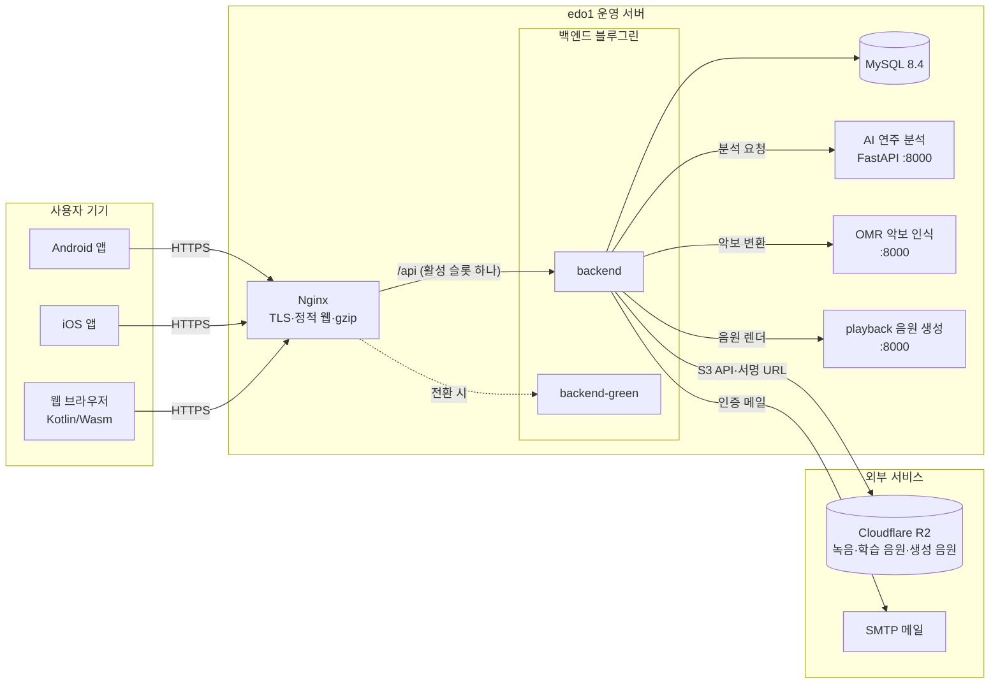
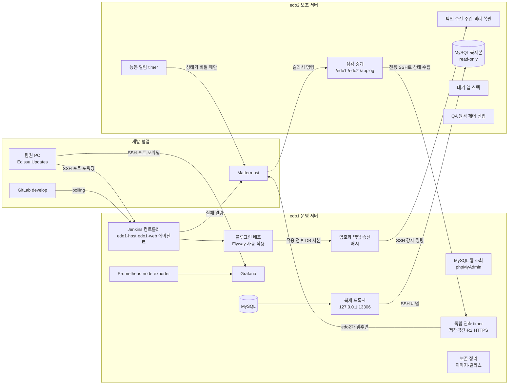

# 얼쑤 시스템 아키텍처

- 작업: [S15P31E102-941](https://ssafy.atlassian.net/browse/S15P31E102-941). 기준 develop `25f7d263`, 정리일 2026-11-15. 장애 대비 행과 미확인 항목은 [S15P31E102-1045](https://ssafy.atlassian.net/browse/S15P31E102-1045)에서 develop `0c06cc56` 기준으로 고쳤다.
- 목적: 발표와 인수인계에서 실제 운영 구성을 한 장으로 보여 준다. 구성 요소마다 저장소의 정의 위치를 연결했다.
- 저장소 파일과 운영 문서만 보고 정리했다. 서버의 현재 상태와 같은지는 이번에 접속해 확인하지 않았다.
- 발표 슬라이드는 [S15P31E102-865](https://ssafy.atlassian.net/browse/S15P31E102-865), 수치 근거는 [운영·품질 실측 근거 표](ops-quality-evidence.md)를 본다.

## 서비스 요청 흐름

## 운영·배포·대비 구성

## 구성 요소와 저장소 위치

### 사용자 요청 경로

| 구성 요소 | 역할 | 위치 | 저장소 근거 |
| --- | --- | --- | --- |
| 앱 공통 코드 | 화면과 로직을 KMP `shared`에 한 번 작성하고 Android·iOS·웹 앱이 띄운다 | 사용자 기기 | [frontend/README.md](../../../frontend/README.md) 5–18. 운영 API 주소는 `HttpClients.kt` 46행 |
| Android·iOS 앱 | Android는 App Links를 쓰고, iOS QA는 Ad Hoc IPA로 배포한다 | 사용자 기기 | [androidApp/build.gradle.kts](../../../frontend/androidApp/build.gradle.kts) 78, [infra/ios-qa/README.md](../../../infra/ios-qa/README.md) 3–8 |
| 웹 앱 | Kotlin/Wasm 산출물을 Nginx가 정적 파일로 준다. 운영 배포는 Jenkins 웹 잡을 수동으로 실행한다 | edo1 | [compose.yml](../../../infra/runtime/compose.yml) 20, [nginx.tls.conf.template](../../../infra/runtime/nginx.tls.conf.template) 155–169 |
| Nginx | TLS 종단, 정적 웹, `/api` 프록시, 블루그린 경로 전환을 맡는다. 해시 이름 Wasm은 1년 캐시, 나머지는 no-cache다 | edo1 | [compose.yml](../../../infra/runtime/compose.yml) 10–31, [nginx.tls.conf.template](../../../infra/runtime/nginx.tls.conf.template) 9–12, 29–37, 121–169, [infra/runtime/README.md](../../../infra/runtime/README.md) 38 |
| 백엔드 | Spring Boot 업무 API. `backend`와 `backend-green` 두 슬롯 중 하나만 활성이다 | edo1 | [compose.yml](../../../infra/runtime/compose.yml) 33–134, [application-ops.yml](../../../backend/src/main/resources/application-ops.yml), [블루그린 스펙](../../specs/backend-blue-green.md) |
| 블루그린 전환 | 새 슬롯이 준비되면 `active.conf`를 원자적으로 바꾸고 Nginx를 다시 읽힌다. 내부 응답으로 실제 경로를 확인한다 | edo1 | [deploy-backend.py](../../../infra/jenkins/deploy-backend.py) 191, 246, 316–353, [infra/runtime/README.md](../../../infra/runtime/README.md) 288 |
| MySQL | 서비스 DB. 호스트 포트를 열지 않고 내부망으로만 접속한다 | edo1 | [compose.yml](../../../infra/runtime/compose.yml) 213–240 |
| AI 연주 분석 | `POST /v1/analyses`. 메모리 6GiB 한도, 응답이 60초 없으면 백엔드가 시간 초과로 본다 | edo1 | [compose.yml](../../../infra/runtime/compose.yml) 167–186, [ai/Dockerfile](../../../ai/Dockerfile) 31–32, [infra/runtime/README.md](../../../infra/runtime/README.md) 52–54 |
| OMR 악보 인식 | `POST /v1/recognitions`. PDF·사진 악보를 인식한다 | edo1 | [compose.yml](../../../infra/runtime/compose.yml) 188–211, [ai/README.md](../../../ai/README.md) 106–115 |
| playback | 내 악보를 M4A·MIDI로 렌더링한다 | edo1 | [compose.yml](../../../infra/runtime/compose.yml) 136–165, [infra/runtime/README.md](../../../infra/runtime/README.md) 77–87 |
| Cloudflare R2 | 녹음 원본, 학습 음원, 내 악보 생성 음원(10분 기한)을 보관한다. 앱은 서명 URL로 읽는다 | 외부 | [compose.yml](../../../infra/runtime/compose.yml) 84–106, [r2-storage-verification.md](r2-storage-verification.md) 16–17 |
| SMTP 메일 | 이메일 인증번호와 비밀번호 재설정 메일을 보낸다 | 외부 | [compose.yml](../../../infra/runtime/compose.yml) 61–66, [infra/runtime/README.md](../../../infra/runtime/README.md) 155–162 |

### 배포·관측

| 구성 요소 | 역할 | 위치 | 저장소 근거 |
| --- | --- | --- | --- |
| Jenkins 컨트롤러 | loopback 전용 컨테이너. executor 없이 에이전트에 일을 나눈다 | edo1 | [controller/compose.yml](../../../infra/jenkins/controller/compose.yml), [controller/README.md](../../../infra/jenkins/controller/README.md) |
| Jenkins 에이전트 | `edo1-host`는 백엔드 등 일반 잡, `edo1-web`은 웹 수동 배포 전용이다 | edo1 호스트 | [controller/README.md](../../../infra/jenkins/controller/README.md) 20, 54–64, [backend.Jenkinsfile](../../../infra/jenkins/backend.Jenkinsfile), [frontend.Jenkinsfile](../../../infra/jenkins/frontend.Jenkinsfile) |
| 배포 중 DB 마이그레이션 | 백업 → Flyway 적용 → 백업 순서로 배포에 들어 있다 | edo1 | [ops-flyway-auto-migration.md](ops-flyway-auto-migration.md) |
| Jenkins 실패 알림 | 실패 원인·짧은 로그·조치를 Mattermost로 보낸다 | edo1 | [notifications/README.md](../../../infra/jenkins/notifications/README.md) 5–12 |
| Prometheus·Grafana | 15초 수집, 15일 보관. Grafana는 Prometheus와 열 제한 MySQL 계정을 읽는다. SSH 터널로만 접속한다 | edo1 | [monitoring/compose.yml](../../../infra/monitoring/compose.yml), [prometheus.yml](../../../infra/monitoring/prometheus.yml), [monitoring/README.md](../../../infra/monitoring/README.md) 3–13 |
| MySQL 웹 조회 | 운영 담당자용 읽기 전용 phpMyAdmin. loopback과 SSH 터널로만 접속한다 | edo1 | [mysql-admin/compose.yml](../../../infra/mysql-admin/compose.yml), [mysql-admin/README.md](../../../infra/mysql-admin/README.md) 1–11 |
| 보존 정리 | 오래된 이미지·빌드 캐시·릴리스를 규칙에 따라 정리한다 | edo1 | [921 계획](../../plans/S15P31E102-921.md) |

### 장애 대비 (edo2)

| 구성 요소 | 역할 | 위치 | 저장소 근거 |
| --- | --- | --- | --- |
| 암호화 백업·격리 복원 | edo1이 DB(매시)와 설정을 암호화해 SSH로 보내고, edo2가 검증·보관한 뒤 매주 일요일 실제로 복원해 본다 | edo1 → edo2 | [infra/backup/README.md](../../../infra/backup/README.md) 1–31 |
| MySQL 복제 | edo1의 loopback 프록시를 SSH 터널로 이어 edo2 복제본(GTID, read-only)이 받는다. 상태는 20초마다 검사한다 | edo1 → edo2 | [proxy.compose.yml](../../../infra/standby/proxy.compose.yml), [replica.compose.yml](../../../infra/standby/replica.compose.yml), [eolssu-replication-tunnel.service](../../../infra/standby/eolssu-replication-tunnel.service), [infra/standby/README.md](../../../infra/standby/README.md) 34–69 |
| 대기 앱 스택 | 운영과 같은 이미지로 웹·백엔드·AI·OMR·playback을 띄워 둔 격리 스택. 전환 런북과 운영 도메인 TLS 절차는 930에서 작성했다. 2026-11-15 복제본 사본으로 서버 리허설을 했고(948), 승격 파일과 인증서는 edo2에 미리 뒀다. 운영 도메인 가상 호스트는 꺼 두었고 SSAFY DNS 변경 경로는 답을 기다린다 | edo2 | [infra/standby/compose.yml](../../../infra/standby/compose.yml), [infra/standby/README.md](../../../infra/standby/README.md) 1–21, [장애 전환 런북](../../../infra/standby/failover-runbook.md) 9–20, [948 계획](../../plans/S15P31E102-948.md) 73–81, [릴리스 절차](../../../infra/release/README.md) 18 |
| 점검 중계 | Mattermost `/edo1`·`/edo2`·`/applog` 명령을 받아 전용 SSH로 상태를 모아 게시한다 | edo2 | [infra/edo-check/README.md](../../../infra/edo-check/README.md) 1–52 |
| 능동 알림 | 외부 HTTPS·복제·백업·디스크 상태가 2회 연속 바뀔 때만 Mattermost로 알린다 | edo2 | [infra/edo-check/README.md](../../../infra/edo-check/README.md) 172–252, [919 계획](../../plans/S15P31E102-919.md) |
| edo1 관측 timer | 저장공간, R2 쓰기, 독립 HTTPS를 주기적으로 기록해 점검이 읽는다. edo2 중계가 멈추면 edo1이 따로 Mattermost로 알린다(944) | edo1 | [infra/edo-check/README.md](../../../infra/edo-check/README.md) 111–171, [944 계획](../../plans/S15P31E102-944.md) |

### 협업·QA 도구

| 구성 요소 | 역할 | 위치 | 저장소 근거 |
| --- | --- | --- | --- |
| QA 원격 제어 | 실제 Android 폰·태블릿을 웹에서 조작한다. edo2 Nginx에서 역방향 SSH로 Windows PC의 Node 중계와 ADB에 닿는다 | edo2 + Windows PC | [infra/qa-phone/README.md](../../../infra/qa-phone/README.md) 1–20 |
| Eolssu Updates | 팀원 PC 앱. COCO 갱신, QA APK·IPA 다운로드, edo1 SSH 포트 포워딩 바로가기 | 팀원 PC | [infra/tool-updates/README.md](../../../infra/tool-updates/README.md) 1–24 |
| 기술 블로그 | `blog` 브랜치를 Hugo로 빌드해 GitHub Pages에 올린다. 편집기는 edo1의 별도 컨테이너이고 Nginx `/blog-editor`로 연결한다 | edo1 Jenkins + GitHub Pages | [server-configuration.md](server-configuration.md) 130–134, [nginx.tls.conf.template](../../../infra/runtime/nginx.tls.conf.template) 1–2, 84–113 |
| 릴리스 절차 | 발표용 RC 선정, 동결, main fast-forward, 롤백 기준 | 저장소 | [infra/release/README.md](../../../infra/release/README.md) |

## 운영에 없는 것

- **Metabase**: [S15P31E102-202](https://ssafy.atlassian.net/browse/S15P31E102-202)에서 뺐고, 곡별 통계는 Grafana로 옮겼다([monitoring/README.md](../../../infra/monitoring/README.md) 3). 발표 그림에 넣지 않는다.
- **루트 `docker-compose.dev.yml`·`docker-compose.prod.yml`**: 초기 예시이고 운영 구성이 아니다. 운영 구성은 `infra/runtime/compose.yml`이다([infra/runtime/README.md](../../../infra/runtime/README.md) 7).
- **Redis**: 7일 운영 지표로 검토했고 지금은 들이지 않았다([redis-adoption-review.md](redis-adoption-review.md)).

## 미확인 항목

- 블루그린의 현재 활성 슬롯은 고정값이 아니다. 2026-11-10에는 `backend-green`이었다([710 계획](../../plans/S15P31E102-710.md) 10).
- 운영 SMTP 처리자: 저장소 안내는 `smtp.naver.com`이지만 운영 값은 저장소로 확인할 수 없다(S15P31E102-302).
- 복제 프록시는 운영에서 `docker run`으로 만든 독립 컨테이너라 `proxy.compose.yml`과 세 가지가 다르다([infra/standby/README.md](../../../infra/standby/README.md) 54–65).
- 블로그 잡이 도는 `edo1-blog` 노드와 편집기 소스는 develop이 아니라 `blog` 브랜치에 있다. develop 문서에는 언급만 있다([755 계획](../../plans/S15P31E102-755.md) 15).
- edo2 대기 앱을 공개 도메인으로 전환할 SSAFY DNS 변경 경로와 실제 DNS 변경·반영 시간. 서버 리허설은 [948](../../plans/S15P31E102-948.md)에서 사본 DB로 했고, DNS 변경·원복 연습은 SSAFY 답이 온 뒤 한다(같은 문서 15–16, 112–117).
- edo2 하드웨어 사양, AI와 OMR이 함께 돌 때의 CPU 경합 실측.
